# Status

Everything Coda changes, one row each, with a screenshot of the bit that changed (Psion's first, where there is one). Click a screenshot to see it full size.

## Replaced

| Area | Problem | What was done | Screenshot | Post |
|---|---|---|---|---|
| Email program | Psion's Email program: no modern mail. | PsiMail in its place: IMAP and SMTP with TLS, a CalDAV calendar. The toolbar's Email icon opens it. On the netBook, a preview of the chosen message under the list, the system's colours and the full height for compose and Help. Since PsiMail 1.03 it asks the first time how the netBook gets online: directly, through the Atom modem helper, or through PsiProxy on a computer, and the box in the title band shows the way it went. On the netBook, colour folders, envelopes and flags; the message's pictures in the preview, with Reply, Reply to all, Forward, Archive and Flag under it; the rest of today's events under the folders; and the week as a grid of hours. New mail shows at once on the network card or a dial-up. Find works without a connection, Shift+Ctrl+J goes to the next unread message, and Tools > Accounts has rules and a signature for replies. |  <a href="img/2026-11-17-web-and-mail/psimail-inbox.png">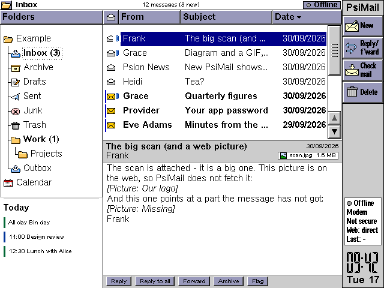</a> <a href="img/2026-11-17-web-and-mail/psimail-week.png">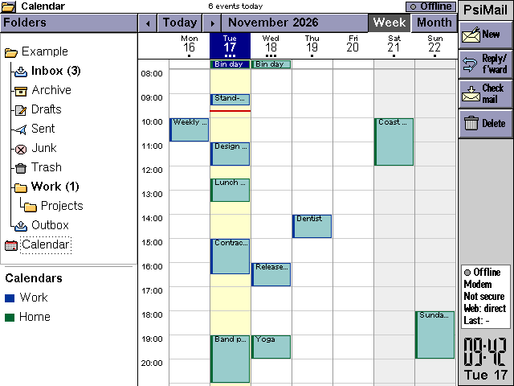</a> | [post](posts/2026-11-12-the-starting-point.md), [post](posts/2026-11-16-office-files-and-record.md) |
| Web browser | Opera (v1.05(450)) or Psion's Web (v1.05(254)): useless on today's web. | PsiWeb in its place, built on Links 2, in colour on the whole screen. The toolbar's browser icon opens it. Since PsiWeb 0.88 it asks the first time how the netBook gets online, then opens on a start page with a speed dial (keys 1 to 8). Going direct, it checks each secure site's certificate itself and shows pictures as standard; a light by the address shows the route, with a padlock for a checked page. Shift+Ctrl+R goes round four page styles: Full, Lighter, Reader (the article first) and Text only. Words typed in the address are searched for, addresses complete from favourites and history, and a page that won't open says why. |  <a href="img/2026-11-17-web-and-mail/psiweb-start.png">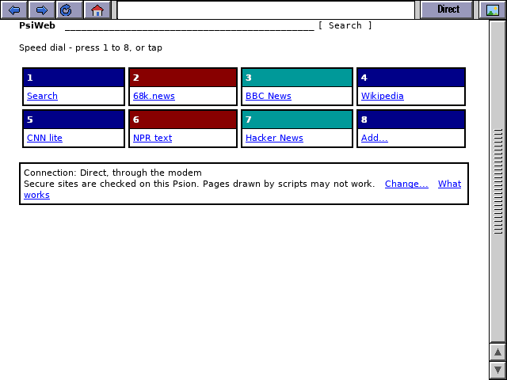</a> <a href="img/2026-11-17-web-and-mail/psiweb-setup.png">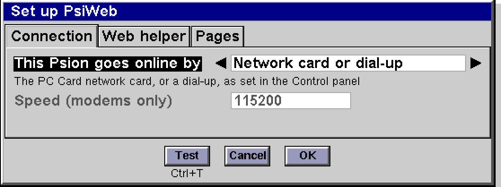</a> | [post](posts/2026-11-12-the-starting-point.md) |
| Comms terminal | A dial-up terminal with no SSH. | PsiTerm in its place: SSH with SFTP and tmux support. |  | [post](posts/2026-11-12-the-starting-point.md) |
| Start-up list | The Shell starts nine programs in the background at boot. | Psion's list kept, with PsiStart in Jotter's place (eighth, about 8 s after the Shell); Word, Data and the rest start in the background as Psion has them, and Jotter ninth, after PsiStart. Once they have made their documents, PsiStart closes them again, each saving as it goes, leaving PsiHub, the System screen and whatever you have in front alone. That gives about 1.4 MB of memory back (46.4 MB free before, 47.8 MB after). | <a href="img/2026-11-15-start-list/word-typing.png">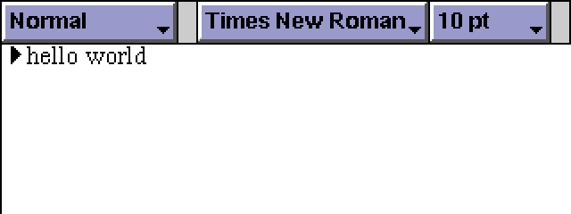</a>  <a href="img/2026-11-15-polish-4/startlist-after.png">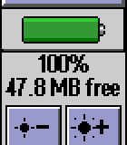</a> | [post](posts/2026-11-14-psihub-and-psistart.md) |

## Removed

| Area | Problem | What was done | Screenshot | Post |
|---|---|---|---|---|
| Opera and Java | About 4.7 MB of an old browser and a Java runtime. | Removed (Psion's Web and its engine on v1.05(254)). | <a href="img/2026-11-12-starting-point/extras-before.png">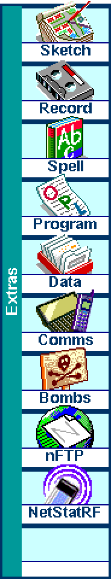</a> <a href="img/2026-11-12-starting-point/extras-after.png">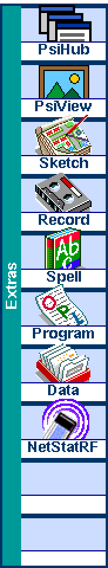</a> | [post](posts/2026-11-12-the-starting-point.md) |
| Comms, nFTP | Replaced by PsiTerm, or unsafe (FTP in clear). | Removed to make room. |   | [post](posts/2026-11-12-the-starting-point.md) |
| Example files | Psion's example documents and "Welcome to netBook" in the Documents folder: old, and nothing in them about Office files. | Psion's removed, none left. Coda's own in their place, in Documents > Example files on a new C: disk, 67 KB in all: Garden notes (.docx: headings, a list, a picture that opens as a Sketch, a table as tabbed text, and things to try), Allotment (.xlsx: a harvest to filter and summarise, SUMIF and COUNTIF that recalculate as Sheet's own formulas, a second worksheet to try Fill down and Fill series on), Lemon cake (.odt), Walks (.csv), Notes (.md, Markdown that opens formatted in Word), Parrots (a photo, Kodak's "kodim23", shown in its own colours) and "About these examples", a Word file. Since 18 November they live on the card, in Documents > Example files, and Tools > Re-install sample files (which only said "Folder not found" without them) is gone from the System screen's menu, its Shift+Ctrl+S with it. The files can be edited and saved. On the way, a fix: spreadsheets opened from Office files now recalculate when a cell changes. | <a href="img/2026-11-16-example-files/folder-2x.png">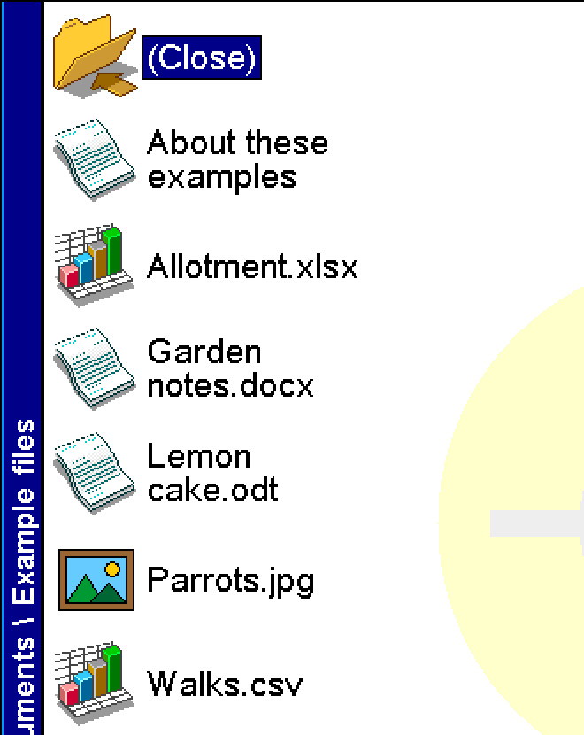 Example files"></a> <a href="img/2026-11-16-example-files/garden-2x.png">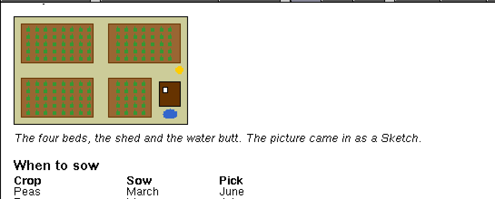</a> <a href="img/2026-11-16-example-files/allotment-2x.png">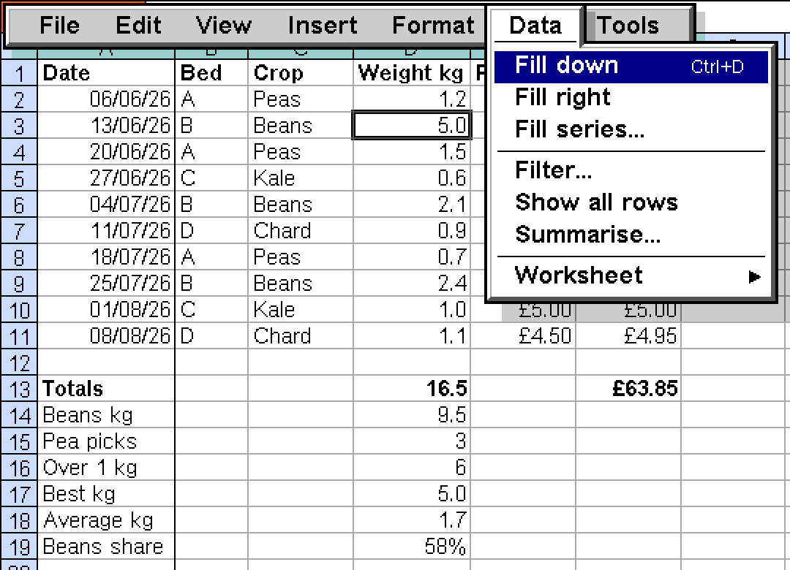</a>  <a href="img/2026-11-16-example-files/reinstall-2x.png">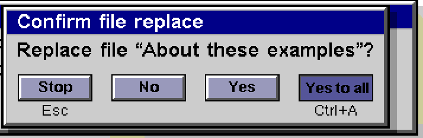</a> | [post](posts/2026-11-12-the-starting-point.md) |
| Re-install sample files | Tools > Re-install sample files on the System screen could only say "Folder not found" once the example files moved to the card, and the menu ran Control panel and Link to desktop together where it hid the command. | The command is out of the Tools menu, and its Shift+Ctrl+S with it; the menu keeps its line under Control panel. | <a href="img/2026-11-18-tools-menu/before-2x.png">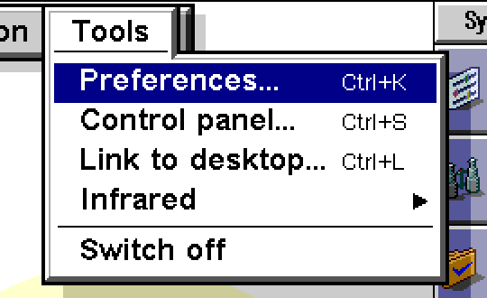</a> <a href="img/2026-11-18-tools-menu/after-2x.png">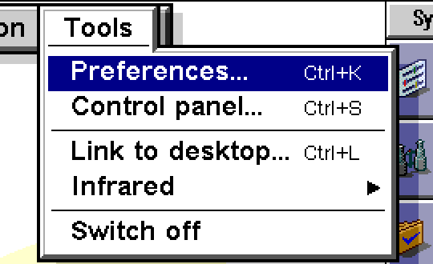</a> | |
| Fax programs | A Fax editor and viewer, for a phone line nobody faxes from. | Removed with their engine, printer driver and templates (Extras bar shown). |  | [post](posts/2026-11-14-the-review.md) |
| Psion's Calc | Two calculators: Psion's, drawn half the screen high, and the new full-screen Calc, which does everything Psion's does. | Removed (19 November): Calc's icon and the Calc name are the new one's only, Psion Calc is gone from the Extras bar and from Programs in the Control panel, and the system no longer starts it in the background at every start. About 100 KB more room in the full system, and 104 KB less on the card for the small one. | <a href="img/2026-11-19-calc-icon/extras-2x.png">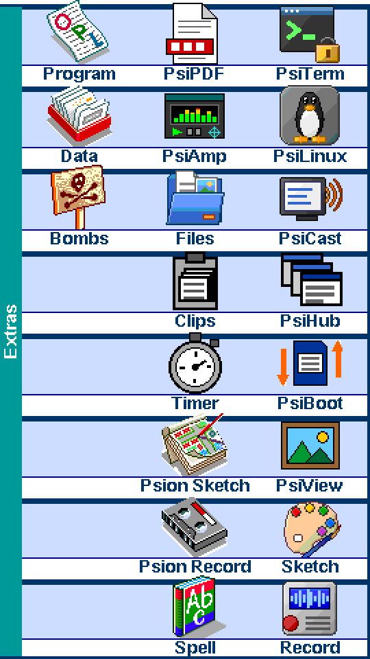</a> <a href="img/2026-11-19-calc-icon/programs-2x.png">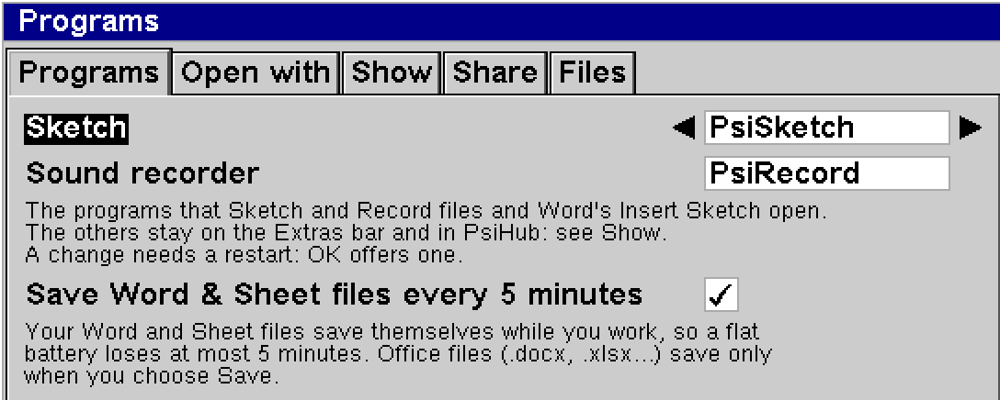</a> | |
| NetStatRF | A signal-strength meter for the wireless LAN cards of 2002. The drivers for those cards stay. | Removed. | <a href="img/2026-11-15-polish/extras-before.png">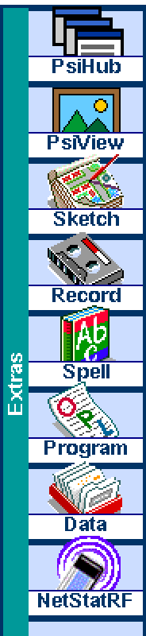</a> <a href="img/2026-11-15-polish/extras-after.png">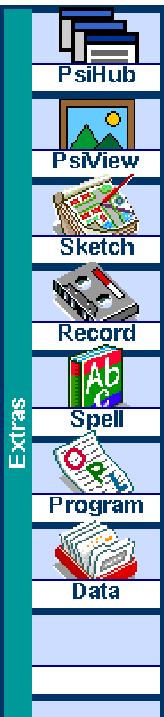</a> | [post](posts/2026-11-12-the-starting-point.md) |

## Added

| Area | Problem | What was done | Screenshot | Post |
|---|---|---|---|---|
| PsiHub | No quick way to switch or start programs. | A launcher on Ctrl+Menu: switch, search programs, settings, files and commands. | <a href="img/2026-11-14-psihub-and-psistart/psihub-switch.png">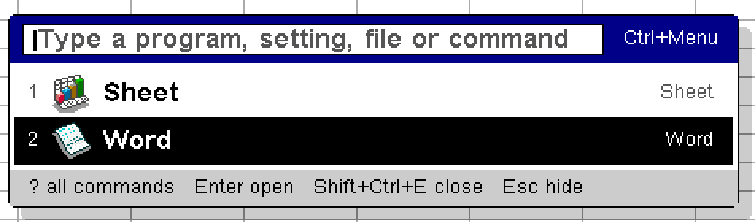</a> | [post](posts/2026-11-14-psihub-and-psistart.md) |
| Programs started from PsiHub | PsiHub started a program on its own. | Started as the System screen starts them: with their last document, or their standard one in Documents, made if it is not there. | <a href="img/2026-11-15-polish/word-cold.png">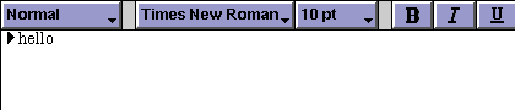</a> <a href="img/2026-11-15-polish/data-cold.png">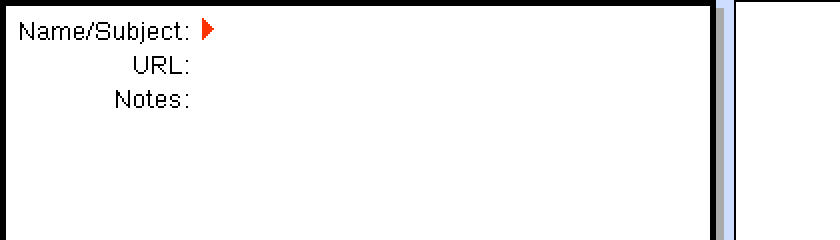</a> <a href="img/2026-11-15-polish/jotter-cold.png">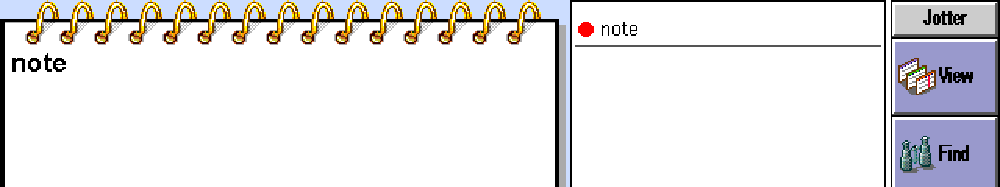</a> | [post](posts/2026-11-14-psihub-and-psistart.md) |
| OPL programs from PsiHub | PsiHub could not start programs written in OPL, such as Bombs ("Not supported"). | Started the way the System screen starts them, in the OPL runtime: Bombs and any OPL program you install now start from PsiHub. | <a href="img/2026-11-15-opl-and-prepare/hub-opl-before.png">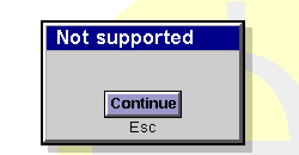</a> <a href="img/2026-11-15-opl-and-prepare/hub-opl-after.png">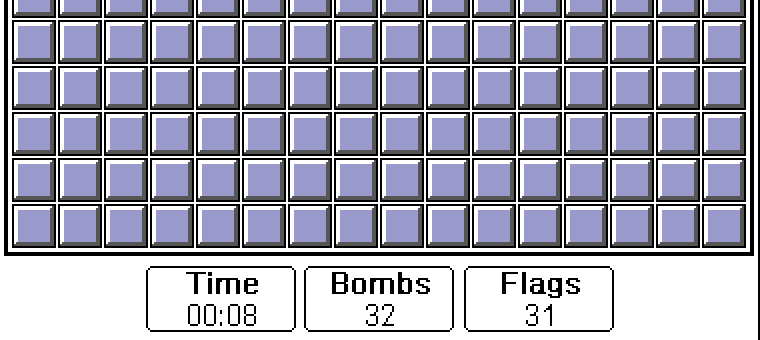</a> | [post](posts/2026-11-14-psihub-and-psistart.md) |
| Hidden programs | PsiHub listed the OPL runtime and the Word viewer, which open nothing on their own. | Programs marked hidden are left out, as the System screen leaves them out. | <a href="img/2026-11-15-polish/hub-hidden-before.png">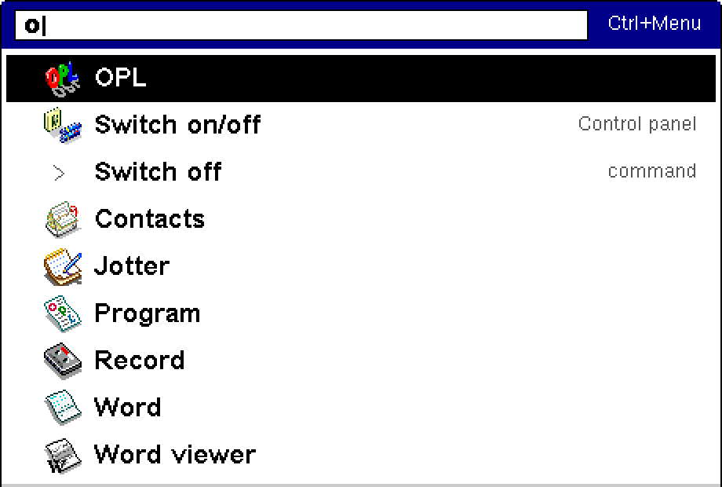</a> <a href="img/2026-11-15-polish/hub-hidden-after.png">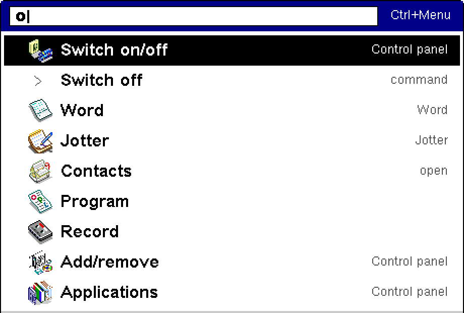</a> | [post](posts/2026-11-14-psihub-and-psistart.md) |
| PsiHub's key | PsiHub offered Ctrl+Fn+Space to open it, which is also the brightness key. | Taken off the list: Ctrl+Menu, Fn+Tab and Ctrl+Fn+Tab remain. Anyone who had chosen Ctrl+Fn+Space gets Ctrl+Menu instead. | <a href="img/2026-11-17-psihub-key/before-2x.png">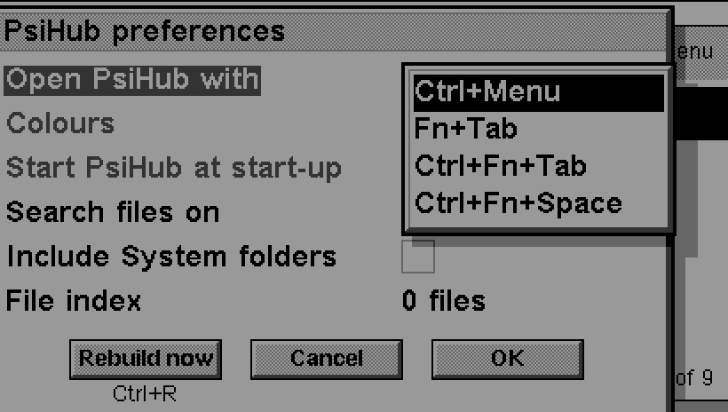</a> <a href="img/2026-11-17-psihub-key/after-2x.png">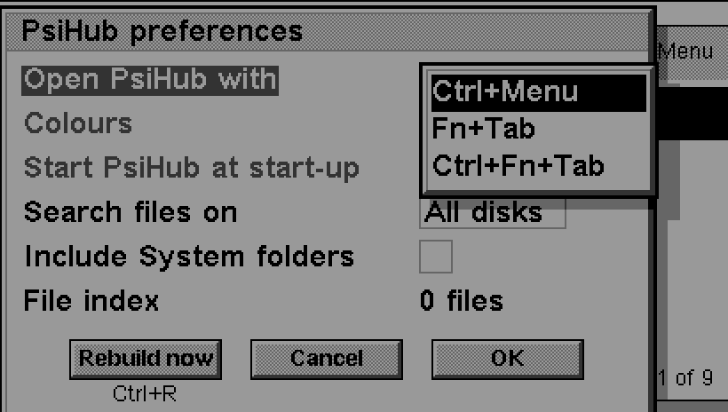</a> | |
| PsiStart | Start-up work had nowhere to live. | A hidden program that paints the theme's pictures, sets first-start defaults, runs the timers and does the warm restart. |  | [post](posts/2026-11-14-psihub-and-psistart.md) |
| Credits and licences | The fonts' licences, which must go with every copy, were not in the image, and nothing on the netBook said whose work is in Coda. | One plain text in the image, 22 KB: who made what, then the licence texts (the SIL Open Font License for Inter, Noto Sans and Liberation Sans, the Bitstream Vera licence for DejaVu Sans, zlib and the rest). In PsiHub, type credits, licences or about, and it opens in Word. Control panel > Text has a Credits button with each font's copyright line. | <a href="img/2026-11-16-credits/hub-credits-2x.png">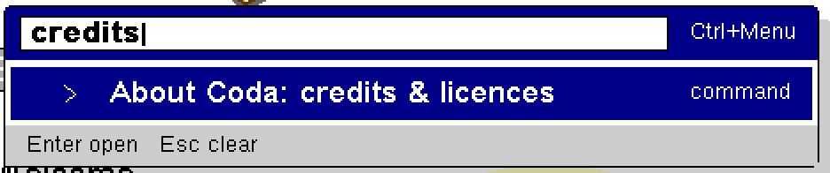</a> <a href="img/2026-11-16-credits/text-credits-button-2x.png">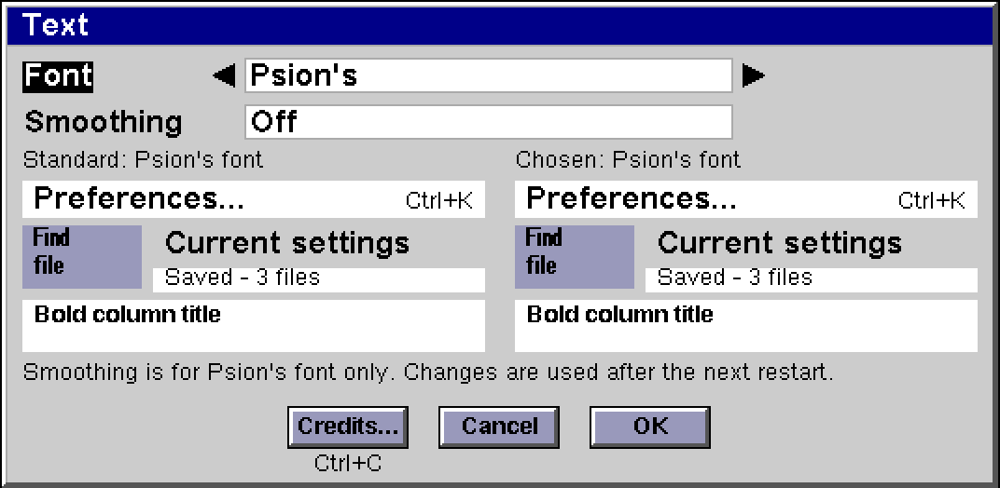 Text with its Credits button"></a> <a href="img/2026-11-16-credits/font-credits-2x.png">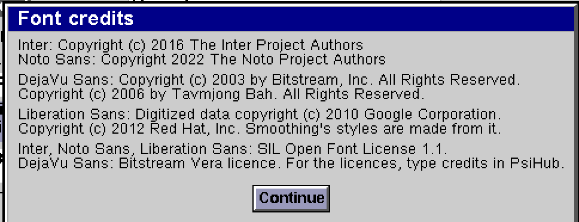</a> | [post](posts/2026-11-14-psihub-and-psistart.md) |
| Psi programs | Not part of the system. | In the ROM in the full build. In my build they stay on the card. Other Psi programs are also included. |  | [post](posts/2026-11-12-the-starting-point.md) |
| PsiView | No picture viewer. | PNG, JPEG, GIF and BMP, fitted to the screen, a palette chosen for each photo; opens from the System screen. | <a href="img/2026-11-14-pictures/psiview.png">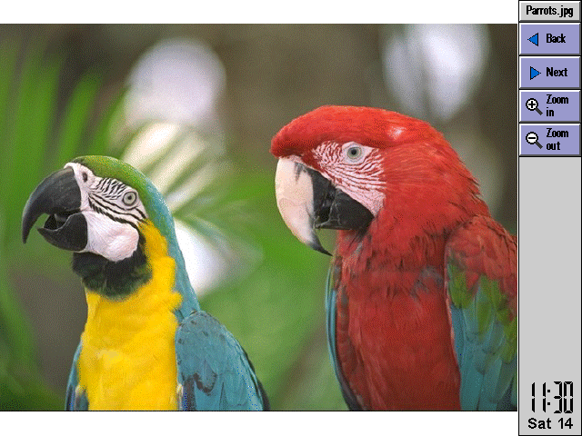</a> | [post](posts/2026-11-14-pictures-and-colour-tests.md) |
| PsiCalc | Psion's Calc draws its Series 5 face, half the netBook's height, in the middle of the screen. | Calc made again for the whole screen: the same Desk and Scientific views, till roll, keys, menus, memories, formats and keyboard shortcuts, with keys drawn the way Calc draws its own: the same raised grey keycaps, scaled up. Calc's own icon opens it. Since 19 November Psion's Calc is gone from Coda altogether (the new one does everything it did), and a C: disk brought over from an older system or restored from an old backup no longer keeps Calc's icon pointing at the old calculator. |  <a href="img/2026-11-15-psicalc/psicalc-desk.png">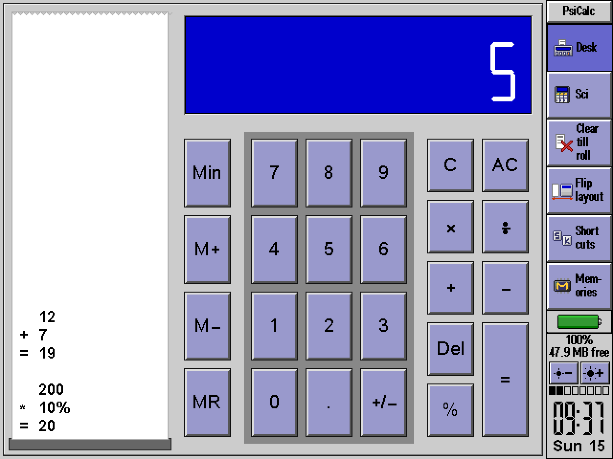</a> <a href="img/2026-11-15-psicalc/calc-sci-before.png">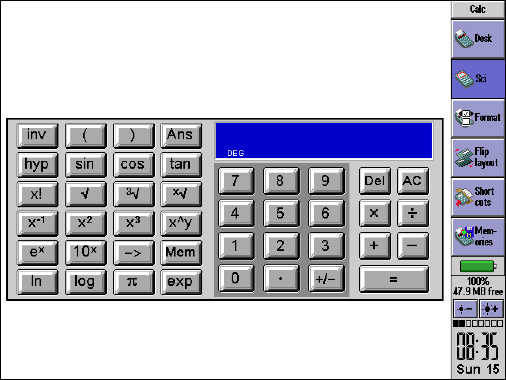</a> <a href="img/2026-11-15-psicalc/psicalc-sci.png">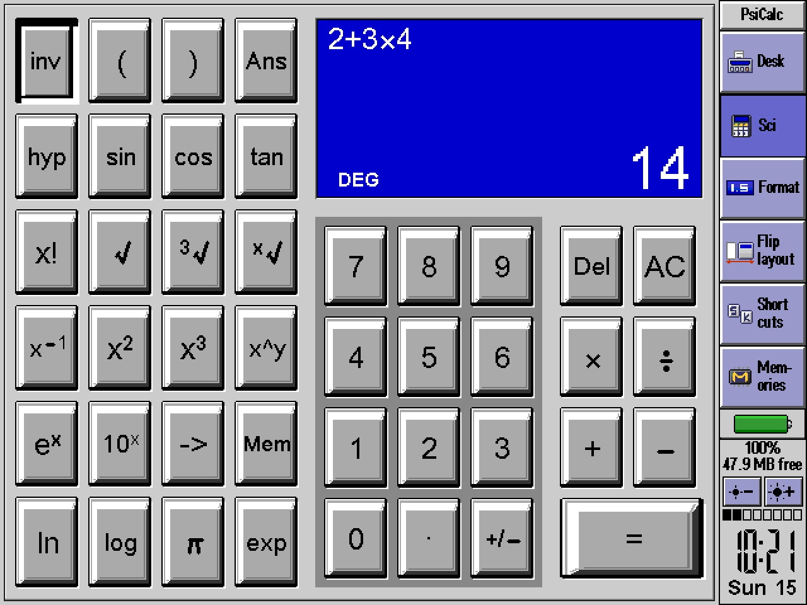</a> <a href="img/2026-11-15-psicalc/keys-desk-before-after.png">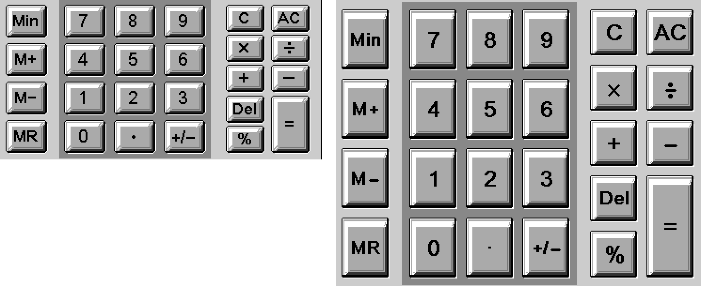</a> | [post](posts/2026-11-15-psicalc.md) |
| PsiCalc: units and currencies | Nothing on the netBook converted units or currencies. The Psion community had five programs for it (Convert5 Pro by DevRag, Conversion Calculator Pro, Converti, Monnaie, XChange). | A third view in PsiCalc, Convert, beside Desk and Scientific (Ctrl+Q goes round all three, and Conv on the toolbar). Eight kinds as keys across the top: length, weight, volume, temperature, area, speed, data size and currency. Type an amount in any unit and the list shows it in every other unit of the kind; Up and Down choose the row, Enter makes a row's value the amount. 30 currencies, the pound, euro and dollar first. Update rates fetches the latest rates straight from the address set in PsiCalc's Preferences (Ctrl+K): as standard Frankfurter's copy of the European Central Bank's rates, or any service that answers in the same form. Through the Atom modem, the modem makes the secure connection; on a network card or dial-up, a small helper on the card does it, with the certificate checked. Once a day it refreshes by itself when the netBook is already online; otherwise the last rates kept are used, and their date and source are on the display. | <a href="img/2026-11-17-convert/length-2x.png">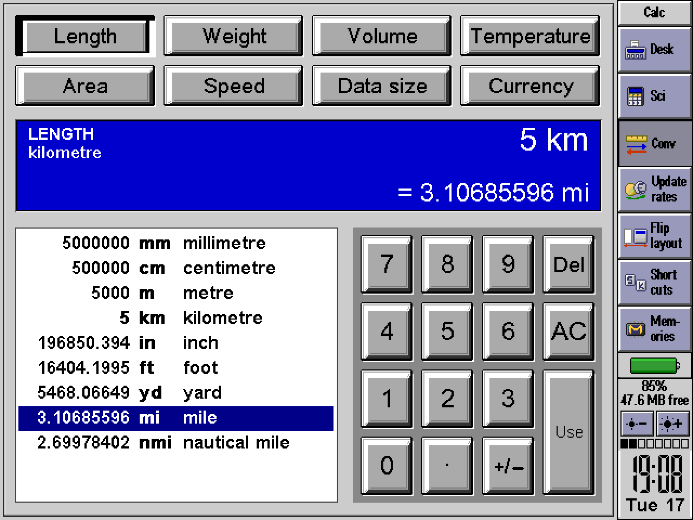</a> <a href="img/2026-11-17-convert/currency-2x.png">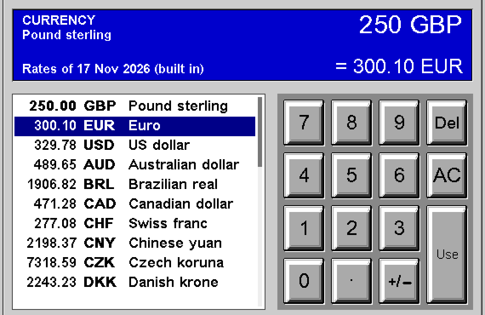</a> <a href="img/2026-11-17-convert/temperature-2x.png">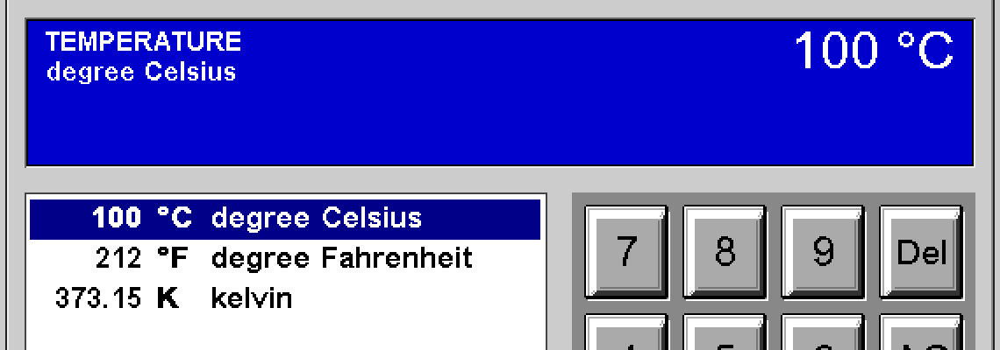</a> <a href="img/2026-11-17-rates/updated-2x.png">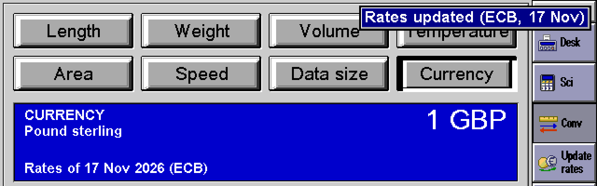</a> <a href="img/2026-11-17-rates/preferences-2x.png">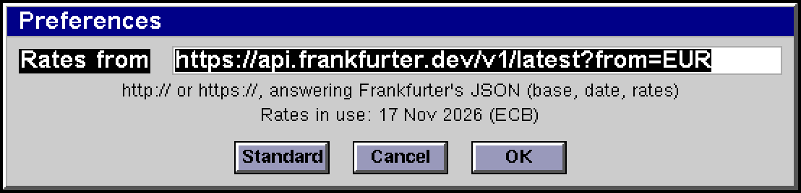</a> <a href="img/2026-11-17-convert/toolbar-2x.png">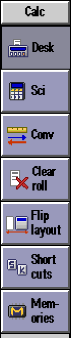</a> | |
| PsiSketch | Psion's Sketch draws a smaller picture inside a frame and offers 16 of the screen's 256 colours. | Sketch made again for the whole screen beside the toolbar, looking and working as Sketch does: the same toolbar with Sketch's own pictures, menus, shortcut keys, tools, dialogs and clip art. The Colour tool offers all 256 colours, laid out by hue and lightness, with the colours used last, the colour's name and a pick from the sketch; a second tap on the colour in use opens it. Its files are Sketch files, so either program opens the other's, and copy and paste works between them. Printing with page setup and preview, undo up to 16 steps, stretch handles, Sketch's Insert text and Merge in, Sketch's 2-times view and keyboard cursor. Word's Insert Sketch opens it. Export as PNG. A Fill tool, which Psion's Sketch never had: a tap fills the area of one colour with the colour in use, and undo takes it back. Enter fills at the keyboard cursor. Fill also has a button of its own, across the top of the strip under the toolbar, which stays down while Fill is the tool. It starts with the netBook and Sketch files open in it, even after it has been closed; Psion's Sketch stays on the Extras bar. The Clipart panel has tabs: Psion's own clip art under Original, and three sets of our own drawn in the same style, Diagrams (flowchart shapes, arrows, connectors, callouts, an org chart, computers and the netBook itself), Symbols (ticks, crosses, stars, numbers, signs) and Office; their shapes have closed outlines, so Fill fills them. |   <a href="img/2026-11-15-psisketch/sketch-colour-before.png">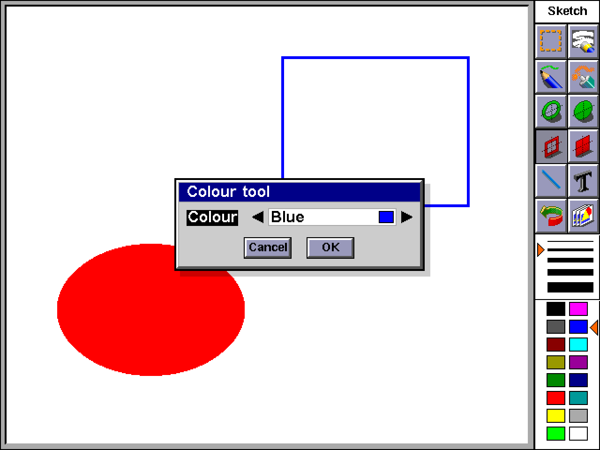</a>    <a href="img/2026-11-16-sketch-fill/sketch-fill.png">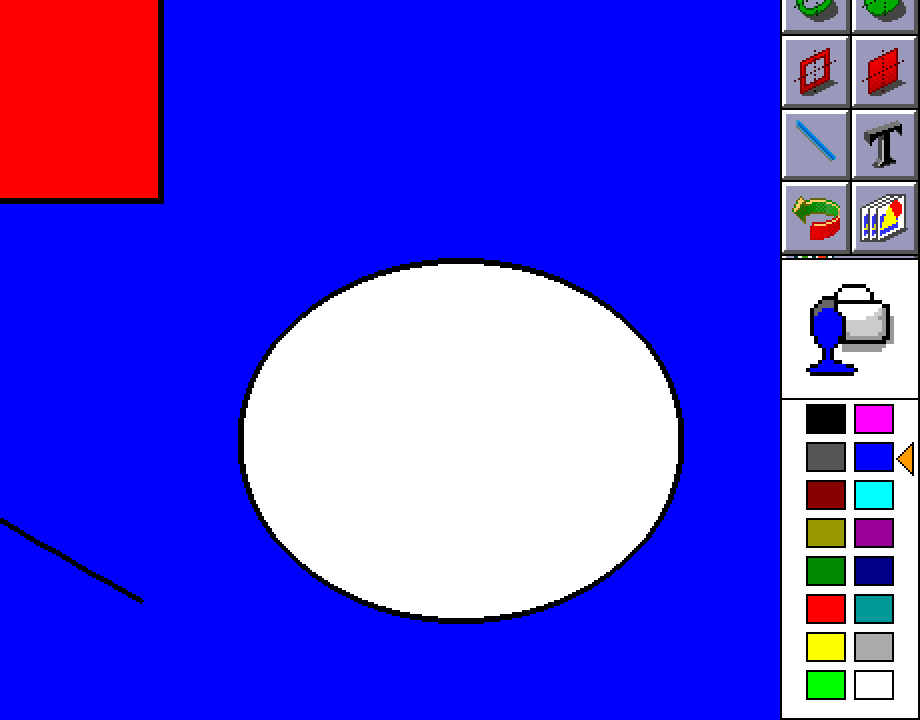</a> <a href="img/2026-11-16-sketch-clipart/diagrams.png">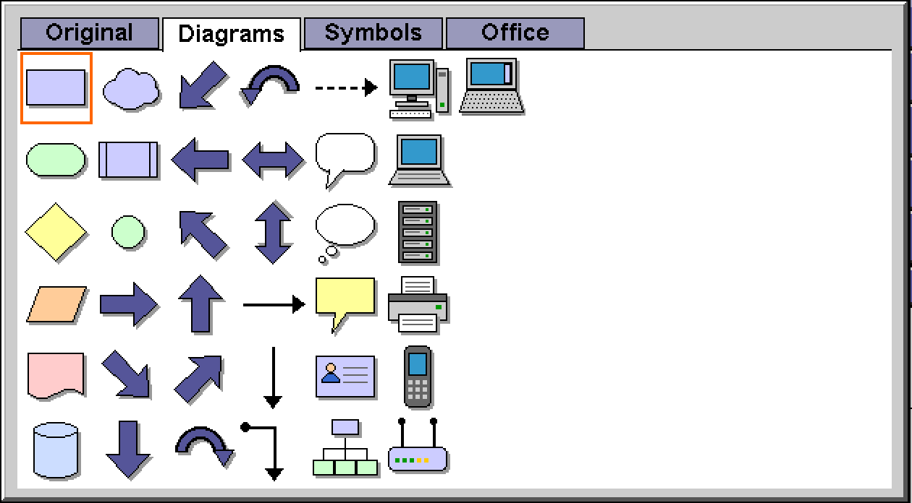</a> | [post](posts/2026-11-15-psisketch.md) |
| PsiSketch: Redo, Clipart and Fill | Undo had no Redo beside it, Clipart and Fill had no buttons of their own, and Insert clipart stayed open until Esc or a choice. | A Redo button beside Undo. Clipart and Fill each have a button, side by side. A tap outside Insert clipart closes it, as Esc does. |   | [post](posts/2026-11-18-memory-back-and-alarm.md#sketch-redo-clipart-and-fill) |
| Office files | Word read old Word files only through a viewer that opened a copy; Sheet read nothing from outside. | Word opens and saves .docx, .doc, .rtf, .odt and .txt; Sheet .xlsx, .xls, .ods and .csv. They show Word's and Sheet's icons on the System screen and open there with their own names. Save as and Export have a File type line, starting at the file's own type, in a dialog the width of Psion's own Save as. Pictures come in as Sketch objects and go back out as pictures. Psion's viewers are no longer needed and are gone. Markdown too (.md): a Markdown file opens in Word formatted, with its headings, bold and italic, lists, quotes, code and tables, and saves back as clean Markdown; "Markdown (.md)" is in Save as. View > Markdown source (Shift+Ctrl+X) shows the plain text with its marks to edit, and switches back; for other files it is dimmed. Before the first save over an Office file that Word or Sheet cannot keep whole, they say what will be simplified (tables, pictures, comments, characters) and ask; a save that cannot be finished leaves the file as it was and says why; a damaged file can be opened as a new file with what could be read. | <a href="img/2026-11-16-office-and-record/system-office.png">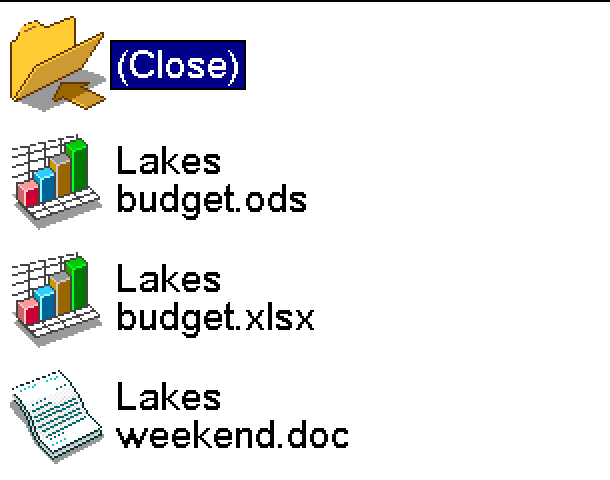</a> <a href="img/2026-11-16-office-and-record/word-docx.png">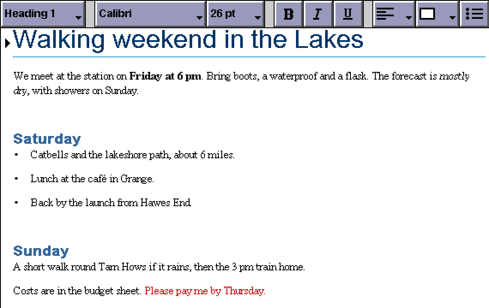</a> <a href="img/2026-11-16-office-and-record/sheet-xlsx.png">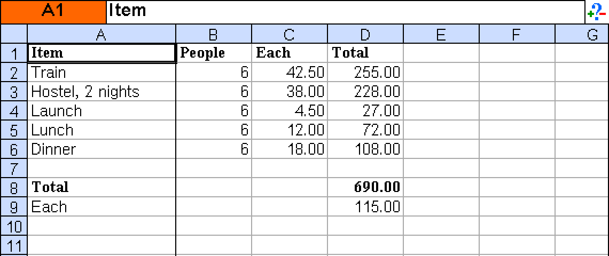</a>  <a href="img/2026-11-17-markdown/formatted-2x.png">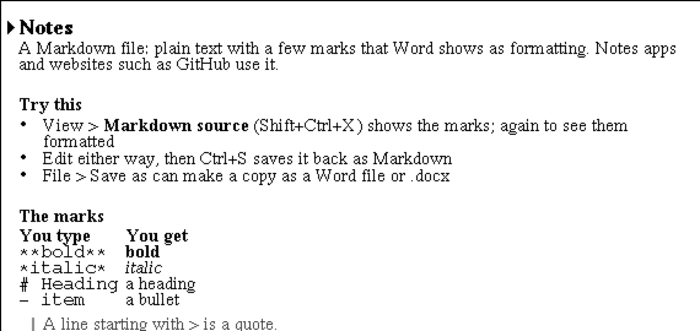</a> <a href="img/2026-11-17-markdown/source-2x.png">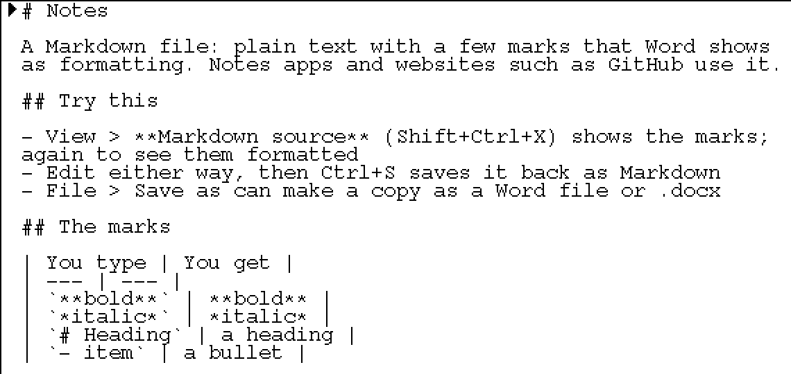</a> <a href="img/2026-11-17-markdown/view-menu-2x.png"> Markdown source, ticked"></a>    | [post](posts/2026-11-16-office-files-and-record.md) |
| Sheet's Data menu | Sheet keeps several worksheets but shows only one, with no way to change; no fill, filter or summary; SUMIF and COUNTIF from Office files came in as values. | A Data menu before Tools: Fill down (Ctrl+D), Fill right, and Fill series (numbers, dates or months by a step); Filter shows only the rows whose value in a column matches, and Show all rows brings the rest back; Summarise counts, sums or averages a column for each value of another, into a new worksheet; Worksheet switches between worksheets (Ctrl+W), adds, renames and deletes them. SUMIF and COUNTIF over small ranges now come in as working formulas. |       | [post](posts/2026-11-16-office-files-and-record.md) |
| Print to PDF | The printers in the list are for 1999 hardware, so the Print button had nothing to print to. | "PDF file" in every program's list of printers. Printing to it saves a PDF beside the document, named after it, and says "Saved as PDF". Text stays text in Times, Helvetica, Courier and Symbol, so it can be found and copied; lines and shapes stay sharp, and pictures go in as images. Page size and margins come from Page setup, and Print preview works as before. Tried with Word, Sheet, Agenda, Jotter and Sketch. |   | [post](posts/2026-11-16-print-to-pdf.md) |
| File manager | Ctrl+Q on the System screen only popped up a small list of disks, and Tab opened a folder browser sized for the Series 5, with names cut short and nothing to do but make a folder. | PsiFiles, a file manager of its own, opened by Tab (at the folder you are in) and Ctrl+Q (a page of the disks with how full each is). A folder tree with every disk and the Trash, the files in Details (each with its program's icon, size, date and type), Compact or Pictures (thumbnails), a preview on Space, Find, cut, copy and paste, rename, Properties, favourite and recent folders. Copies are written under another name, read back and checked before they take their name, so a full disk or a card taken out never leaves half a file; a name already there asks: Replace, Keep both or Skip. Delete goes to a Trash, and Undo takes back the last rename, move, copy or delete. Share sends the chosen files by email or to the card; several copies queue up behind each other; the pen marks files by drawing down the list; favourite folders are stars at the top of the tree. Tab and Ctrl+Q can go back to Psion's own in the Control panel's Programs. On the Series 5mx too, in greys, with thumbnails. |          | [post](posts/2026-11-17-files-clips-sharing-agenda.md) |
| Share icon | The Infrared Command icon only ever sent by infrared, to machines hardly anyone has now. | It is Share now. A tap shows a small list for the file in front, titled with its name, offering only what fits: Email (a new PsiMail message with the file attached), Save as PDF (the program's own printing, the PDF beside the file), Copy to card (into a Shared folder on the card), and Infrared, Psion's own as before. In Agenda and Contacts, where there is no file to send, it offers Save as PDF and Infrared, so sending an entry by infrared is where it was. A changed file is saved first, as the program's own Save does. On the System screen it shares the files chosen. Nothing is ever replaced: a second copy is "Report (2)", a second PDF "Report (2).pdf"; a Shared folder already on the card is used as it is; a file called Shared is left alone and the copies go in "Shared files", with a message saying so. Each copy is written under a temporary name, read back and compared byte for byte, and only then given its name, so a card pulled out half way, or a flat battery, never leaves half a file. No card, a locked card or too little room each get a plain message ("Not enough room on the card - 1.2 MB needed"). Control panel > Programs has a Share page: the icon can ask, or go straight to one of the four. |      | [post](posts/2026-11-16-print-to-pdf.md), [post](posts/2026-11-17-files-clips-sharing-agenda.md) |
| PsiAmp | No way to play an MP3 file. | An MP3 and WAV player in the look of the classic skinned players: green LED digits, a scrolling title, a visualiser, a position bar and volume, with a playlist under it. It floats over the program in use and plays on when put away with Esc. In any program, Ctrl+Fn+A shows or hides it, Ctrl+Fn+X plays or pauses, and Ctrl+Fn+Z and Ctrl+Fn+B go back and on a track (Tools > Preferences turns these keys off). The playlist takes files, whole folders and .m3u playlists, with shuffle and repeat. Two skins of its own: Coda, and EPOC, which takes the theme's colours. Classic .wsz skins put in a Skins folder are in View > Skin too, and K goes round them. An MP3, WAV, .m3u or .wsz tapped on the System screen opens in it. The first playlist holds Coda, a short tune made for it. Since 19 November the netBook stays on while it plays, it pauses when an alarm is due so the alarm can sound, and put away it gives back its skin and pictures (about 400 KB) until it is shown again; Esc puts it away with Keep on top on too. Ctrl+S saves the playlist and Ctrl+P is left for printing, as in every EPOC program; Space, X, C and V play, pause and stop. |      | [post](posts/2026-11-16-psiamp-open-with-and-more.md) |
| Record (the new one) | Record showed only how far through a recording you were, with no way to see or pick part of it. | Record written afresh with Record's panel, menus, keys and files: the recording drawn as a waveform, a selection to play, erase or crop to, skips of 5 and 30 seconds, a Recordings list (Ctrl+L), and WAV files in and out. The Record icon and Record files open it; Psion's is "Psion Record" on the Extras bar, and Programs in the Control panel swaps them. |  | [post](posts/2026-11-16-office-files-and-record.md) |
| Programs (Control panel) | No way to choose between one of Psion's programs and Coda's version of it. | A Programs item: for Sketch, whether Sketch files and Word's Insert Sketch open Psion's Sketch or PsiSketch (Coda's as standard); the other one stays on the Extras bar. Used after a restart, which OK offers ("Restart now?"). Since 19 November there is no Calculator line: Psion's Calc is gone. Since 16 November a third page, Show: untick a program to leave it off the Extras bar, the System screen's New file list and PsiHub, such as Psion Sketch when Coda's is the one used (or the other way round), or a Coda program you do not want, such as PsiAmp. Its files and icons still open it. The program in use for Sketch and Record is always shown, choosing the other one shows it again, and Show all brings everything back. Kept in the image itself, so it survives restarts and a restored backup. Since 17 November a Share page sets what the Share icon does, and a Files page whether Tab and Ctrl+Q on the System screen open PsiFiles. |        | [post](posts/2026-11-15-psicalc.md), [post](posts/2026-11-15-psisketch.md) |
| Control panel items | Nowhere to choose the new settings. | Themes, Text, Toolbar, Screenshot, Internet time, SerialBoost. |   | [post](posts/2026-11-12-the-starting-point.md) |
| Internet time | The clock drifts; summer time by hand. | The clock set daily from a time server, summer time on the right dates, the time zone found on request (off as standard). |  | [post](posts/2026-11-14-small-additions.md) |
| Spelling | A 1995 word list without email or website. | About 123,000 British English words beside Psion's lexicon, for checking, suggestions, anagrams and crossword answers, in Word and Spell. |   | [post](posts/2026-11-14-small-additions.md), [post](posts/2026-11-15-record-and-spell.md) |
| SerialBoost | The serial port stops at 115,200 bps. | 230,400 bps for any program that asks for 115,200; on as standard, off in the Control panel. |  | [post](posts/2026-11-14-small-additions.md) |
| Build stamp | No way to tell one image from another. | A small text file naming Coda, with the build's date and theme, which PsiBoot shows. Nothing on screen changes. |  | [post](posts/2026-11-12-the-starting-point.md) |
| Base image | Built on v1.05(254), the version my card came with, which has no Ethernet. | Built on v1.05(450), Psion's last English release, with its Ethernet, wireless LAN and infrared LAN support and a larger ROM. |  | |
| PsiHub's search | "calc" listed Psion's Calc first, though the Calc icon opens the new one. "wifi" found nothing. A typing slip gave "Nothing found". | The program chosen in the Control panel comes first. Other words for things: wifi, network and online find the Internet settings, email PsiMail, ssh PsiTerm, settings the Control panel, and more. One letter wrong, missing, extra or swapped is forgiven when nothing else matches. |       | [post](posts/2026-11-16-first-impressions.md) |
| Open with | A file only ever opened in the program its type belongs to. A user asked for a way to pick another. | On the System screen, Fn+Shift+Enter on a file shows "Open with": the file, a list of programs and "Remember this choice". The programs that open files come first, and the usual one is chosen. The file then opens in the program picked. PsiHub offers the same on a file it has found: File > Open with... (Shift+Ctrl+O) or Fn+Shift+Enter. A remembered program is only chosen first next time for that type of file. Enter and a tap still open the usual program, so a slip never hides a file's own program. Untick the box to forget it, or use "Forget 'Open with' choices" in PsiHub. A program that cannot read the file makes a new file of its own instead, as Psion's programs always have. Control panel > Programs has an Open with page: one tick box turns the key off, so Fn+Shift+Enter opens a file as Enter does, another stops programs being remembered, and the list shows what is remembered ("Text files (.txt): Word") with Remove and Remove all. Changes count at once, with no restart. The dialog now keeps to the size of Psion's own, with the file's folder on a line of its own; a long name or folder is shortened with "…". |      | [post](posts/2026-11-16-psiamp-open-with-and-more.md) |
| Disk list on Ctrl+Q | On the System screen, Ctrl+Q stepped to the next disk, one at a time: C:, then D:, then E: and on to Z:. Getting to a disk meant pressing it until it came round, or tapping the disk at the foot of the Documents bar for its list. | Ctrl+Q now pops up that same list of disks, on the disk you are on: the arrow keys and Enter choose, the disk's letter goes straight to it, and Esc closes it. It works with the title on the left or at the top. Shift+Ctrl+C and Shift+Ctrl+D still go straight to C: and D:. PsiHub finds the disks too: type "disk", "drive" or "card" for a row for each, with its free space (or "read only" for the ROM), and Enter takes the System screen there. On the Series 5mx, whose System screen is in its ROM, PsiHub takes it to C: and D: and shows any other disk's folders itself. The idea is DiskList, a Macro5 macro by OSG from 2008 (on Omega's site, omega.webnode.page): Coda does it natively, without Macro5. |    |  |
| Clips: more than one clipboard, and saved texts | EPOC keeps one thing on the clipboard, and text you type again and again has to be typed again. The Psion community wrote this add-on five times over (HotKeys by Henry Hirst, SwitchTask and Macro5 by Pascal Nicolas, RMRAutoText and MagicKeys, ExtraBars, StationeryPad by John McAleely). | Built in: Clips keeps what you copy in any program. Ctrl+Fn+V opens it over the program you are in; Enter pastes the chosen text there, at the cursor, through the program's own Ctrl+V, so Word, Jotter, Agenda, Contacts, Data and dialogs all take it unchanged. Saved texts have names, and %date% and %time% in them are filled in when pasted; today's date and the time are always there. Settings turn the remembering off. The same on the Series 5mx. The idea is the community's, written afresh. |     | [post](posts/2026-11-17-clips.md) |
| Spelling and the thesaurus from any program | Psion's speller and thesaurus could only be reached from Word's Spell command or the Spell program, never for a word typed in Agenda, Data or a dialog. The community's answer was Thesaurus Link by Henry Hirst and SpellOK by Huub Linthorst. | Ctrl+Fn+L in any program looks up the word at the cursor in Psion's own speller and thesaurus, Coda's extra words included. A word that is not in the dictionary gets the speller's suggestions; one that is gets the thesaurus's words, with their part of speech, and opposites marked. Replace (Enter) puts the one chosen in its place, in the same case and with the space or stop after it kept, through the program's own paste, as Clips does; whatever was on the clipboard is put back afterwards. Since tested in Jotter, Agenda, Data, Contacts and dialogs, and on the Series 5mx; not in Sheet, where the keys it uses to find the word ended a cell's typing and lost the text: there it now says "Not available in Sheet" and changes nothing. |    | |
| Abbreviations | Text you type often, "be right back" or a sign-off, has to be typed in full each time. The community had ExAb by Huub Linthorst and RMRAutoText. | A new page in Clips, Abbreviations: each one a few letters and what they become ("brb", "be right back"). With Expand as you type ticked, an abbreviation typed in any program's text, then a space or a stop, turns into its text at once, in the case it was typed ("Brb" gives "Be right back"). It works in Word, Jotter, Agenda, Contacts, Data and every dialog's edit box; Paste on the page puts an abbreviation's text in as a saved text would. Fixed after testing in every program: the space or stop after an expansion was being dropped ("backx"), and in Sheet a cell lost what had been typed in it; both are right now, and Ctrl+Z straight after an expansion puts the abbreviation back (Psion's own editors cannot undo typing). A password box is never touched. The same on the Series 5mx. |          | |
| Timer: stopwatch and countdown | No stopwatch on the netBook, and Time's alarms are set for a time of day, not "in 10 minutes". The community had StopWatch by Dirk C Roennau and Countdown Timer by Roger Creagh-Osborne. | A new program, Timer, in the Extras bar and PsiHub. The stopwatch shows tenths of a second in large figures; Space starts and stops it, L marks a lap, and the laps are listed newest first with each lap's time and the total. The countdown is set in hours, minutes and seconds with a note of what it is for; at zero it rings as one of Psion's own alarms, with Time's sounds, so it rings with Timer closed or the netBook switched off, and the alarm settings in Time's Preferences apply to it. Both keep counting with Timer closed. The same program on the Series 5mx. |    | |
| Calc and PsiView: the silkscreen icons | In the new Calc, the Clipboard icon's Copy and Paste did nothing and showed no keys, and the Zoom icons did nothing; in PsiView the Zoom icons did nothing. Found by checking every program's standard shortcuts (Ctrl+X, C, V, Z, A, F, G, S, E, M, T, P...) and the five Command icons against Psion's own image: the rest work as in Psion's. | Calc answers the icons as Psion's Calc does: the pop-up shows Ctrl+C and Ctrl+V, Cut is dimmed, Copy and Paste work with Word and the rest, and the Zoom icons zoom. PsiView zooms the picture on the Zoom icons. |  | [post](posts/2026-11-17-files-clips-sharing-agenda.md) |
| Saving as you go | Files live in memory: a flat battery or a cold start loses what was not saved. | Word and Sheet save changes every 5 minutes, as Ctrl+S does, with a small "Saved". Not while a menu or dialog is open, nor when nothing has changed. A tick box in the Control panel's Programs turns it off. |    | [post](posts/2026-11-16-first-impressions.md) |
| Memory and task manager | EPOC's task list (Ctrl+J on the System screen) shows each program's name and document, and nothing more: not how much memory a program holds, and no way to end one that will not close or to give back memory programs have finished with. | PsiMemMan, a memory and task manager. Memory: the total, what is free, what programs, the files on the Internal disk and the system take, the biggest programs and the disks, with a graph of the memory in use over time, kept up to date as it changes. Tasks: every process with its threads, memory, heap, stacks and priority. Switch to a program, Close it (it saves first), End one that does not answer (the system's own processes are protected), or close every program in the background; the priority is under Advanced. Free memory compresses every program's unused heap ("Freed 116 KB"). Clean up, Open files, System information with the reason for the last restart, and Preferences. Type "tasks" in PsiHub to open it. Ideas from EPOC Task Manager by Robin Hood. |    | [post](posts/2026-11-17-files-clips-sharing-agenda.md#psihub) |
| Support line | Nothing in Coda said how to support the work on it. | One quiet line at the bottom of each About box, the same words everywhere: "Support: buymeacoffee.com/danedge", in the small annotation font, with no pop-up, button or reminder. PsiHub, the Calc, Sketch, Record and picture programs, the file manager, PsiBoot, PsiAmp and the other Psi programs have it, and so does "About Coda: credits &amp; licences". The dialogs keep their sizes. |    | |
| Help in every program | Coda's own programs had no Help, and About sat on different keys from program to program. | Tools > Help on the program (Shift+Ctrl+H) in Files, PsiView, Calc, Sketch, Record, Timer, PsiHub, PsiAmp and PsiPDF: a few short topics, kept in the program so they work with no card in. About is the last item on Tools (Shift+Ctrl+A, except in Sketch and Record, which keep Psion's own keys). Messages now say what went wrong in words, and anything kept on the card says "... is on the Coda card - put the card in". |  | |
| Memory back when Coda asks | Programs kept the memory they had taken until they closed, and Coda had no way to ask for it back. | Coda now asks. When memory runs down, PsiMail, PsiWeb, PsiPDF, PsiAmp and Files are told to trim, giving back what they can spare, and behind another program to sleep. A program that is busy says so and is left alone. PsiHub, which does the asking, keeps less of its own and lets go of a search once it is done. PsiMail's engine rests behind other programs and starts again quietly when it is needed: about 750 KB back. PsiPDF asleep lets go of its page, about 440 KB, and PsiAmp, stopped, closes its file and its buffers, about 300 KB less. After a program closes, and every ten minutes, the spare room in every program's memory is handed back, and a large piece a program frees goes back to the system at once rather than when the program closes. The idle System screen has about 20.1 MB free. | nothing to show | |
| Reclaim before running out | A program that asked for more memory than was free went without, even when another program held pictures it could simply draw again. | Before a request for memory fails, Coda empties the stores that can be rebuilt and tries again, so the program gets its memory. PsiWeb keeps the pictures of the page in such a store: if they are taken, they are drawn again when you go back to it. | nothing to show | |
| The Bin on the internal disk | Deleted files went to a Bin on the internal disk, which is memory, so deleting files to make room made none. | The internal disk's Bin keeps 256 KB at most, and nothing for more than a week. A bigger delete asks first: "Too big for the Bin (it keeps 256 KB) - this cannot be undone". Free memory has a line to empty it, "Empty the Bin on the Internal disk (195 KB)", not ticked unless you tick it. Deleting 1.5 MB of files now gives 1.5 MB back at once. |   | |
| PsiTerm: lighter | PsiTerm took about 2 MB as soon as it opened, most of it for a scrollback with nothing in it yet. | It takes about 0.9 MB on opening, 1.2 MB less: the scrollback grows as lines arrive, the second screen that programs such as vim use is made only while they use it, and an ended connection's memory goes back. Behind other programs it answers Coda's requests to trim. Its history is written when it changes, not at every Enter. | nothing to show | |
| Sketch and Record in documents | Coda's Record could not go inside a document, and Insert sketch in Jotter and Agenda always opened Psion's Sketch. | Coda's Record is an object program: Insert > Object in Word lists Sketch and Record beside Psion's two, and a sound goes into the page. It is kept in the same format Psion's Record uses. Insert sketch in Word, Jotter and Agenda opens the Sketch chosen in Control panel > Programs, Coda's to start with. The band at the top reads "'Sketch' object in 'Word'", as Psion's programs have it, and Done puts the object in the page. |   | |
| Connection on the toolbar | Nothing on the screen said whether the netBook was online. | An Internet connection widget, in the standard stack under the free memory: a dot and a word, "Online" (green), "Dialling…" (half amber) or "Offline" (empty), which read in greys too. It follows the modem, a network card and the Atom modem helper. A tap while online through the modem or a network card asks "Disconnect now?" and hangs up. It looks only while the program is in front, and can be taken off in Control panel > Toolbar. |   | |
| Find from the System screen | The System screen's Find files and Files' Find were two different finds, and Files' had no wildcards and no way to ask for one program's files. | Find file on the System screen (Ctrl+F, the toolbar's button and Edit > Find files) opens Files' Find in the folder the System screen shows, and Esc shows that folder in Files. Files' Find takes Psion's `*` and `?`: a word with them matches the whole name, so `*.md` finds every Markdown file. View > Filter... (Shift+Ctrl+L) on the Find page chooses where to look (every disk, the disk Find started from, or that folder and the folders in it) and which program's files; with nothing typed, it lists every file of that program, and the path bar says so ("Word files, on C:"). Enter opens a file and Ctrl+G shows it in its folder. Find again (Shift+Ctrl+F) is still Psion's own, and turning Files off for the System screen in Control panel > Programs gives Psion's Find files back. |     | |

## Patched

| Area | Problem | What was done | Screenshot | Post |
|---|---|---|---|---|
| Record on the netBook's screen | Record drew its Series 5 panel at half the screen's height. | The panel fills the screen beside the toolbar: buttons 68 pixels high from Psion's own pictures, a bigger position display and bar, larger readouts, a full-height volume slider; wider still with the toolbar hidden. |   | [post](posts/2026-11-15-record-and-spell.md) |
| Spell on the netBook's screen | Small results with room to spare. | Larger results, and the word box the full width under them. |   | [post](posts/2026-11-15-record-and-spell.md) |
| Themes on the netBook | A theme could only be built into the image. | A hook as each program builds its colours lays the chosen theme over Psion's. |  | [post](posts/2026-11-13-themes-and-the-name-tap.md) |
| Standard theme | Psion's bright yellow clock face. | "Classic, soft clock": Psion's colours with a cream face, the standard. |  | [post](posts/2026-11-14-colour-everywhere.md) |
| The name tap | A tap on the program's name showed a plain list. Then it opened PsiHub, but only while PsiHub was running: after a restart or with little memory the same tap showed Psion's list instead. | It opens the task list of the memory and task manager (PsiMemMan), bringing it forward or starting it, which starts straight on its task list without looking at the disks first. Only if that cannot be done (not installed, too little memory) does it open PsiHub, and failing that Psion's own list, so a tap always does something. Ctrl+Menu still opens PsiHub. (18 Nov; PsiHub from 13 Nov) |    | [post](posts/2026-11-13-themes-and-the-name-tap.md) |
| Name box colours | Black on light grey in every theme. | The toolbar's text colour on a dark box, black on a light one; Classic unchanged. |  | [post](posts/2026-11-14-colour-everywhere.md) |
| Name box look | Flat, tall, a thin name floating in it. | The buttons' raised edge and bold condensed font; 24 pixels high, the room to the buttons. |  | [post](posts/2026-11-14-the-toolbar.md) |
| Battery, memory, brightness | No battery percentage or brightness control on screen; then a percentage read straight off the voltage, which jumped with the backlight, ran high while charging and never said when the pack was full. | A line under the battery on every built-in program's toolbar. Since 16 November the charge comes from a model of the pack (three lithium-ion cells, 11.1 V, 1500 mAh): the voltage corrected for the load, filtered so it never jumps about and only falls on battery, and a model of the charger, ending in "Fully charged". PsiHub's Battery... shows the time left ("about 2 h 20 min left"), the backup battery and the pack's health, on the netBook and the Series 5mx (AA cells), and a short "Battery low - about 15 minutes left" comes once. |   | [post](posts/2026-11-14-the-toolbar.md) |
| Control panel > Toolbar | No way to hide the new lines. | Show or hide each line. | <a href="img/2026-11-14-the-toolbar/toolbar-control-panel.png"> Toolbar"></a> | [post](posts/2026-11-14-the-toolbar.md) |
| Digital clock colours | Grey with black digits in every theme. | The theme's toolbar colours, repainted by PsiStart. |  | [post](posts/2026-11-14-the-clock.md) |
| Toolbar widgets and clock faces | The space above the clock held three fixed lines, and the clock only went between analogue and digital. | A stack of up to six widgets you choose in Control panel > Toolbar: the charge, the time left, free memory, free space on C: or D:, the date, the week, the moon, the next alarm, brightness or contrast controls. A tap on each does what you choose: nothing, its own action (free memory opens the memory manager, the date Agenda, the alarm Time) or any program. The clock shows up to six faces in the order you choose: Psion's analogue and digital clocks, this month, the moon with the next full or new moon, sunrise and sunset for your home city with the sun on its arc, the date in large figures, or a widget drawn large; a tap shows the next. With one face a tap does its action; with none the clock is off and the widgets have its room. Changing the brightness or contrast from the keyboard shows the level large on the screen for a moment. |    |  |
| World clock | The netBook's Time program has a world map, but nothing on screen showed the time somewhere else. | A World clock widget and clock face: two or three cities, "New York 09:14" and "Tokyo 23:14", the face with the times large and the day where it is already tomorrow or still yesterday. The cities come from Time's own list and are chosen on a new World page in Control panel > Toolbar; each keeps its own summer time, so New York moves in March and November and London in March and October, whatever the netBook's own settings. |   |  |
| Battery history | The battery showed only how full it was now. | The charge is recorded every 15 minutes while the netBook is on, with the times on mains marked, in a small file on the internal disk that never grows past 8 KB. A clock face shows the last 24 hours as a graph, and a new Battery item in the Control panel (or a tap on the charge) shows the last day and the last week: the lowest it went, the time on battery and on mains, how often it was charged, how much it used an hour on battery and how long a full charge lasts at that rate. The same history and Battery item on the Series 5mx, sized for its screen. |     |  |
| Battery tap | A tap on the battery picture on the toolbar did nothing; only the charge line under it opened the battery history. | A tap on the battery picture opens the battery history too (Control panel > Battery: the last day and week), on the System screen and in every program whose toolbar has the battery. Psion's own battery is still the one you see, drawn exactly as before. (19 November) |   | |
| Toolbar changes at once | Changes in Control panel > Toolbar that changed the height of the stack (the brightness controls for a line, a widget added or taken away, the clock on or off) showed only in programs started afterwards, and the System screen's toolbar never took them: "Saved - programs show the new widgets when next started". | Every open toolbar, the System screen's included, follows at once: the widgets, their order, the clock faces and the world clock's cities, laid out again when the height changes. A clock tap in one program changes every other program's clock too. The Toolbar item just says "Saved". (19 November) |    | |
| Card check | No way to tell whether the CF card was healthy or just slow. | Tools > Check card... in PsiFiles reads every file on the card to find any that cannot be read, times writing and reading a test file (which it deletes), and says in plain words how fast the card is, how much room is left and whether it looks healthy, slow or failing. Esc stops it at any point, and nothing else on the card is touched. |  |  |
| Shell start list | Ran only on the first start of a new C:. | Runs at every start, so PsiHub is there after a restart. |  | [post](posts/2026-11-14-psihub-and-psistart.md) |
| Icon position names | "Beside 'Email' icon", "Beside 'Opera' icon". | Now name PsiMail and PsiWeb. |   | [post](posts/2026-11-14-the-review.md) |
| Classic's colours | The colours in Psion's own file are not in EPOC's palette; the nearest showed. | Buttons in one family of cube colours; the Find bar's palette entry tuned on Classic. |   | [post](posts/2026-11-14-the-review.md) |
| Psion's exact colours | Classic's buttons are in EPOC's nearest colours, a step or two off Psion's own blue-greys (a latched button blue-violet, not Psion's grey-blue). | On Classic and Coda the screen's palette shows the button colours as near Psion's as the panel can (face, latched and pressed; the Find bar as before). A tick box in Control panel > Themes, "Psion's exact colours", on as standard, switches it on and off at once; dimmed for the other themes, which are unchanged. The same palette entries are in a few of Psion's pictures (Control panel icons, the clip art), which shift by a shade. |      | [post](posts/2026-11-14-the-review.md) |
| Year planner | Past days hatched with diagonal lines. | Past days plain light grey. |   | [post](posts/2026-11-14-the-review.md) |
| Word's font name | Cut to "Times New Rom". | 16 pixels moved from the style list to the font list. |   | [post](posts/2026-11-14-the-review.md) |
| Word's zoom | Four zoom steps. | Six: 1250 and 2000 added. | nothing to show yet | [post](posts/2026-11-14-small-additions.md) |
| Font choice | One system font. | Psion's, Inter, Noto Sans or DejaVu Sans in Control panel > Text. Psion's font remains the standard. |  | [post](posts/2026-11-14-fonts.md) |
| Smooth text | One-bit letters only. | Optional smoothing for Psion's font, several styles. Off as standard. |  | [post](posts/2026-11-14-fonts.md) |
| Typefaces | Word's and Sheet's font lists had only Psion's Arial, Courier and Times New Roman. | Three new typefaces in the image, each by its own name beside Psion's: Inter (sans), Noto Serif and DejaVu Sans Mono, in regular, bold, italic and bold italic, at every size Word and Sheet use, so they look right at every zoom. Word, Sheet and other programs list them, whichever printer is chosen. Six more can go on the card: Arimo, Tinos and Cousine (the same widths as Arial, Times New Roman and Courier New), Noto Sans, Caladea (Cambria's widths) and Comic Neue. Office files that ask for Calibri, Cambria, Georgia, Consolas and the like open in the nearest one the netBook has. Print to PDF prints each in the nearest of its Helvetica, Times and Courier. All are free fonts (SIL Open Font License, Apache, Bitstream Vera), credited in the image. |     |  |
| Internet service name | Control panel > Internet named the dial-up service "Dummy". | Named "Modem". |   | [post](posts/2026-11-14-the-review.md) |
| About netBook | "Worldwide patents pending". | The build's date and number. |   | [post](posts/2026-11-14-the-review.md) |
| Clock type | "Analog" in Time and the Shell. | "Analogue". |  | [post](posts/2026-11-14-the-review.md) |
| Calc's angle unit | "Gradients" for the grad. | "Gradians". |  | [post](posts/2026-11-14-the-review.md) |
| Battery texts | "12.6v", and "Batteries too low" for the one battery pack. | "12.6V"; "Battery too low", "Main battery too low for backlight". |   | [post](posts/2026-11-14-the-review.md) |
| Time's status line | "Distance 272 Miles". | "miles", as "km" beside it. |   | [post](posts/2026-11-14-the-review.md) |
| Installed programs | Long names cut off in Add/remove. | The list made wider; the dialog still fits. |   | [post](posts/2026-11-14-the-review.md) |
| Colour names | "Dark Grey", "Dark Red". | "Dark grey", "Dark red". |   | [post](posts/2026-11-14-the-review.md) |
| Control panel order | Coda's items scattered among Psion's. | Themes, Text and Toolbar together, then the rest. |   | [post](posts/2026-11-14-the-review.md) |
| Agenda's calendar on Dark | The pop-up calendar (Ctrl+J) was white digits on pale cyan, almost unreadable. | Dark's lists, choice lists and number boxes are now black on white, like its edit boxes, so the calendar reads black on cyan. |   | [post](posts/2026-11-14-colour-everywhere.md) |
| Control panel on Dark | Every icon sat on a white tile on the charcoal ground. | The same change: the Control panel's ground is white on Dark, so the icons sit on it as on Classic. |   | [post](posts/2026-11-14-colour-everywhere.md) |
| System screen on Dark | The thin border round the System screen took the controls' colour. | It now takes the ground's own colour, so Dark's charcoal runs right to the edges. |   | [post](posts/2026-11-14-colour-everywhere.md) |
| Highlights | The chosen file, menu item and list row were black, as on the old grey screens. | Navy on Coda, the same navy as Psion's title bars, and the infoprints too. Classic keeps Psion's black; the other themes keep their own colours. |   | [post](posts/2026-11-14-colour-everywhere.md) |
| Theme list | The standard theme sat last, as "Classic, soft clock". | Called Coda and listed first, in the Control panel and in PsiHub. A theme already chosen stays chosen. |   | [post](posts/2026-11-14-colour-everywhere.md) |
| PsiHub panel | The panel jumped up and down as I typed, the right column said "Word" next to Word and "open" a lot, and System had no icon. | The search box stays put and the bottom edge moves. The right column only shows a file name that says something new. System gets the System screen's own desk icon. |     | [post](posts/2026-11-14-psihub-and-psistart.md) |
| About boxes | About PsiHub came up titled "Information". | Proper About PsiHub and About PsiView boxes. |   | [post](posts/2026-11-14-psihub-and-psistart.md) |
| PsiHub on a small screen | With lots of programs open, PsiHub's list ran off the bottom of a Series 5mx's screen, taking the last rows and the hint line with it. | The panel shows as many rows as fit the screen (five on the 5mx, nine on the netBook) and scrolls through the rest, with "2 of 12" on the hint line. |   | [post](posts/2026-11-14-psihub-and-psistart.md) |
| PsiHub restart and settings | PsiHub's restart command was "Restart netBook...", and not every Control panel item could be opened from it on every machine. | Plain "Restart..." (it asks "Restart now?"), offered on the Series 5mx too; every item in the Control panel is listed and opens from PsiHub, the right one each time, on the netBook (Programs included) and the 5mx. |   | [post](posts/2026-11-14-psihub-and-psistart.md) |
| One question before a restart | Settings that need a restart each asked in their own words ("Restart now for the new colours?", "Restart now for the new text?", "Restart now, so the System screen and programs use them?"). | Every one now asks the same: "Open programs save and close first", then "Restart now?" (Themes, Text, Programs, PsiHub and a restore in PsiBoot); No still says the change comes after the next restart (19 November). |  | |
| PsiHub with Coda's extras on a 5mx | Internet time, Text and Screenshot came only with Coda's ROM, and a Series 5mx has nothing running in the background to catch the screenshot key. | PsiHub 0.35 starts a small background helper when it opens, if those three items are installed on a 5mx, and finds Internet time and Screenshot on any disk. On the netBook, where Coda's own start-up program does this, nothing changes. |   | [post](posts/2026-11-14-psihub-and-psistart.md) |
| Switching and freeing memory in PsiHub | Switching programs took a key, a choice and Enter; there was no way to give back memory programs had finished with; and a few Control panel items opened from PsiHub opened the one before (Start-up opened Programs). | PsiHub 0.48: hold Ctrl and press Menu again to step through the open programs (Shift+Menu goes back), and let go of Ctrl to switch, as Alt+Tab; programs can be left out by name or pattern. Type "free" for Free memory (every program's spare heap given back: "Freed 116 KB"), "last" for why the netBook last restarted, "recent" for the files opened lately. Ctrl+V and the Clipboard icon paste into the search box. Control panel items open the right one. Ideas from EPOC Task Manager by Robin Hood. |     | [post](posts/2026-11-17-files-clips-sharing-agenda.md) |
| Shortcut keys | Starting a program meant opening PsiHub or going back to the System screen. | Ctrl+Fn and a letter starts a program from any program, or brings it to the front if it is open. PsiHub's Shortcut keys... (type "keys") lists them, with Add, Change and Remove. Ctrl+Fn+A is PsiAmp's as standard. The same on the Series 5mx. |   | [post](posts/2026-11-17-files-clips-sharing-agenda.md) |
| Finding files instantly | Finding a file meant walking folders on the System screen, each read from the disk as it opens; PsiHub found files by one piece of the name only, and read every folder again after each start. | PsiHub 0.44 keeps a list of every file and folder on the disks you can write to (C:, the card and its other parts; System folders left out unless you ask) and saves it, so it has them all the moment it starts. It is made in the background, a few entries at a time, so typing is never held up, and kept up to date as files change: only the folders that changed are read again. Type several words, in any order, and it finds the files with all of them in the name or the folder (`invoice 202`, `202 inv`), the best matches first, then those opened or changed lately; one letter out is forgiven when nothing else matches. Each result shows its disk and folder, shortened with "…". Preferences choose the disks and System folders, show how many files are listed and when, and rebuild the list. In the emulator, 1,625 files take 79 KB and a search about 8 ms; the same on the Series 5mx. |   | [post](posts/2026-11-14-psihub-and-psistart.md) |
| Agenda: Quick add and search | Adding an entry meant a dialog per field (date, start, end, repeat, alarm), and nothing could find an Agenda entry from outside Agenda. | Agenda (still Psion's program) gets Entry > Quick add... (Ctrl+Y): type "lunch with Sam fri 1pm", "dentist 3 Dec 9:30 for 45 min", "every Monday 9am standup", "Sam's birthday 12 March" or "todo buy milk" and it shows the title and the time as you type, then adds a day entry, event, anniversary or to-do with its repeat, alarm and place, and goes to that day. British dates. PsiHub does the same as you type ("New Agenda entry: ..." as the first row) and lists Agenda's entries by their words or place, opening Agenda at the day. On a Series 5mx, Ctrl+Y in Agenda and PsiHub's rows work too (no menu item there: its Agenda is in its ROM). |      | [post](posts/2026-11-16-agenda-quick-add.md) |
| Agenda: Snooze choices and Up next | An alarm's Snooze added 5 minutes a press, an hour at most: no quick way to put a reminder off until tomorrow. Nothing outside Agenda said what was coming up. | Snooze (or Space) now steps through 5 minutes, 15 minutes, an hour and a day (the same time tomorrow), then round again; everything else in the alarm window is Psion's. PsiHub, opened with nothing typed, ends its list with "Up next": the next Agenda entry in the coming week, which Enter opens. |   | [post](posts/2026-11-16-agenda-quick-add.md#reminders) |
| Alarms that stop by themselves, missed alarms, the chime | An alarm rang until someone cleared it, however long that was; one that rang while you were away left no sign; and there was no chime. | Time's Preferences (Tools > Preferences in the Alarms view) have two new pages beside Psion's own. Ringing: an alarm can ring until cancelled (Psion's way, still the standard), ring for a set time (15 seconds to 5 minutes) and then stop, or snooze 5 minutes a few times and then stop; alarms that stopped with nobody there are listed at the next switch-on; the netBook can switch itself off again after an alarm that switched it on; and Agenda can be opened after one of its alarms, so it sets its next one. The moment you touch a ringing alarm (Snooze, Silence), it is left to you. Chime: a short two-note beep every 15, 30 or 60 minutes, twice on the hour, with quiet hours, and none while alarm sounds are off. Psion's own alarms and alarm screen do all of it: there is no extra program. The idea is from Alarm+ by Robin Hood (2002), an add-on for the Series 5mx. |      | [post](posts/2026-11-17-files-clips-sharing-agenda.md) |
| Agenda: calendars, entry details, time zones | Agenda entries had no calendar, no time zone and nowhere to see who was invited. | Calendars are Agenda's own entry symbols with names and Psion's colours: "/work" or "#work" in Quick add puts an entry in Work. Edit > Entry details... shows the place, calendar, time zone, attendees and your reply for the entry under the cursor. An entry given a time zone shows at local time (2pm New York is 7pm in London) and moves, alarm and all, when the netBook's own zone changes. Agenda's week, day and year views already fill the screen, so no new week view. |   | [post](posts/2026-11-16-agenda-quick-add.md#calendars-entry-details-and-time-zones) |
| Agenda: calendars shown or hidden, synced calendars, time zones by their own rules | Hiding a calendar worked in one view of Agenda's three; synced calendars and invitations had no place in Agenda; a time zone was a fixed offset, wrong for half the year. | View > Calendars shown... hides a calendar in the Day, Week, Busy and Year views (Work off: its meeting gone, Home's and the uncalendared kept). Calendars from the calendar sync are listed beside your own, and Entry details shows a synced entry's calendar, time zone, organiser and who has replied. An entry's time zone now follows that place's own summer time and the netBook's, from the 2026 time zone database: a call at 2pm New York on 20 March, when New York is in summer time and London not yet, shows at 6pm. |     | [post](posts/2026-11-16-agenda-quick-add.md#calendars-entry-details-and-time-zones) |
| PsiView toolbar | No name and no battery line, unlike every other program. "Back" on the toolbar, "Previous picture" in the menu. | The name box, the battery and the charge, memory and brightness line, as the built-in programs have. "Previous" on the toolbar to match the menu. |     | [post](posts/2026-11-14-pictures-and-colour-tests.md) |
| Control panel > Toolbar | Show and Hide choice lists for things that are simply on or off. | Tick boxes. | <a href="img/2026-11-15-polish-3/toolbar-before.png"> Toolbar"></a> <a href="img/2026-11-15-polish-3/toolbar-after.png"> Toolbar"></a> | [post](posts/2026-11-14-the-toolbar.md) |
| Internet time | A wide dialog, On and Off lists, and "World" for a program called Time on the netBook. | Tick boxes, shorter lines so the dialog is narrower, and "Time". |   | [post](posts/2026-11-14-small-additions.md) |
| SerialBoost | Its name twice and a modem note full of AT commands. | One tick box, "Serial port at double speed", and the note in plain words. |   | [post](posts/2026-11-14-small-additions.md) |
| Text preview | Both halves of the preview were headed "Psion's". | "Standard: Psion's font" on the left, "Chosen:" with the font and smoothing on the right. The restart notes now read the same in every Control panel item. |   | [post](posts/2026-11-14-fonts.md) |
| The font in use | Text went by the font named in its settings. | Text shows the font the netBook is really using: Psion's only when it is Psion's font, byte for byte. When the font in use is none of Text's choices, it says "The font in use is not one of these - OK changes it", and OK puts the chosen font in place at the next restart. |  | [post](posts/2026-11-16-psiamp-open-with-and-more.md) |
| Screenshot key | The standard key came second, and the note gave drive letters. | Ctrl+Fn+P first. The note says the Memory disk, or Internal without a card. |   | [post](posts/2026-11-14-pictures-and-colour-tests.md) |
| Owner and Machine | "Home Tel:", "Work Tel:", "Unique id". | "Home tel:", "Work tel:", "Unique ID". |     | [post](posts/2026-11-14-the-review.md) |
| "e.g. Web" | The Internet and Modems settings pointed at Web, which Coda doesn't have. | They say PsiWeb. |     | [post](posts/2026-11-14-the-review.md) |
| Modem settings | The Fax class and Fax init. string lines, with no fax programs to use them. | Both lines are hidden, and the arrow keys go straight past them. |   | [post](posts/2026-11-14-the-review.md) |
| Battery levels | Hatched bars, like a 1990s progress meter. | Solid bars in the theme's highlight colour; the memory and disk gauges take it too. |   | [post](posts/2026-11-14-the-review.md) |
| Memory figures | "Used 1856K, Free 49344K" on a 64 MB machine. | Whole megabytes, as "Total memory 50M" above them. |   | [post](posts/2026-11-14-the-review.md) |
| Recent files | With no recent files, tapping Recent files on the System screen did nothing at all. | It now says "No recent files" in the top corner, as EIKON programs do. A list with files opens as before. |   | [post](posts/2026-11-14-the-review.md) |
| "Dialing" | An Email message said "Dialing"; the Control panel item is Dialling. | "Dialling". | nothing to show yet | [post](posts/2026-11-14-the-review.md) |
| Contacts' labels | Zoomed in, a contact's labels were cut short: "Home addre...:", "Home count...:". | The labels may take up to half the card, so each one shows in full at every zoom. |   | [post](posts/2026-11-14-the-review.md) |
| Extras bar's icons | Each program's name was drawn across the lower third of its icon. | Eight taller cells down the screen: the icon sits above its name. |    | [post](posts/2026-11-14-the-review.md) |
| Word and Sheet toolband | The lists and buttons above the document were 25 pixels high, sized for a smaller screen. | A third taller, 33 pixels, in Word, Sheet and Sheet's graphs, easier to hit with the pen. |     | [post](posts/2026-11-14-the-review.md) |
| Word's new file | 10 point at the standard zoom: about 9 pixels high. | New files start at 12 point, one zoom step up: about 14 pixels high. Existing files keep their own. |   | [post](posts/2026-11-16-first-impressions.md) |
| One name for each program | The new Calc, Sketch and Record each named themselves differently: PsiCalc, Calc, PsiRecord. | The new programs take the names you know: Calc, Sketch, Record. Psion's are Psion Sketch and Psion Record on the Extras bar (Psion Calc too until 19 November, when Psion's Calc was removed), whose cells are a little wider so the names fit. |   | [post](posts/2026-11-16-first-impressions.md) |
| Record's file | Record made a "PsiRecord" file in Documents at every start. | Record makes its file, "Record", the first time you open it, as Psion's did. |   | [post](posts/2026-11-16-first-impressions.md) |
| Control panel by kind | 22 items in no order, the five about getting online spread out, "Programs" beside "Applications", one item named after a product. | Columns by kind: Psion's own, the connection items next to Dialling, the look, then programs. "Applications" is "Extras bar", Psion's name for it on the 5mx. SerialBoost is "Serial speed". |   | [post](posts/2026-11-16-first-impressions.md) |
| PsiView's Previous | "Previous" cut to "Previou" on the toolbar. | Narrower arrow pictures: the word fits. |   | [post](posts/2026-11-16-first-impressions.md) |
| Time zones | Time's cities had the time zones of 1999: Moscow, Istanbul, São Paulo, Vancouver and 87 more showed the wrong time for part or all of the year, and Samoa was missing. | Each city's offset and summer time set once from today's world time zone database (the IANA tz database, release 2026f, which is in the public domain): Russia, Turkey, Belarus, Kazakhstan, Brazil and Western Canada now without summer time or on their new offsets, and Apia (Samoa, 13 hours ahead) added. |   | [post](posts/2026-11-17-files-clips-sharing-agenda.md) |
| Short of memory | With little memory free (2.8 MB of 14.4 MB on the first evening of real use) things went wrong without saying why: the picture viewer could stay on "Opening..." for ever, PsiAmp ended with "Program closed" where it should say "Not enough memory", and several Control panel items kept so much on the System screen's small stack that an overflow, which restarts the netBook, was near. | Every program and Control panel item of Coda's was opened in the emulator with 3 MB, 1.5 MB and 500 KB free, before and after: nothing restarts the netBook, and what cannot open says "Not enough memory". The picture viewer always takes its message down; PsiAmp says so and keeps its playlist; Settings snapshot does its saving and restoring off the System screen's stack, and Text and the toolbar's Battery face use far less of it; a damaged battery file can no longer stop the start; PsiHub copes with very long file names and keeps its file index when a search of the disks runs out of memory; the file manager goes on noticing changes. |    | |
| Data kept through failures | A review after the low-memory pass found places where a failure could cost work or settings: Clips set its saved texts aside after any failed start and deleted the copy on a second; Record and replace cut a recording before it knew it could record; Erase and Crop rewrote the only copy of a sound; an Office file opened in a second program could make the first save its .docx as a Psion file; pictures were dropped from Office saves when memory was short; settings files were emptied before being written, so a full disk or a reset part way through put them back to the standard ones; and a few Control panel items still used much of the System screen's small stack. | Clips never deletes or writes over its file after a failed read and reads it again later; Record opens the sound device before it cuts anything, and Erase and Crop write a new copy before they replace the old; Word and Sheet keep each open Office file's working copy, and a save that is short of memory for its pictures says "Not enough memory" and leaves the file as it was; the Markdown view puts the text back if switching fails; Word and the picture viewer no longer wait for ever on a picture; every settings file is written beside the old one and put in its place only when whole. Programs, Start-up and Toolbar in the Control panel use a fraction of the stack they did, and Toolbar says "Not enough memory" instead of drawing half a dialog. Tested in the emulator with 3 MB, 1.5 MB and 500 KB free, and each fault made to happen before and after. |      | |
| Memory running low | When memory ran short nothing told you, and nothing helped: you had to guess which program to close. The mail and calendar programs also kept buffers for a connection in memory all day, whether connected or not. | Coda now watches the free memory. Under 3 MB it tidies up silently. Under 1.5 MB the toolbar's free memory line turns white on black and one message says "Memory low - tap free memory for choices". Under 750 KB, or when a program cannot start for want of memory, a Free memory dialog comes up by itself, once: tick lines, biggest first (close a program, put the PDF viewer to sleep, move the biggest files of Documents to the Memory disk), programs behind others already ticked, the one in front not. Free does it and says what was freed; programs are asked to close, so they save first. A tap on the toolbar's line, or "free" typed in PsiHub, opens the same dialog at any time; "Tell me when memory is low" turns the telling off. The same in PsiHub on the Series 5mx. Underneath, the programs take less: PsiMail 212 KB less while no mailbox is open, the calendar and contacts sync 650 KB less between syncs, the PDF viewer about 370 KB less with a file open. Emulator only so far. |      | |
| Record: recording on, and keys held | Two faults in the new Record, found while chasing a crash in a test. Record (the REC button or Enter) on a recording you had just opened wiped it: the sound was cut at the position, which is 0:00 on opening, before the new sound went on. And holding an arrow, or Shift and an arrow to select, could close Record with "Program closed", as could changing the volume while it played or recorded. | Record goes to the end of the recording before it records on, as Psion's own Record does, so what is there stays: a 30-second sound is still 30 seconds after REC and STOP at 0:00, where nothing was left before. Keys can come as fast as they like: a held arrow moves and selects smoothly, and the volume can be changed at any time, kept for the file when the sound ends. Menus, shortcut keys and the Command icons checked side by side with the version before: no change. Tested in the emulator, which cannot take in or play sound, so the recording itself still has to be heard on the netBook. |     |  |
| Three faults that were the test's, not Coda's | Three things reported from the emulator on 18 November: the Control panel's Toolbar item drew half its dialog and closed by itself; an example Word file from a PC came back with a long run of page breaks after a save; and with very little memory free the netBook restarted in a loop. The first had already been "fixed" by refusing to open the dialog with less than 640 KB free. | All three came from the emulator. It could pass a key's release to the netBook's software as a second press, so the key repeated: Enter opened the dialog, pressed OK on it and opened it again, over and over, and in Word the Enter that opened the file became Ctrl+Enter, a page break, once Ctrl was held to save. It also gave the netBook three times its real memory. With both put right in my copy of the emulator, the Toolbar dialog opens whole with 344 KB, 144 KB and even 96 KB free, so the 640 KB check is gone; the Word file is the same after a save and a second open; and nothing restarts with 96 KB free. Office files now have a test of their own that saves each one twice and counts the page breaks: it found none gained, and two small faults in other formats (a space added to list lines in .rtf, a page break one paragraph late in .odt), both fixed. |   |  |
| Taking the card out | With a program's file-type finder (its recogniser) on the card, taking the card out made the system's program list fail ("AppArcServerThread E32USER-CBase 21"), and Control panel > Sync could restart the System screen when its last message was long. | Every recogniser is in the system now, none on the card, so the card can come out at any time. Sync makes room for a long message. Diagnostics' Send waits for the connection (up to 3 minutes) before sending, showing "Connecting..." then "Sending log...". The low battery warning says "Main battery low", so it is not confused with the backup battery. | | |
| Toolbars | The battery, free memory and brightness block sat under the last button, so it was in a different place in every program, and some programs had none. | The block sits just above the clock in every program, Psion's and Coda's alike, with the same margins: the System screen, Word, Files, Calc, Timer, PsiBoot, PsiMail, PsiWeb, PsiTerm, PsiPDF and PsiLinux. |     | |
| About boxes | Each program's About had its own layout and wording. | One About box everywhere: the name and version in bold, one line saying what it is, "© Dan Edge 2026 - part of Coda for the Psion netBook" (on Coda; just the copyright elsewhere), and the coffee link. Other people's code is behind a Credits button. |  | |
| Themes | A tick box, "Psion's exact colours", that meant little to anyone. | Gone: its two choices are two themes in the list, "Classic" and "Psion original", beside Coda, Slate, Graphite, Teal and Dark. A theme chosen before keeps its look. |  | |
| Wallpaper | The wallpaper was called "Coda", like the theme and the system, and its big ring ran behind the first file names. | It is called "Shapes", and the ring has moved down and right, leaving the top and the file list plain. A wallpaper chosen before is kept under its new name. |   | |
| Extras bar | Names on white bands under the icons, and icons cut at the cell's edge. | Taller cells with every icon whole over its name, the names on the bar's own ground, and every Coda icon drawn the same way. |  | |
| PsiMail | A new account came with one provider's servers filled in. | A new account starts empty (the servers are worked out from the address if left blank). | nothing to show | |
| PsiTerm snippets | The snippets a new user started with were for one tool. | Plain shell snippets to start with (follow a log, disk space, memory, the busiest processes, uptime, git status), and Snippets > Import snippets… adds more from a text file, one per line; an extra set comes on the card in Documents > PsiTerm. Snippets already saved are kept. | nothing to show | |
| Help | Help boxes could show part of a line at the bottom, and a scroll bar whether the topic needed one or not. | One Help box in every program, Coda's own and PsiMail, PsiWeb, PsiTerm, PsiPDF and PsiAmp alike: whole lines, 12 on the netBook, moved a line at a time, and a scroll bar only when the topic is longer than the box. Up at the top goes back to the Topic line. |   | |
| First start | The System screen changed several times while it filled in. | Welcome is there from the first look, and "Coda is ready" shows once everything has settled. | nothing to show | |
| Themes preview | The preview's Find and Sort buttons had words but no pictures. | They have the toolbar's binoculars and arrows, in their own colours in every theme, as on the real toolbar. |   | |
| Brightness cells | The toolbar's brightness and contrast cells changed up to 10 seconds after the key. | They follow the key at once: the toolbar looks at the levels every half second for a few seconds after a change, and every 2 seconds while the cells are shown and the program is in front. | nothing to show | |
| Text | Control panel > Text took about 800 KB more than it needed while it was open, and kept most of it after it closed. | The letters of each smoothing style are read only when that style is shown, and all of it goes when the dialog closes: 800 KB less while it is open, 570 KB less kept after. Its note says what another font costs: "Another font takes 250 KB of memory." |  | |
| The toolbar block | Psion's big battery picture took a line of its own, and the brightness controls filled most of the rest. | Above the clock, top to bottom: the battery and its percentage on one line, the free memory, the connection, then the clock face, with no gap inside. The battery is a small picture beside its figure, green, amber at 20% and red at 10%. On mains it shows a flash while charging, then a plug and "Full". Free memory reads "18 MB free"; under 3 MB it sits on an amber band, and under 1.5 MB it is white on red with a warning sign, each one clear in greys too. The brightness controls are a choice in Control panel > Toolbar. A toolbar saved before gains the battery line and the connection once, and nothing else in it changes. |    | |
| The date face | The day's number on the large date face was a small figure blown up pixel by pixel. | It is set in Psion's own Arial, the largest size whose figures fit, with the day's name above and the month below. Coda, Classic and Dark. |  | |
| System screen's Delete | Delete on the System screen deleted for good, while Files kept a Bin. | Delete, Ctrl+D and File > Delete ask Psion's own question with a second line, "It goes to the Bin: Undo or Restore in Files brings it back", then put the files in Files' Bin, by the same rules: 256 KB and a week on the internal disk, and anything bigger asks first. Undo in Files brings back the last one and Restore any of them. "Bin" ends the disk list at the foot of the Documents bar and Disk > Current disk, and opens Files on its Bin. |   | |
| Extras bar order | The Extras bar went by program number, so one new program moved all the others, and the empty cells sat in the middle. | A steady order, read along the rows: the internet programs, pictures and files, tools, Coda's programs, then Psion's, with the empty cells at the end. Each icon sits just above its name, with a margin at the top. Only where the cells are drawn changes. |  | |
| PsiHub: finding things | Typing a word could bury the right row under calendar entries, and two files of one name looked the same. | PsiHub puts the System screen and the Control panel first for "system", shows each file's disk and folder, cuts long names with "…", and finds calendar entries only by the words in them. "memory" opens Control panel > Memory. Close all programs is Shift+Ctrl+D. |  | |
| Timer's countdowns | Psion's alarms ring on the minute, so a countdown ended on the minute too. | Timer times the end itself and rings on the second, on Psion's alarm screen with your alarm settings. A countdown set to Silent shows without a sound. |  | |
| Record: playing | While a sound played, Record drew its whole panel again ten times a second. | Only what changes is drawn: the times once a second and the bar in one go, so playback is smooth and the position moves as it goes. With part of the sound selected, Play plays just that. | nothing to show | |
| Toolbar: the free room | The block above the clock was the same small stack on every toolbar, so on most of them a quarter of the toolbar stood empty. | The block takes the room each toolbar leaves, worked out every time the toolbar is laid out. With room to spare, the charge gets a meter shaped like the battery and the free memory a meter of what is free, and the lines are set in the ROM's own Arial. With more, each line has its name over it ("Battery", "Memory", "Internet"), as on the toolbars of Files, Timer and PsiTerm. The clock faces grow with it: the moon to the face's full width, the date to its largest Arial, and the calendar in the middle. With less room, or a longer stack, it steps back: meters in the toolbar's own type, then the compact stack, and nothing is squashed or cut. Taps, colours and the low memory bands are as before. |    | |
| Timer's buttons | Timer's toolbar buttons were words only. | Stopwatch, Countdown, Start/Stop, Lap and Set each have a picture, drawn in the house style. |  | |
| PsiHub: Close all and Information | Close all programs counted every program, a connected PsiTerm included, and typing "machine" found nothing. | Close all programs (Shift+Ctrl+D) and Close all others leave a program open while it is busy or connected, and the internet programs while the netBook is online, and the question says who stays: "PsiTerm may be connected and stays open / Close 2 programs?". Typing machine, owner, disk, battery or about (or serial, unique id, model, version, storage) finds the System screen's Information commands: Owner, Machine, Memory, Disk and Battery information, and About netBook. |    | |
| Diagnostics: Save | Saving the logs took a while, with nothing to say how far it had got. | Save writes the logs through a buffer, several times faster (about 700 KB in 9 seconds in the emulator), and its message, bottom left, says how far it has got: "Saving the logs... 50%". |  | |
| System screen's disk list | The disk list at the foot of the Documents bar was words only, and nothing in it said whether the Bin had anything in it. | Each disk has Files' own 16 pixel picture, drawn from Files' own pictures so the two always match: the internal disk, the card and the ROM, and a plain outline for any other disk. The Bin's row has Files' can, with paper over the rim and the lid lifted when something is in it, and says "Bin (empty)", "Bin (3)" or, past 99, "Bin (99+)": one for each thing deleted, as Files' Bin lists them, counted when the list opens. Disk > Current disk says "Bin (empty)" too. The pictures are loaded when the list opens and let go when it closes. |     | |
| Open with in the File menu | Open with was only on a key, Fn+Shift+Enter, so it was hard to find. | The System screen's File menu has Open with… second, under Open, with its key shown beside it, and dimmed unless a file is chosen. Browse folders… moved to the Disk menu, so File keeps to eight items. PsiHub finds "open with" and says where it is. With the key turned off in Control panel > Programs, the menu still asks. |    | |
| The world clock face | The world clock face's times were scaled-up pixel figures and its city names were squashed together. | The times are in the ROM's own type at its real sizes, the names in a clean bold (cut with "…" if long), with am or pm after each time on a 12-hour clock. The large memory, disk, alarm and battery faces are drawn the same way. |  | |
| Offline, tapped | The toolbar's Internet line showed Offline, but a tap on it only said so. | Tapping Offline now connects, as Coda's programs do: Dialling… shows at once, then Online, and if it fails it says why. Tapping Dialling… offers to stop; with nothing set up, it offers the settings. |  | |
| Toolbar: the names | In the roomier toolbars (Timer, Files, PsiTerm) the names over the lines were in a cramped type, and a gap was left above the block. | The names (Battery, Memory, Internet) and "free" are in the ROM's Arial at its real size, and the room left is shared evenly between the lines and the clock, so no gap is left. |  | |
| Esc in Files | Esc did nothing in Files, which stands in for Psion's Browse dialog. | Esc first cancels whatever is in progress (a copy, the preview, what is marked, Find, the Bin, Disks), then closes Files and goes back to the System screen, as the Browse dialog did. |   | |
| Disk names | A card named on a Mac showed as D "NETBOOK    ", with the name's padding, in the disk list and in Disk > Current disk. | Disk names are shown without the padding, in the System screen's disk list, Disk > Current disk and PsiHub. |   | |
| Office files, Open with | A zip program could take Word and Excel files. Opening a file in the wrong program made an empty file or said "Corrupt", and a damaged program said only "Corrupt". | Word and Excel files stay with Word and Sheet, tested with a stand-in zip program. Word and Sheet say they cannot open what they cannot, and make nothing. Open with names a damaged program. Tested in the emulator. |    | [post](posts/2026-11-25-beta-1-07.md) |
| Ctrl+Q's own setting | Tab and Ctrl+Q both opened Files, or neither did. | Ctrl+Q has its own setting, in Files' Preferences and Control panel > Programs > Files: Files' disks or the list of disks, while Tab still opens Files. Tested in the emulator. |  | [post](posts/2026-11-25-beta-1-07.md) |
| Format a Coda card | Formatting a card with Coda on it said only "In use". | It now says Coda is using the disk, and to take it out and format it on a computer. Psion's own system cannot format such a card either. Tested in the emulator. |  | [post](posts/2026-11-25-beta-1-07.md) |
| Silkscreen buttons after a restore | Restoring an older backup could leave the silkscreen buttons opening the wrong programs, or nothing. | PsiBoot's restore leaves the System screen's own settings file out (the wallpaper, its preferences and your own button choices are set again afterwards), and Coda repairs a wrong list of buttons when it starts, or sets it aside so a fresh one is made. Tested in the emulator. | nothing to show | [post](posts/2026-11-25-beta-1-07.md) |

## Pictures

| Area | Problem | What was done | Screenshot | Post |
|---|---|---|---|---|
| Boot pictures | Psion's banner. | A new splash and bootloader picture, now reading "Coda · 2026" with a small coda sign. About netBook shows it too. On 17 November the sign was redrawn pixel by pixel as a true circle with an even crosshair: on the real netBook the first one, an upright oval with its line a little off centre, looked squashed. |    | [post](posts/2026-11-14-the-name-coda.md) |
| Alarm screen | An alarm showed the start-up banner, the "netBook" wordmark, across the top of its screen, so it looked like an About box. | The alarm screen has a picture of its own: a bell and "Alarm" in the same navy and orange, with the rule, the four squares and the coda sign. The start-up banner and About netBook keep theirs. |   | |
| Alarm screen: the clock | Under the new banner, the alarm screen still had Psion's photo-style clock (a grey chrome bezel, a cream face with "PSION", black hands and a red second hand, on a light grey square) and the date and time on dark grey. | The alarm screen has a clock of its own in Coda's colours: a white face with a slim navy ring, navy hour marks and light grey minute marks, navy hour and minute hands, an orange second hand and an orange centre dot, and a small "Coda" where "PSION" was. The date and time sit on navy. The grey square round the clock is gone. Time, the System screen and the toolbar keep their clocks and the theme's face colour. |   | |
| Cleaner pictures | Dithered and blurred pictures. | 80 of 993 de-dithered or smoothed; the rest kept as Psion drew them. |  | [post](posts/2026-11-14-icons.md) |
| Clock faces | A yellow face and an unreadable name. | Both faces drawn again; the name legible. |   | [post](posts/2026-11-14-the-clock.md) |
| Clock face colour | The face's colour fixed in the picture. | Repainted in the theme's colour by PsiStart. |  | [post](posts/2026-11-14-the-clock.md) |
| Documents bar | Navy in every theme. | Its two tiles painted in the theme's colours. |  | [post](posts/2026-11-14-colour-everywhere.md) |
| Wallpapers | Psion's logo only. | Coda (the standard), Coda psi, Coda hills and Coda sweep, drawn in the theme, through EPOC's own Preferences. A wallpaper chosen under its old name is renamed at start, so it still shows. |  | [post](posts/2026-11-14-the-name-coda.md) |
| Coda wallpaper | The new name had no picture. | The coda sign on a quiet disc, in the theme's colours. The standard wallpaper. On 17 November the sign was redrawn as a true circle with even arms, the boot screens' mark at ten times the size, in every theme; it had been an upright oval with longer arms up and down than across. The Control panel's Themes preview and the Series 5mx wallpaper now draw it round too. |   | [post](posts/2026-11-14-the-name-coda.md) |
| Coda shapes wallpaper | Not there. | A flat picture of discs, rings, arches and dots, drawn again for the netBook from simple shapes: cream, yellow, lavender and peach on the right and at the bottom, the side behind the list kept calm. Darker on the dark theme. Chosen in Preferences > Wallpaper. Every wallpaper is now kept as a picture the System screen uses in place, as Psion's own is: one saved the usual way was wiped from the screen within a minute of being chosen. |  | |
| Psion's wallpaper | A white box on a dark theme. | Its ground in the theme's colour; named "Psion EPOC". |  | [post](posts/2026-11-14-colour-everywhere.md) |
| The desk | A shimmering dotted tile behind Calc, Record and Spell. | Plain, in the theme's ground. |   | [post](posts/2026-11-14-the-review.md) |
| Wallpaper in every folder | The System screen showed its wallpaper only in the Documents folder; other folders and disks had a plain screen. | Shown in every folder and on every disk as standard (Preferences > Wallpaper > Show wallpaper: Always). Your own choice there is kept, so Never or "In 'bookmark' folder" stays as you set it. |   | [post](posts/2026-11-16-psiamp-open-with-and-more.md) |
| Contrast strip | 15 greys on a colour screen. | Greys and mid-tone colours from the cube. |   | [post](posts/2026-11-14-the-review.md) |
| Time's world map | Bright green on navy, blocky coasts. | Drawn again from Natural Earth, in the same projection. |   | [post](posts/2026-11-14-the-review.md) |
| Sketch's icon | A dithered icon. | Drawn afresh, and the standard icon since 18 November: on the System screen, the Extras bar and in PsiHub, with nothing to choose. |   | [post](posts/2026-11-14-icons.md) |
| Control panel > Icons | An item for one icon. | Gone (18 November): it only chose Sketch's icon, which is now the standard, so the Control panel has one item fewer and the image is 17 KB smaller. |     | [post](posts/2026-11-14-icons.md) |
| Psi programs' icons | Four-grey icons, lost on Dark. | Colour icons for the published Psi programs. |  | [post](posts/2026-11-14-icons.md) |
| Grey ROM pictures | The last grey and dithered pictures. | Drawn again in the house style. | nothing to show yet | [post](posts/2026-11-14-icons.md) |
| Extras bar on Dark | The Extras bar stayed pale cyan on Dark. | Charcoal cells, white names and a black strip on Dark. The other themes keep Psion's look. |   | [post](posts/2026-11-14-colour-everywhere.md) |
| Sheet's graphs | A new graph's bars came out light grey. | A proper blue. Graph settings still choose any colour. |   | [post](posts/2026-11-14-the-review.md) |
| Sketch and Record files' icons | A drawing saved in Coda's Sketch showed Psion Sketch's pen-and-pad icon on the System screen and in Files, not the paint palette Sketch has on the Extras bar; a recording showed Psion Record's cassette. | Each file now shows the icon of the program that opens it: the palette for drawings, Coda's Record icon for recordings, at every zoom of the System screen, in Files and in the search. Choose Psion's Sketch or Record in Control panel > Programs and their files show Psion's icons again after the restart. The files themselves are unchanged, so Psion's programs and other machines still open them. |   | |
| Sketch's fill picture | With the Fill tool chosen, Sketch showed the paint bucket under its toolbar at twice the size of the button's picture, so it came out jagged, with a ragged pour and washed-out greys. | Drawn again at its own size, 48 pixels, in the button's colours with crisp edges; the paint is still drawn in the colour in use. The other tools there show line widths and paste modes, which were already drawn at their size. |   | |
| Psion's program icons | Psion's Word, Sheet, Agenda, Data, Contacts and Jotter icons looked grainy on the netBook's screen, with lines missing: they are drawn with near-white greys and fine dot patterns that the passive colour screen shows as white or as scattered dots. | Redrawn in Coda's flat style, the same objects (Word's page, Sheet's chart, Agenda's binder, Data's card box, Contacts' card file, Jotter's pad), with solid colours the screen shows cleanly and crisp outlines, each size drawn for itself. Psion's originals are kept: Control panel > Themes > Program icons switches back to them, and choosing the Psion original theme does too. |   | |

## Settings and start-up

| Area | Problem | What was done | Screenshot | Post |
|---|---|---|---|---|
| First-start settings | PC link and key clicks on; new features off. | On a new C:, PC link and clicks off, Internet time on, the UK's date, clock and units. Shown in "Preparing Coda" as they are made, and in the Welcome file and the card's README with where to change them. Each is made once and kept only when it worked; after that they are yours: the PC link turned on in the Control panel stays on after a restart. SerialBoost starts off (on at the first start only for a C: already set up for the Atom modem). |   | [post](posts/2026-11-14-small-additions.md) |
| Preparing Coda | The first-start settings were made out of sight. | On a new C:, a "Preparing Coda" window like the installer's names each setting as it is made, with a progress bar, then "Coda is ready". It follows the theme. Ordinary starts are unchanged. Since 19 November it checks at every start: a C: disk kept from an older system, or restored from a backup, gets the settings added since, without any you have changed being set back; the System screen's icons are put back to this system's (an old C: kept Calc's icon on Psion's Calc); and when something it put right is only seen after a restart, it ends with "Getting things ready..." and restarts once by itself. A normal start shows nothing. |     | [post](posts/2026-11-14-psihub-and-psistart.md) |
| Screenshot key | No way to capture the screen. | Ctrl+Fn+P saves a PNG; the key chosen in the Control panel. |  | [post](posts/2026-11-14-pictures-and-colour-tests.md) |
| Warm restart | A new theme needed a restart that kept C:. | Programs save and close, then a warm reset that keeps C:. | nothing to show yet | [post](posts/2026-11-13-themes-and-the-name-tap.md) |
| Units | Psion's English build started with every unit imperial. | At first start: metric for short distances and the rest, miles for long distances, as in the UK. A restored C: keeps its own. |   | [post](posts/2026-11-14-small-additions.md) |
| Date and clock | Psion's English build started with 15-11-2026 and a 12-hour clock. | At first start, 15/11/2026 and the 24-hour clock, as in the UK. A restored C: keeps its own. |   | [post](posts/2026-11-14-small-additions.md) |
| Welcome file | Nothing explained Coda once Psion's sample files were gone. | A short Welcome file in Documents on a new machine, made while Coda prepares itself: PsiHub, the themes, the new programs, Linux and where help is. A Word file, to delete once read. |  | [post](posts/2026-11-16-first-impressions.md) |
| Start-up list | The netBook opened nothing of yours when it started: every program and file had to be opened again by hand. | Control panel > Start-up: a list of programs and files to open after every start, in order, each in front or in the background, with a wait if wanted. Add, Change, Move up and down, Remove; nothing changes until OK. They open once the System screen is up, a second and a half apart: a program already running is not started twice, a file that has gone is skipped, and the last one marked "in front" ends up in front. Hold Shift while the netBook starts to skip them once. The same item on the Series 5mx, where a small helper opens the list as the machine starts. |      | [post](posts/2026-11-17-files-clips-sharing-agenda.md) |
| Power rules | Nothing happened when the battery ran low: a file open on the card could be caught by a flat battery, and the backlight, link and sounds went on draining it. | Control panel > Power rules, two pages. Low battery (at a level you set, 15% offered): documents opened from the card saved and closed (each program saves as it closes; the card itself stays on), the backlight dimmed or turned off, the remote link and internet turned off, key clicks and beeps off (alarms still ring). On mains: the backlight as it was (or brightest), the remote link on, the sounds back. Off until you tick them; an infoprint says what each rule did. If a program has not closed its card file 15 seconds later, an infoprint names it. The same item on the Series 5mx, where the backlight is turned off rather than dimmed. Ideas from jsBattery, SymBiont and PsLight5. |      | |
| Settings snapshot | After a new Coda image, a cold load or a flat battery, every setting had to be made again by hand, or the whole internal disk restored. | Control panel > Settings snapshot: Save keeps your settings in one file on the card (or the internal disk): the Control panel's and the programs' settings files, the theme and toolbar, PsiHub's keys, the date, number and units formats, sound, switch-off and screen settings, and the clock alarms; never documents, connections or passwords. Restore closes the open programs, writes each file beside its place and only then swaps it in (a file is never emptied first; one in use is left), and restarts the netBook. On the first start after a new image, a snapshot on the card is offered back: "Restore your settings?". The same item on the Series 5mx. Ideas from AlarmPlus, SysBack and PsiTweak. |     | |
| Mail, SSH and web settings kept on the card | PsiMail, PsiTerm and PsiWeb kept their settings on the internal disk only, so a new image, a cold load or a flat battery lost the mail accounts, the SSH servers and the favourites unless a whole backup was restored. | Each program keeps a copy of its settings on the card (\System\Data\Kept) and puts it back itself the first time it starts on an empty internal disk, saying so: the mail accounts and calendar settings, the SSH servers, snippets and known hosts, the favourites and preferences, the shared connection settings. Passwords, SSH keys, cookies and PsiTerm's random seed never go to the card: they stay on the netBook only (scrambled, not encrypted), and are asked for, or made, again. PsiBoot's backups follow the same rule. The same programs do the same on the Series 5mx. |    | |
| Debug mode | When the netBook restarted, a Control panel item crashed, a PDF came up blank or memory ran low, nothing was kept to say why: each program had its own log, most switched off, all in memory that a restart clears. | Control panel > Diagnostics: one switch, off unless turned on. On, one log on the card (the last 1 MB, in four files), every line timed and named: a marker at each start with the build, the versions and why the machine last restarted; a summary of memory, disks, battery and the program in front every minute or so; the full picture of every program, thread and memory block every ten minutes, when memory runs low and after a crash; every crash with its panic and reason, written at once; programs opened, closed and in front; every program's own log copied in under its name. Snapshot adds the full picture now, and Save puts the logs in one report beside them, named with the date and time so earlier ones are kept. Nothing is sent anywhere: to report a problem, attach the card's Coda\Diagnostics folder to an issue at github.com/danieledge/coda/issues. Passwords, keys, cookies and message text are never logged, and names are masked. Off, nothing runs and nothing is written. The same item on the Series 5mx. Its first test found a crash of its own: a Control panel item's label with more text than room, which restarts the System screen, and the log named it. |     | |
| Card care | The netBook's card holds the system, the backups of C: and the logs, and a restart came while programs in the background could still be writing to it. A computer's disk check reads folders the netBook made differently from the netBook, and its "repair" can delete them. | Every restart (Restart now?, the restart after a first start, PsiHub's Restart, PsiBoot's) now waits for the programs with no window: Diagnostics puts its logs on the card and stops, Sync is asked to finish, and the restart waits until the card has been quiet for a second (about a second and a half in all). Diagnostics keeps its live log in memory and moves it to the card only now and then (when it is full, every ten minutes, soon after a crash, on Save and before a restart), so the card is written once in minutes, not every two seconds; the folders it makes on the card, and every folder of a PsiBoot backup, are made clean, and the copies of the programs' own logs pass through the same masking as the log itself. The card comes with Coda\Diagnostics and Backup ready-made, and README, the install guide and Diagnostics say not to let a computer repair the card. |  | |
| Lighter start | Every start opened the built-in programs in the background and closed them again two minutes later, and a few checks ran all the time: the brightness every quarter of a second, the power rules every minute. | Only the first start on a new C: opens them (it makes their documents); every other start opens Coda's helper alone, so the System screen is up sooner and about 1 MB more memory is free in the first minutes. The brightness display looks only while Fn is held, the power rules run only while one is ticked, and the alarm watcher slows down while an alarm is yours. The chime waits while the netBook is off and never switches it on, and is never set in the quiet hours. |  | |
| Setting up a connection | The first-start Set up offered the network card even when the program was set to use the modem. | Set up opens on the way the program is set to go online, so OK and Cancel leave the same route. The connection settings read "Connects via" and "Speed", in the same order, in PsiMail, PsiWeb and PsiTerm. | nothing to show | |
| Memory in the Control panel | Nowhere showed where the memory had gone. | Control panel > Memory, an item of its own: the free memory, the three programs holding most, the pictures held for programs, the internal disk and its Bin. Trim now (Ctrl+T) asks every program to give back what it can and says how much came back; Free... opens the Free memory dialog. Three switches: Ask to trim and Trim when idle, both on, and Close when very low, off. Type "memory" in PsiHub, or press Ctrl+M in Diagnostics, to open it. |  | |
| Very low memory | With memory nearly gone, the programs behind you kept what they held until someone did something. | Coda does it. Under 3 MB it asks the programs behind you to give back what they can, and under 1.5 MB it puts them to sleep, once a minute until there is room, whether or not "Tell me when memory is low" is ticked. Free memory learns what each program gives back when it closes, pictures included, so from the second time its lines offer the real figure. PsiTerm, and programs that are online, are offered but never ticked to start with. |  | |
| Psion's Sketch | Two Sketches on the Extras bar and in PsiHub, Psion's and Coda's. | Psion's Sketch is hidden once, on a new or updated internal disk, since Coda's takes its place. Control panel > Programs > Show brings it back. | nothing to show | |
| Show wallpaper | Psion's standard was to show the wallpaper only in the bookmarked folder. | It is set to Always once, so the wallpaper is in every folder and on every disk. Never, if you choose it later, is kept. | nothing to show | |
| Psion's Record | Two Records in Insert > Object, on the Extras bar and in PsiHub, Psion's and Coda's. | Psion's Record is hidden once, as Psion's Sketch is, since Coda's Record goes inside documents. Insert > Object lists Word, Sheet, Sketch and Record. A sound recorded with Psion's Record still opens and plays in it. Control panel > Programs > Show brings it back. |  | |
| Dim when idle | The backlight stayed at full brightness however long the netBook sat unused, and nothing dimmed it for a pause. | Control panel > Power rules has a new page, When idle: dim the screen on battery and on mains, each Off or after 1, 2, 5 or 10 minutes with no key or tap, to a low brightness that can still be read. The first key or tap, an alarm or switching on puts your own brightness back at once, exactly as it was, and a restart while it is dimmed puts it back too. Off until you choose it. |  | |
| Programs on a button | Control panel > Programs > Show listed the programs on a silkscreen button (Web, Word, Calc…) as shown, though the Extras bar leaves them out. | They are listed "(on a button)", unticked. Ticking one puts it on the Extras bar as well as on its button, after a restart. Show's choices now survive a new image, and Files, Clips, Timer and PsiSync can be hidden too. |    | |
| Your own Extras bar order | The Extras bar's order could not be changed, and Psion's Icon position, Extras bar column and Preferred program lines did nothing on Coda. | Control panel > Programs has a new Order page: the bar's programs in their order, with Move up (Ctrl+U), Move down (Ctrl+W) and Coda's order (Ctrl+O). The bar follows within two seconds of OK. Psion's three lines are dimmed, with a note pointing to the Order page. |     | |
| Memory: the levels | Control panel > Memory didn't say what Coda does as memory runs low, or when, and showed only the program holding most. | Three pages. Memory: what is free, the programs using the most (Coda's helpers as one line), the pictures in use and the internal disk. Tidy & sleep: the levels at which Coda's programs behind you give back what they can (3 MB) and are put to sleep (1.5 MB), and whether to tidy after a program closes. Warn & close: when to warn you (1.5 MB) and whether to close a program behind (Never as standard). Each level can be changed and is explained in a line, and Coda follows the levels you set. |    | |

## On the card, not in the ROM

| Area | Problem | What was done | Screenshot | Post |
|---|---|---|---|---|
| A smaller image, more free memory | The netBook copies its whole system image into memory at the start, so every megabyte of image is a megabyte less to work in. Coda's image was 14 MB of a 32 MB machine. | A second, small image of 10 MB. What is not needed all the time lives on the card as ordinary files and is found there: Calc, Sketch and Record (Coda's and Psion's own, which Programs still swaps), the music player, Psion's Help, the Office converters, the extra typefaces and all but one of Smooth text's styles. Psion's own three programs had no file form: they were rebuilt as files from the image, and each is checked to go back into the image byte for byte. In the emulator the System screen has 18.6 MB free where it had 15.6 MB, with the same card in. Without the card the small image still starts, says so once, and a program that lives on the card says "This program is on the Coda card - put the card in". The full image, with everything inside it, is on the card too. |    | |
| The small image at 9 MB | The 10 MB image left 75 KB before the next megabyte line, and the system sets memory aside for its image in whole megabytes. | The small image is 9 MB. Spell's dictionary and thesaurus, Sketch's clip art (the cleaner pictures, the same as the full image's since 19 November), three alarm sounds, Word's templates (not Blank document), OPL's demos and headers and the credits live on the card and are found there; the Coda wallpaper is stored as runs of colour, 6 KB in place of 248 KB, and still in the system; GSM phone support is out of the small image. In the emulator the System screen has 19.9 MB free with the card in, 20.8 MB without. |  | [Down to 9 MB](posts/2026-11-18-down-to-9-mb.md) |
| Choosing the image | PsiBoot switched between two images, Psion's and Coda. | File > Switch image... lists the card's other images by what they are ("Coda, most free memory", "Coda full, no card needed", "Psion's own") with "Back up C: first" under them. A switch that was cut short between its two steps is put right the next time PsiBoot opens. |  | |
| Smooth text's styles on the card | Eight styles took 770 KB of the image, and only one is ever in use. | The small image holds one style; the others are on the card, and Text copies the one chosen into the image's place for it. Smoothing stays on when the card is out. |  | |
| PsiBoot | No safe way to switch images. | Switches between Psion's image and Coda, with a backup of C:. | nothing to show yet | [post](posts/2026-11-13-themes-and-the-name-tap.md) |
| Update the card | New images went to the card by hand. | Fetches only the changed blocks over the network. | nothing to show yet | [post](posts/2026-11-13-themes-and-the-name-tap.md) |
| Safer backups | One backup, replaced each time. | Several dated, checked versions; restore of any. | nothing to show yet | [post](posts/2026-11-14-safer-backups.md) |
| Connection settings in a restore | Psion warns that an older image's connection settings, restored over a newer image's, make its internet unstable. | PsiBoot keeps the new image's settings file and copies the dial-up services, modems, locations and the chosen ones into it from the backup. |  | [post](posts/2026-11-16-psiamp-open-with-and-more.md) |
| Fonts in a backup | A backup took the system font's files with the rest of C:. | PsiBoot 0.14 leaves the system font's files out of a backup and out of a restore. After a restore the netBook starts with Psion's font, and Text chooses another as usual. Other fonts on C: are backed up as before. | nothing to show | [post](posts/2026-11-16-psiamp-open-with-and-more.md) |
| Logs and caches in a backup | A backup of C: took the programs' logs, temporary files and downloaded caches with the rest. | PsiBoot 0.19 leaves them out and says how many: "Backed up 98 files - 23 left out (logs, caches, temporary files)". Every program's settings and accounts stay in: mail, calendar and contacts sync, the connection, the browser's bookmarks, the terminal's settings, the currency rates, clips and abbreviations, the hot keys and Coda's own settings, with all documents and mail. A restore puts back whatever an older backup has. If a file is in use, the backup names it and the program that has it open, so it can be closed and backed up again. |  | |
| PsiLinux | Greys only. | Colour on the netBook, and the netBook's processor supported. PsiHub's Terminal opens Alpine's shell. /proc/cpuinfo names the machine's processor, read from EPOC. |  | [post](posts/2026-11-14-terminal.md) |
| PsiLinux: your Psion from the shell | Linux on the netBook could not reach the Psion it runs on. | PsiLinux 0.36: the disks under /psion (the ROM and the System folders read-only to Linux), and an `epoc` command that opens a file in its program (a .docx in Word), starts or switches programs, lists the tasks, uses the clipboard, shows messages and takes screenshots, and tells the battery, memory and disks. `exit` closes PsiLinux. The same on the Series 5mx. |   | [post](posts/2026-11-17-files-clips-sharing-agenda.md) |
| PsiLinux: memory back | Linux kept its caches in memory while it sat idle, and all its memory while it was behind another program. | PsiLinux 0.38 and 0.39: when Linux is idle it gives back its caches and what its programs have finished with. Behind another program with only a shell at its prompt, it goes to sleep after a minute: Linux's memory is written to the card and given back to the Psion, and Linux carries on where it was when you switch back. A shell at its prompt holds about 4.7 MB awake and 2 MB asleep. Only what changed since the last sleep is written again. Preferences > General > In the background: after 1, 5 or 15 minutes, or never. | nothing to show | [post](posts/2026-11-18-memory-back-and-alarm.md#psilinux-goes-to-sleep) |
| PsiWeb: memory back | The browser held its memory while it sat behind other programs. | PsiWeb 0.92 gives memory back after each page. Behind another program it tidies up after 30 seconds, and after 10 minutes its engine goes to sleep when nothing would be lost; it opens again on the same page, with its Back and Forward lists and cookies. | nothing to show | [post](posts/2026-11-18-memory-back-and-alarm.md#programs-that-hold-less) |
| PsiWeb: big photos, and updates | Big photos needed more memory than the browser would give them, pictures of pages you had left stayed in memory, and an update file could sit on the internal disk. | A large photo, such as a 1600 by 1200 progressive JPEG, shows on the netBook; one too big for the memory free is left out and the page still opens. Pictures of the pages you have left are let go when a page is done. Cookies are kept to 30 a site and 300 in all, and saved only when they change. An update downloaded to the card stays there until you install it, and one left on the internal disk is removed at the next start. | nothing to show | |
| PsiWeb: the toolbar and big sites | The toolbar's buttons were all one size in an uneven row, and without PsiProxy a big site started with a screen of menus. | The toolbar is redrawn: Back, Forward, Reload and Start in one group, the padlock and Pictures in another, every picture centred, and a framed address. The first time a big page comes in directly or through the Atom modem helper, PsiWeb asks once whether to show pages as Text only. Text only leaves out the words sites hide for screen readers, Lighter puts a site's menus and footer on a line each, and Reader shows a page of headlines as Text only does. Set up asks about PsiProxy only when it is new, in a question of its own, and keeps the page open. When the web helper does not answer, PsiWeb says so and offers to open the page directly this time. |   | |
| PsiMail: keys and dialling | Going offline, setting up and dialling again took more steps than they needed. | Work offline is Shift+Ctrl+O. Set up asks about PsiProxy once, when it is new, with the reason in the question. Disconnect, then Check mail, and it dials again through the modem straight away. |  | |
| PsiLinux: memory when Coda asks | Linux didn't hear Coda's requests for memory, and a big block a program had freed could stay taken. | PsiLinux answers them. Asked to trim, it gives back its caches and what its programs have finished with. Asked to sleep, it sleeps if In the background allows, and Free memory's "Put PsiLinux to sleep" sends it at once. While a program runs, has the screen or holds a connection open, it is left alone. A block of 128 KB or more has a piece of memory of its own and goes back as soon as it is freed. | nothing to show | |
| PsiPDF: short of memory | A page that could not be drawn for want of memory stayed blank. | PsiPDF tries again by itself once memory is back, when you return to it, or at a tap. Its message has a "Free memory..." button (Ctrl+F) that opens the Free memory dialog. | nothing to show | |
| PsiMemMan: Programs | There was no quick way to close an open program, as Psion's own list (Ctrl+J) had: the name tap opened a table of processes, heaps and priorities. | PsiMemMan opens on Programs: the free memory at the top, then each open program with its icon, its document and about how much closing it gives back, the one you were using first ("In use"), and "Busy" on one that says it is busy. Enter, a second tap or Switch to brings one forward; Del or Close closes it, saving first, with no question unless something could be lost (it is busy, may hold a connection, is online and uses the internet, or does not answer). Esc goes back to the program you were using. The name tap, Ctrl+J on the System screen and "tasks" in PsiHub open Programs; Memory & tasks opens the detailed views as before, and Ctrl+Q comes back. Close background programs (Shift+Ctrl+N) leaves out what Free memory protects and names what will close. |  | |
| PsiBoot: backing up | Starting from the card, the screen stood still for several seconds before "Backing up", as if nothing was happening. | Every backup, for Back up, Start from the card and Switch image, has a progress dialog: "Making the card ready for the backup - 34%", then "Copying 12 of 30 files" with each file's name, then checking the backup and giving it its date, with a bar all the way. Stop leaves C: and the backups on the card as they were. PsiBoot's busy messages are bottom left, and before the restart it says "Restarting from the card - the start-up picture shows while it loads…". |   | |
| PsiMail: every folder | On an account with many folders, PsiMail listed the first 80, and the standard ones could be among those left out. | Every folder on the server is listed, up to 300, with Inbox, Drafts, Sent, Archive, Spam and Trash always kept and listed first, found by the server's own flags or their usual names. A folder that holds others stays above them. If any are left out, the account line says how many ("Example (+116)"), and so does Go to folder. The box in the toolbar says "Mail on" or "Mail off", for the mail server's connection, beside Coda's Internet line, and keeps its room beside Coda's block. |  | |
| PsiWeb: a page ahead | Without PsiProxy, pages started Full, a big site's menus first; a page was fetched only when it was asked for; and Test in Connection settings checked the modem but not the web. | With no page style chosen, PsiWeb shows pages as Text only without PsiProxy (going direct or through the Atom modem helper) and Full with it; a style you choose stays on every route, and Set up > Pages says which is the standard. Reader on a front page through PsiProxy lists its headlines. Set up > Pages has "Fetch the next page ahead": an article's next page, the first two headlines of a PsiProxy front page and the link the cursor rests on are fetched quietly while you read, and then open at once. It starts on with PsiProxy on a computer and off on a modem or going direct, works only while memory is plentiful and pages come quickly, and never shows as busy. Test in Connection settings opens a page and names the way it came: "The test page opened through the Atom modem helper in 1.5 s". |  | |
| PsiProxy | PsiProxy, the free web helper on a computer, could not open sites built by scripts, fetched each page only when it was asked for, and took some setting up. | PsiProxy ([github.com/danieledge/psiproxy](https://github.com/danieledge/psiproxy)) opens sites that build their pages with scripts by drawing them first in a browser of its own, only when a page needs it and within ten seconds. While you read, it keeps the next page of an article, or the top headlines of a front page, ready with their first pictures, one site at a time and politely. Its own page, at `http://psiproxy/` in PsiWeb or from any browser at home, has its switches and a guide. An installer sets it up on Linux or a Mac as a service that starts with the computer, and updates or removes it. | nothing to show | |
| PsiLinux: waiting and sleeping | `time epoc run Calc` timed only the request, and with In the background at Never, Linux kept its memory however low memory got. | `epoc run` and `epoc open` come back once the program is up and in front (`--no-wait` for the old way, `--wait` to wait until it closes, `--timeout S` to give up). With Never sleep, an idle PsiLinux behind another program now sleeps when Coda asks and less than 1.5 MB is free; a program running, a connection open or a timer due keeps it awake. | nothing to show | |
| PsiLinux: sleeping by itself | Linux held its 3 to 4 MB behind other programs unless you chose a sleep time. | Sleep after 5 minutes is now the standard: an idle shell behind other programs goes to the card after 5 minutes and wakes as it was, but never while a background job is running. A choice you have already made in Preferences is kept. |  | |
| PsiPDF: drawing | While a page was drawn, its busy message flashed, and could be caught as an empty box. | The message stays steady until the page is drawn, in EIKON's own box, bottom left. | nothing to show | |
| PDF viewer | Coda could make PDFs but not read them. | PsiPDF, on the card: a PDF tapped on the System screen, or found in PsiHub, opens fitted to the width of the screen. It zooms, fits the page, goes to a page, finds text (the words found shown in reverse) and opens files with a password. The next page is drawn while you read, so it shows at once. Photos come out in the screen's 256 colours. The same on the Series 5mx, in 16 greys. |   | [post](posts/2026-11-17-files-clips-sharing-agenda.md) |
| Calendar and contacts sync | Agenda and Contacts held only what was typed on the netBook. | Sync, a new Control panel item, keeps Agenda in step with an online calendar (CalDAV) and Contacts with an online address book (CardDAV): at set times, when a connection comes up, or on Sync now; it never dials on its own unless allowed. A change made on both sides keeps both; a deletion goes across only when it is safe. Each of the account's calendars can be in Agenda or not, with its colour, its to-do lists come too, and contacts' birthdays appear in Agenda. Repeating entries go up as one series. Invitations keep their guests: Agenda's Entry details shows the calendar and who has replied, and Your reply answers. A .vcf file tapped on the System screen goes into Contacts. "Sync calendar" in PsiHub syncs at once. The same on the Series 5mx. Since 19 November Sync now goes online by the connection chosen, the netBook's own Internet connection or the modem, and says how it went ("Calendar synced", or what stopped it); before it starts it says what is missing ("No password entered", "Agenda file not found", "No internet connection set up - see Control panel, Internet"). A saved password shows as stars, and a sync going on can be stopped. |         | [post](posts/2026-11-17-files-clips-sharing-agenda.md) |
| Colour test | How much colour can the panel show? | A photo in EPOC's fixed palette beside 256 colours chosen for it. |   | [post](posts/2026-11-14-pictures-and-colour-tests.md) |
| Icon test | New pictures need checking on the real panel. | Psion's pictures beside the new ones, page by page. |  | [post](posts/2026-11-14-icons.md) |
| Free memory line, Diagnostics, Help, example files | A tap on the toolbar's free memory line once restarted the System screen; it gave no sign of the low levels before the last; Diagnostics needed a button to copy the programs' logs; Help was nowhere to be found; the example files took room in the ROM and on C:. | A tap on the line opens the Free memory dialog at any level, saying "Counting memory..." at once, and counts faster; a dialog left behind another program closes, and the tap or Ctrl+Menu brings it back. Every step of the tap goes to the debug log, and the text the toolbar builds can no longer overflow. The line turns amber under 3 MB and white on red under 1.5 MB. With the debug mode on, every program's own log is kept on the card as it changes, and Send sends them too. PsiHub has a Help command (type help) that opens the netBook's guide. The example files, with two PDFs, are on the card only. The file manager always shows hidden files and folders, and a sound recorder file that cannot be opened starts a new one beside it. |    | |
| Free memory: put a program to sleep | Getting memory back from the browser or the PDF viewer meant closing it, and the toolbar's free memory figure could lag behind the Free memory dialog's. | PsiHub 0.62's Free memory dialog puts PsiWeb (0.97) and the PDF viewer (0.07) to sleep when they are behind another program: the engine goes, the page, Back and Forward and the cookies stay, and it opens again on the same page when brought forward. The dialog then says what each choice did, "PsiWeb asleep - 1.4 MB back", or why not ("PsiWeb cannot sleep now - a page is still opening"). A program already asleep is not offered again. The dialog and the toolbar show one figure, written the same way ("11.3 MB free"), and every open toolbar changes as soon as the dialog has done its work. |   | |
| The backup battery's own warning | The backup battery (the coin cell that keeps memory while the main pack is out) had no warning of Coda's own, and the system's "Battery too low" did not say which battery. | A low or missing backup battery gets its own warning, once: "Backup battery low - replace it", or "No backup battery - fit one before the main battery comes out". The main battery's warning comes only from the main pack, and the system's "too low" message for the disk says "Main or backup battery too low". | nothing to show yet | |

