# Status

Everything Coda changes, one row each, with where it's at and a screenshot of the bit that changed (Psion's first, where there is one). Click a screenshot to see it full size.

"Emulator" means I've seen it work in the emulator. "On my netBook" means it's been on the real machine.

## Replaced

| Area | Problem | What was done | State | Screenshot | Post |
|---|---|---|---|---|---|
| Email program | Psion's Email program: no modern mail. | PsiMail in its place: IMAP and SMTP with TLS, a CalDAV calendar. The toolbar's Email icon opens it. | emulator; on my netBook (from the card) | <a href="img/2026-11-12-starting-point/psimail.png">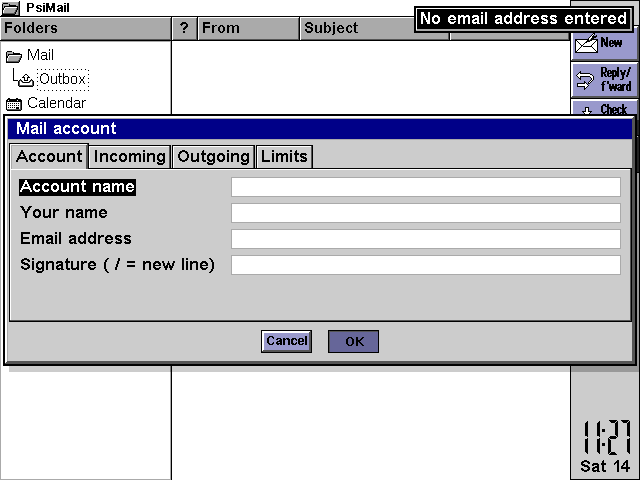</a> | [post](posts/2026-11-12-the-starting-point.md) |
| Web browser | Opera (v1.05(450)) or Psion's Web (v1.05(254)): useless on today's web. | PsiWeb in its place, built on Links 2, in colour on the whole screen. The toolbar's browser icon opens it. | emulator; on my netBook (from the card) | <a href="img/2026-11-12-starting-point/psiweb.png">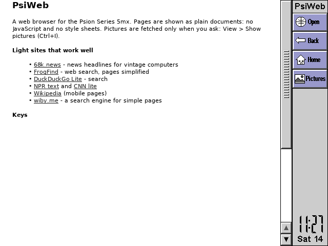</a> | [post](posts/2026-11-12-the-starting-point.md) |
| Comms terminal | A dial-up terminal with no SSH. | PsiTerm in its place: SSH with SFTP and tmux support. | emulator; on my netBook (from the card) | <a href="img/2026-11-12-starting-point/psiterm.png">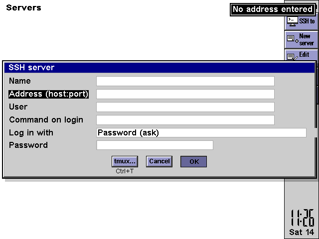</a> | [post](posts/2026-11-12-the-starting-point.md) |
| Start-up list | The Shell started nine programs in the background at boot. | Only PsiStart, 5 s after the Shell, in Jotter's place. | emulator | <a href="img/2026-11-14-psihub-and-psistart/psistart-dark-bar.png">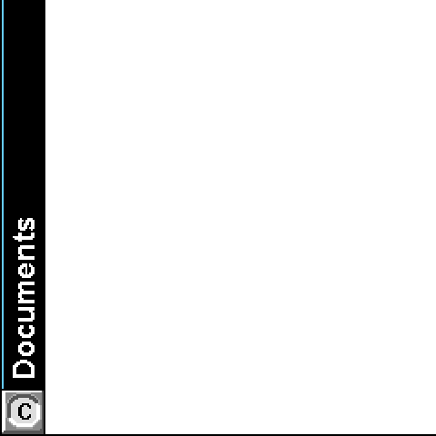</a> | [post](posts/2026-11-14-psihub-and-psistart.md) |

## Removed

| Area | Problem | What was done | State | Screenshot | Post |
|---|---|---|---|---|---|
| Opera and Java | About 4.7 MB of an old browser and a Java runtime. | Removed (Psion's Web and its engine on v1.05(254)). | emulator; on my netBook |   | [post](posts/2026-11-12-the-starting-point.md) |
| Comms, nFTP, Bombs | Replaced by PsiTerm, or unsafe (FTP in clear), or not needed. | Removed to make room. | emulator; on my netBook |   | [post](posts/2026-11-12-the-starting-point.md) |
| Example files | Example documents and "Welcome to netBook" in the Documents folder. | Removed. | emulator; on my netBook | <a href="img/2026-11-12-starting-point/documents-before.png">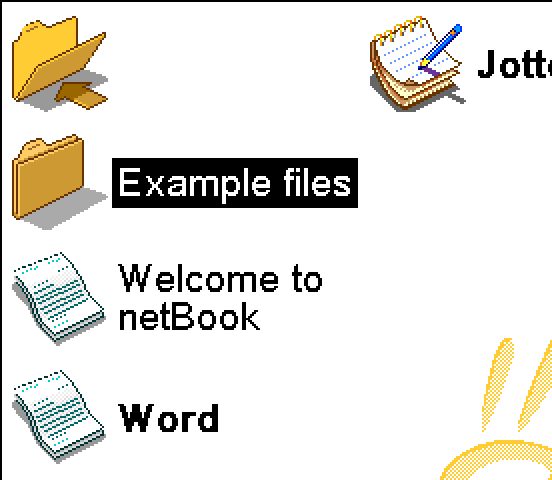</a> <a href="img/2026-11-12-starting-point/documents-after.png">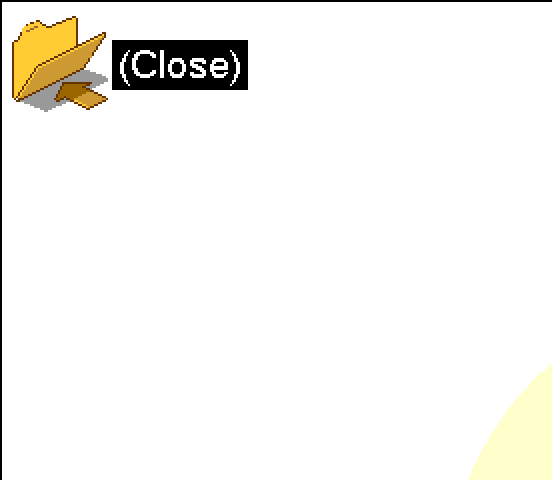</a> | [post](posts/2026-11-12-the-starting-point.md) |
| Fax programs | The Fax editor and viewer crashed at start without the Email program. | Removed with their engine, printer driver and templates. Nothing else broke (Extras bar shown). | emulator |  | [post](posts/2026-11-14-the-review.md) |

## Added

| Area | Problem | What was done | State | Screenshot | Post |
|---|---|---|---|---|---|
| PsiHub | No quick way to switch or start programs. | A launcher on Ctrl+Menu: switch, search programs, settings, files and commands. | on my netBook |  | [post](posts/2026-11-14-psihub-and-psistart.md) |
| PsiStart | Start-up work had nowhere to live. | A hidden program that paints the theme's pictures, sets first-start defaults, runs the timers and does the warm restart. | emulator |  | [post](posts/2026-11-14-psihub-and-psistart.md) |
| Psi programs | Not part of the system. | In the ROM in the full build. In my build they stay on the card. Other Psi programs are also included. | emulator; on my netBook from the card | <a href="img/2026-11-14-icons/psi-programs-now.png">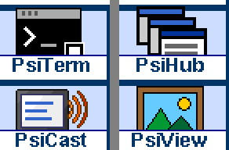</a> | [post](posts/2026-11-12-the-starting-point.md) |
| PsiView | No picture viewer. | PNG, JPEG, GIF and BMP, fitted to the screen, a palette chosen for each photo; opens from the System screen. | emulator |  | [post](posts/2026-11-14-pictures-and-colour-tests.md) |
| Control panel items | Nowhere to choose the new settings. | Themes, Text, Icons, Toolbar, Screenshot, Internet time, SerialBoost. | emulator | <a href="img/2026-11-12-starting-point/control-panel-before.png">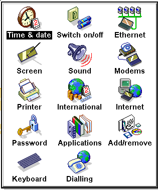</a>  | [post](posts/2026-11-12-the-starting-point.md) |
| Internet time | The clock drifts; summer time by hand. | The clock set daily from a time server, summer time on the right dates, the time zone found on request (off as standard). | emulator |  | [post](posts/2026-11-14-small-additions.md) |
| Spelling | A 1995 word list without email or website. | About 123,000 British English words beside Psion's lexicon. | emulator |   | [post](posts/2026-11-14-small-additions.md) |
| SerialBoost | The serial port stops at 115,200 bps. | 230,400 bps for any program that asks for 115,200; on as standard, off in the Control panel. | on my netBook | <a href="img/2026-11-14-small-additions/serialboost.png">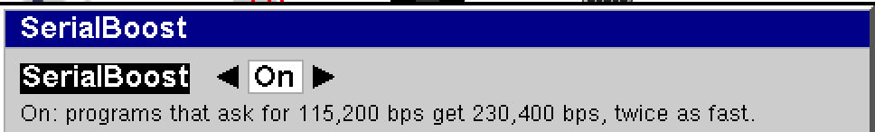</a> | [post](posts/2026-11-14-small-additions.md) |
| Build stamp | No way to tell one image from another. | A small text file with the build's date and theme, which PsiBoot shows. Nothing on screen changes. | on my netBook | <a href="img/2026-11-12-starting-point/splash-after.png">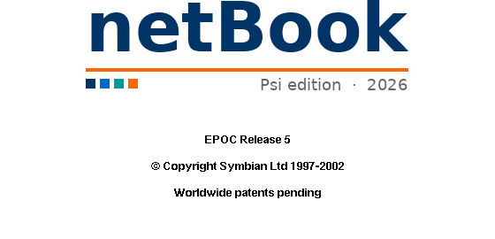</a> | [post](posts/2026-11-12-the-starting-point.md) |

## Patched

| Area | Problem | What was done | State | Screenshot | Post |
|---|---|---|---|---|---|
| Themes on the netBook | A theme could only be built into the image. | A hook as each program builds its colours lays the chosen theme over Psion's. | on my netBook | <a href="img/2026-11-13-themes-and-the-name-tap/themes-six.png">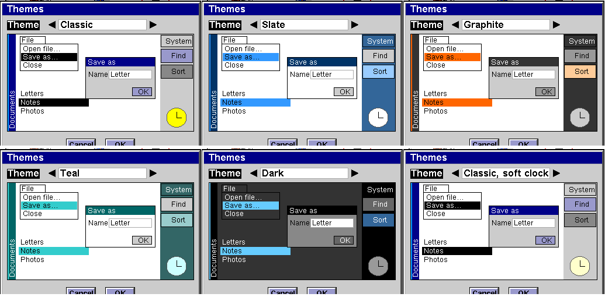</a> | [post](posts/2026-11-13-themes-and-the-name-tap.md) |
| Standard theme | Psion's bright yellow clock face. | "Classic, soft clock": Psion's colours with a cream face, the standard. | emulator | <a href="img/2026-11-14-colour-everywhere/themes-dialog.png">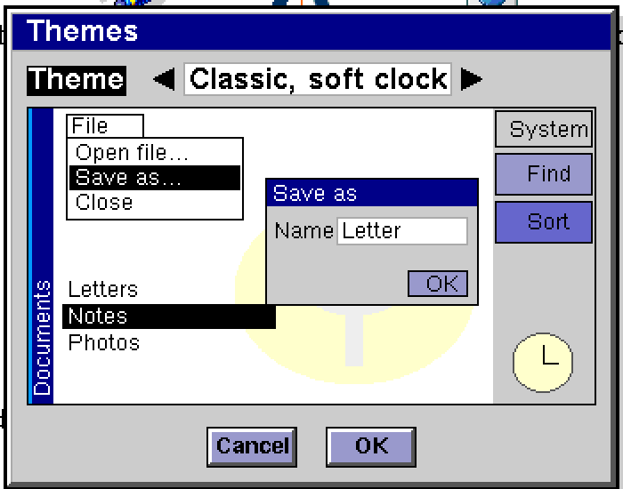</a> | [post](posts/2026-11-14-colour-everywhere.md) |
| The name tap | A tap on the program's name showed a plain list. | It opens PsiHub; a second tap puts it away. | emulator | <a href="img/2026-11-13-themes-and-the-name-tap/name-tap.png">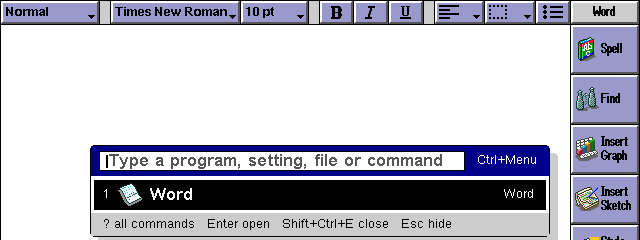</a> | [post](posts/2026-11-13-themes-and-the-name-tap.md) |
| Name box colours | Black on light grey in every theme. | The toolbar's text colour on a dark box, black on a light one; Classic unchanged. | emulator | <a href="img/2026-11-14-colour-everywhere/title-before-after.png">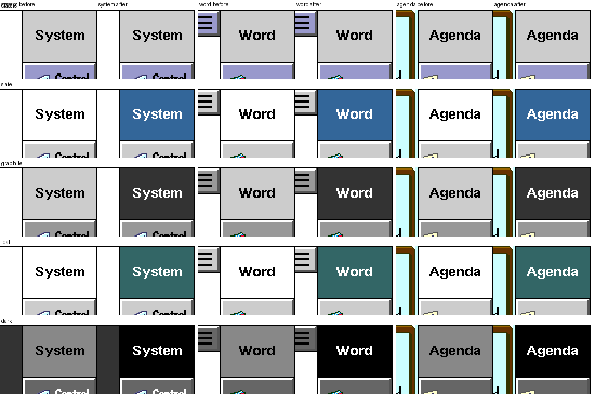</a> | [post](posts/2026-11-14-colour-everywhere.md) |
| Name box look | Flat, tall, a thin name floating in it. | The buttons' raised edge and bold condensed font; 24 pixels high, the room to the buttons. | emulator | <a href="img/2026-11-14-colour-everywhere/toolbar-top.png">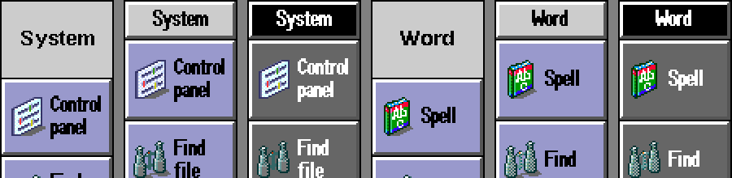</a> | [post](posts/2026-11-14-the-toolbar.md) |
| Battery, memory, brightness | No battery percentage or brightness control on screen. | A line under the battery on every built-in program's toolbar. | emulator | <a href="img/2026-11-14-the-toolbar/toolbar-bottom.png">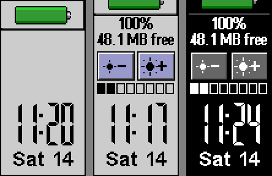</a> | [post](posts/2026-11-14-the-toolbar.md) |
| Control panel > Toolbar | No way to hide the new lines. | Show or hide each line. | emulator | <a href="img/2026-11-14-the-toolbar/toolbar-control-panel.png">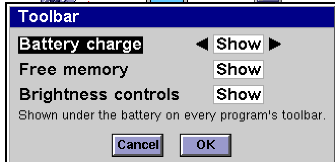 Toolbar"></a> | [post](posts/2026-11-14-the-toolbar.md) |
| Digital clock colours | Grey with black digits in every theme. | The theme's toolbar colours, repainted by PsiStart. | emulator | <a href="img/2026-11-14-the-clock/clock-digital.png">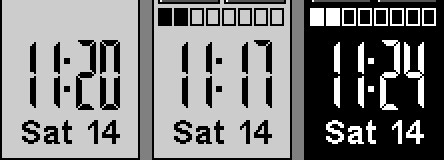</a> | [post](posts/2026-11-14-the-clock.md) |
| Shell start list | Ran only on the first start of a new C:, so nothing started after a warm restart. | Runs at every start. Nothing to see: PsiHub is simply there after a restart. | emulator | <a href="img/2026-11-14-psihub-and-psistart/psihub-empty.png">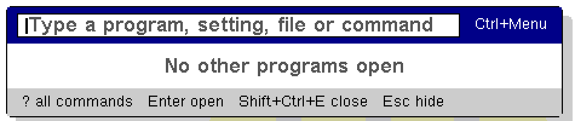</a> | [post](posts/2026-11-14-psihub-and-psistart.md) |
| Icon position names | "Beside 'Email' icon", "Beside 'Opera' icon". | Now name PsiMail and PsiWeb. | emulator | <a href="img/2026-11-14-review/icon-position-before.png">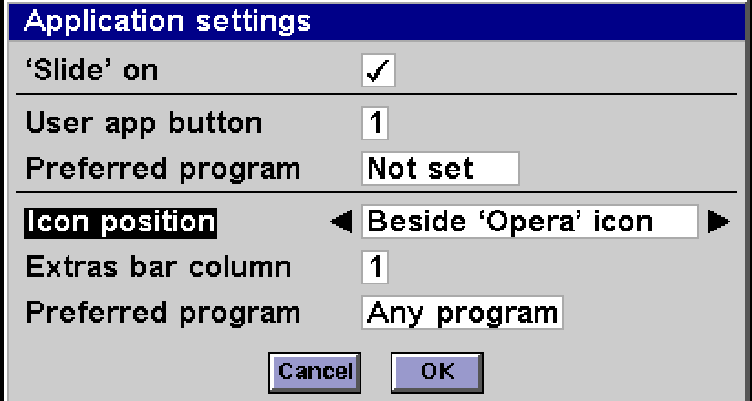</a>  | [post](posts/2026-11-14-the-review.md) |
| Classic's colours | The colours in Psion's own file are not in EPOC's palette; the nearest showed. | Buttons in one family of cube colours; the Find bar's palette entry tuned on Classic. | emulator |   | [post](posts/2026-11-14-the-review.md) |
| Year planner | Past days hatched with diagonal lines. | Past days plain light grey. | emulator | <a href="img/2026-11-14-review/planner-before.png">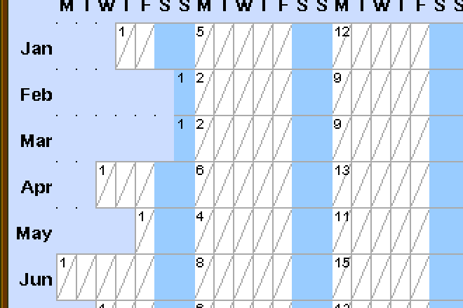</a>  | [post](posts/2026-11-14-the-review.md) |
| Word's font name | Cut to "Times New Rom". | 16 pixels moved from the style list to the font list. | emulator |   | [post](posts/2026-11-14-the-review.md) |
| Word's zoom | Four zoom steps. | Six: 1250 and 2000 added. | in progress | nothing to show yet | [post](posts/2026-11-14-small-additions.md) |
| Font choice | One system font. | Psion's, Inter, Noto Sans or DejaVu Sans in Control panel > Text. Psion's font remains the standard. | in; tried on my netBook | <a href="img/2026-11-14-fonts/menus.png">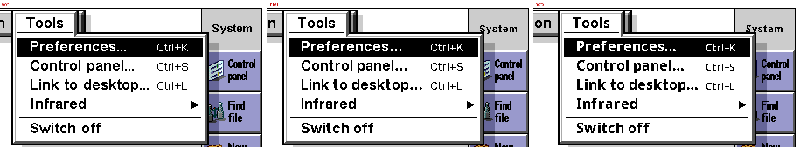</a> | [post](posts/2026-11-14-fonts.md) |
| Smooth text | One-bit letters only. | Optional smoothing for Psion's font, several styles. Off as standard. | in; tried on my netBook | <a href="img/2026-11-14-fonts/text-dialog.png">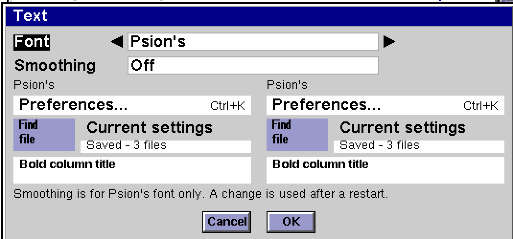</a> | [post](posts/2026-11-14-fonts.md) |

## Pictures

| Area | Problem | What was done | State | Screenshot | Post |
|---|---|---|---|---|---|
| Boot pictures | Psion's banner. | A new splash and bootloader picture. | on my netBook | <a href="img/2026-11-12-starting-point/splash-before.png">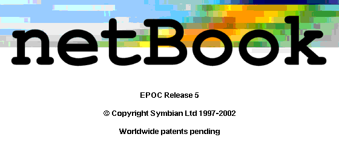</a>  | [post](posts/2026-11-12-the-starting-point.md) |
| Cleaner pictures | Dithered and blurred pictures. | 80 of 993 de-dithered or smoothed; the rest kept as Psion drew them. | emulator | <a href="img/2026-11-14-icons/calc-toolbar.png">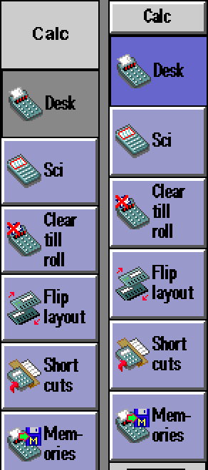</a> | [post](posts/2026-11-14-icons.md) |
| Clock faces | A yellow face and an unreadable name. | Both faces drawn again; the name legible. | emulator; checked on my netBook with Icon test | <a href="img/2026-11-14-the-clock/clock-psion.png">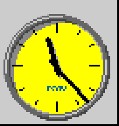</a> <a href="img/2026-11-14-the-clock/clock-coda.png">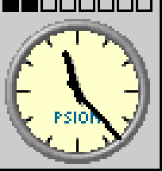</a> | [post](posts/2026-11-14-the-clock.md) |
| Clock face colour | The face's colour fixed in the picture. | Repainted in the theme's colour by PsiStart. | emulator | <a href="img/2026-11-14-the-clock/clock-dark.png">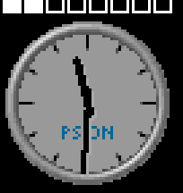</a> | [post](posts/2026-11-14-the-clock.md) |
| Documents bar | Navy in every theme. | Its two tiles painted in the theme's colours. | emulator | <a href="img/2026-11-14-colour-everywhere/documents-bar.png">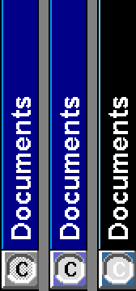</a> | [post](posts/2026-11-14-colour-everywhere.md) |
| Wallpapers | Psion's logo only. | Psi, Hills and Sweep, drawn in the theme, through EPOC's own Preferences; becoming Coda, Coda psi, Coda hills, Coda sweep. | emulator; the Coda design in progress | <a href="img/2026-11-14-wallpapers/wallpapers.png">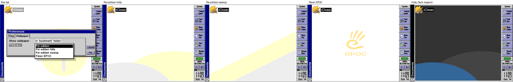</a> | [post](posts/2026-11-14-wallpapers.md) |
| Psion's wallpaper | A white box on a dark theme. | Its ground in the theme's colour; named "Psion EPOC". | emulator | <a href="img/2026-11-14-colour-everywhere/system-dark.png">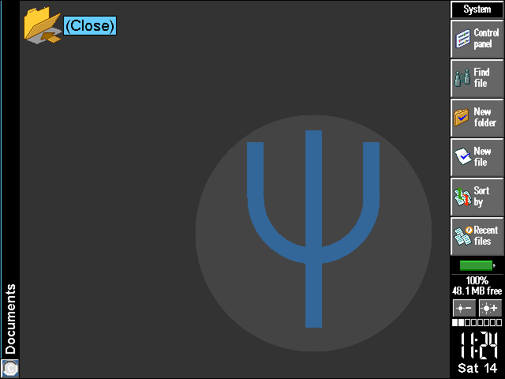</a> | [post](posts/2026-11-14-colour-everywhere.md) |
| The desk | A shimmering dotted tile behind Calc, Record and Spell. | Plain, in the theme's ground. | emulator |  <a href="img/2026-11-14-review/desk-after.png">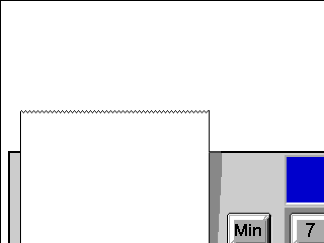</a> | [post](posts/2026-11-14-the-review.md) |
| Contrast strip | 15 greys on a colour screen. | Greys and mid-tone colours from the cube. | emulator |   | [post](posts/2026-11-14-the-review.md) |
| Time's world map | Bright green on navy, blocky coasts. | Drawn again from Natural Earth, in the same projection. | emulator |   | [post](posts/2026-11-14-the-review.md) |
| Sketch's icon | A dithered icon. | Drawn afresh; a choice in Control panel > Icons. | emulator |   | [post](posts/2026-11-14-icons.md) |
| Control panel > Icons | No way to choose new icons. | Psion's (standard) or New. | emulator | <a href="img/2026-11-14-icons/icons-dialog.png">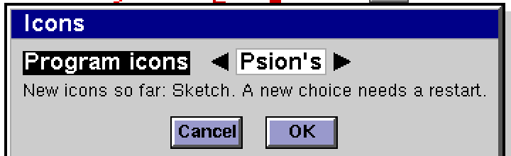 Icons"></a> | [post](posts/2026-11-14-icons.md) |
| Psi programs' icons | Four-grey icons, lost on Dark. | Colour icons for the published Psi programs. | drawn; with each program's next release |  | [post](posts/2026-11-14-icons.md) |
| Grey ROM pictures | The last grey and dithered pictures. | Drawn again in the house style. | waiting for me to sign off | nothing to show yet | [post](posts/2026-11-14-icons.md) |

## Settings and start-up

| Area | Problem | What was done | State | Screenshot | Post |
|---|---|---|---|---|---|
| First-start settings | PC link and key clicks on; new features off. | On a new C:, PC link and clicks off, SerialBoost and Internet time on. Nothing to see but the settings. | emulator |  | [post](posts/2026-11-14-small-additions.md) |
| Screenshot key | No way to capture the screen. | Ctrl+Fn+P saves a PNG; the key chosen in the Control panel. | emulator | <a href="img/2026-11-14-small-additions/screenshot-key.png">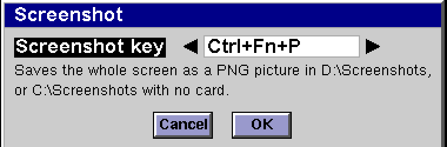</a> | [post](posts/2026-11-14-pictures-and-colour-tests.md) |
| Warm restart | A new theme needed a restart that kept C:. | Programs save and close, then a warm reset that keeps C:. | on my netBook | nothing to show yet | [post](posts/2026-11-13-themes-and-the-name-tap.md) |

## On the card, not in the ROM

| Area | Problem | What was done | State | Screenshot | Post |
|---|---|---|---|---|---|
| PsiBoot | No safe way to switch images. | Switches between Psion's image and Coda, with a backup of C:. The netBook emulator cannot see the card, so there is no netBook screenshot. | 5mx emulator; on my netBook | nothing to show yet | [post](posts/2026-11-13-themes-and-the-name-tap.md) |
| Update the card | New images went to the card by hand. | Fetches only the changed blocks over the network. | in progress | nothing to show yet | [post](posts/2026-11-13-themes-and-the-name-tap.md) |
| Safer backups | One backup, replaced each time. | Several dated, checked versions; restore of any. | in progress | nothing to show yet | [post](posts/2026-11-14-what-is-next.md) |
| PsiLinux | Greys only; Linux programs died at once on the netBook. | Colour on the netBook; the processor's caches handled. PsiHub's Terminal opens Alpine's shell. | built; cache fix not on my netBook yet | <a href="img/2026-11-14-terminal/psihub-term.png">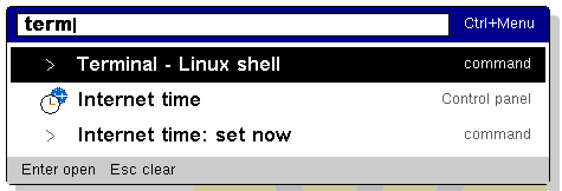</a> | [post](posts/2026-11-14-terminal.md) |
| Colour test | How much colour can the panel show? | 12-bit tried and dropped; a palette for each photo kept. | on my netBook |   | [post](posts/2026-11-14-pictures-and-colour-tests.md) |
| Icon test | New pictures need checking on the real panel. | Psion's pictures beside the new ones, page by page. | on my netBook | <a href="img/2026-11-14-icons/icon-test-page.png">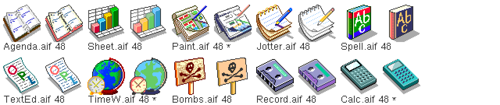</a> | [post](posts/2026-11-14-icons.md) |

## Planned

| Area | Problem | What was done | State | Screenshot | Post |
|---|---|---|---|---|---|
| PsiCalc | Calc keeps its 240-line face. | A full-screen calculator, designed. | planned | nothing to show yet | [post](posts/2026-11-14-what-is-next.md) |
| Coda wallpaper | The new name has no picture yet. | A design round a coda sign. | in progress | nothing to show yet | [post](posts/2026-11-14-the-name-coda.md) |
