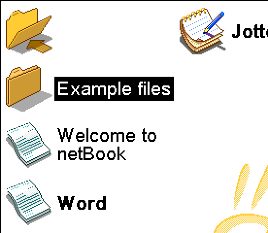
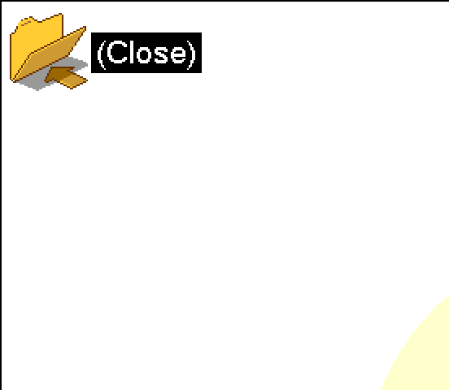
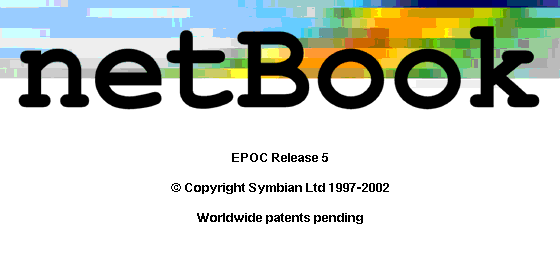
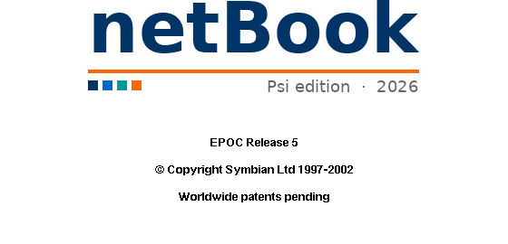
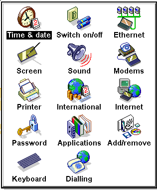
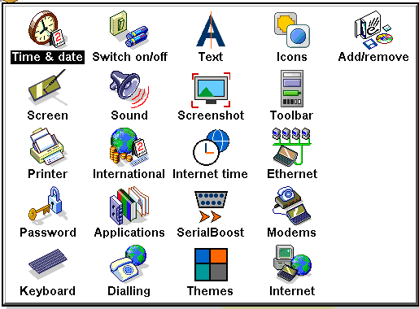
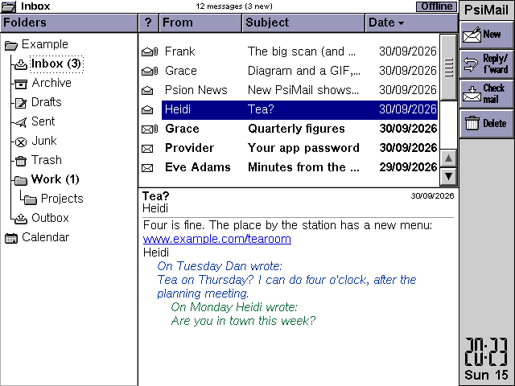
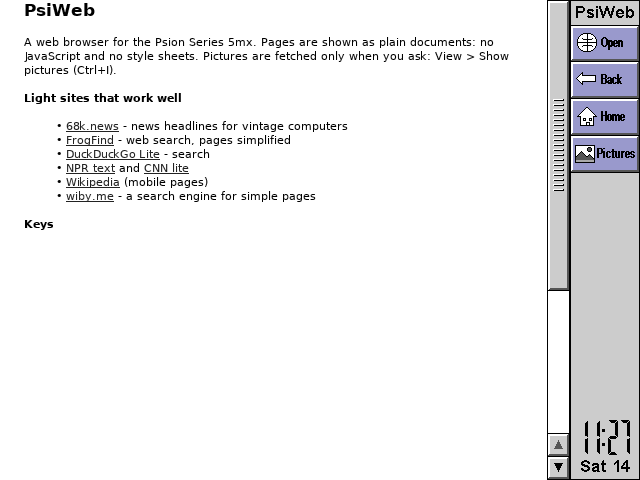
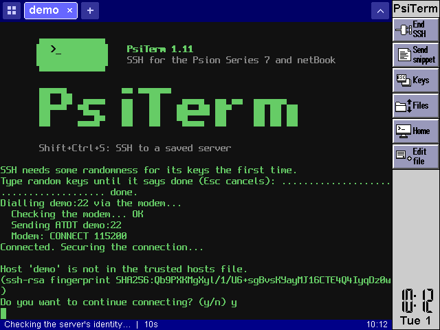

# The starting point

*12 November 2026, plus a few later changes to the same areas. It was still called the "Psi edition" then.*

The netBook loads its whole operating system from the card at every cold start, from a 14 MB file called `OS.IMG`. That's the way in. Build a different `OS.IMG`, put it on the card, and the next cold start runs it. Psion's own image stays on the card too, so going back is a file swap.

So the first job was a tool to take Psion's image apart, change it and put it back together. That was fiddlier than it sounds. Every program in the image is an execute in place ROM image rather than a normal program file, and if you drop a normal one in, the boot stops with "Bad request". The tool now converts each new program into a ROM image at the address it will live at, with its imports wired up to the DLLs already there. The kernel also reads the ROM's folder tree in place, so the original folder blocks have to stay put and new files get squeezed into whatever space the removals free up.

I build on a community patched v1.05(450) image from 2005 (c1.60a), which already fixes colour icons, the console and a few other things. My own netBook runs v1.05(254), and Coda builds on that as well.

## What came out

Opera and Java went first, about 4.7 MB between them. On v1.05(254) it's Psion's older Web browser and its engine instead. The Email program went, though the messaging engine underneath stays because Contacts and SMS use it. The old Comms terminal went (its dial-up settings stay), and so did nFTP, which sends passwords in clear. The example files and the "Welcome to netBook" document went too.

On 14 November the fax programs followed. I can't remember the last time anyone faxed from a netBook. Their engine, printer driver and templates went with them.

The Documents folder, before and after:

| Psion | Coda |
|---|---|
|  |  |

## What went in

The Psi programs went in from their published `.sis` files, each converted to a ROM image. On my own netBook I actually keep most of them on the card, where they work under both images, and only PsiHub and PsiStart live in the ROM. The full v1.05(450) build has all of them in the ROM.

The Shell starts a few programs in the background at boot. Jotter's slot in that list now starts our own program instead: PsiHub at first, PsiStart since 14 November.

I also replaced Psion's boot banner:

| Psion | Coda (still "Psi edition" here) |
|---|---|
|  |  |

By 14 November the Control panel had picked up Text, Icons, Screenshot, Toolbar, Internet time, SerialBoost and Themes:

| Psion | Coda |
|---|---|
|  |  |

## What replaced what

| Psion's program | Coda's |
|---|---|
| Email | PsiMail |
| Opera (v1.05(450)), Web (v1.05(254)) | PsiWeb |
| Comms | PsiTerm |
| nFTP | PsiTerm's SFTP |

The netBook's toolbar has icons for Email and the web browser. In Coda they open my programs instead.

PsiMail replaces Psion's Email. It does IMAP and SMTP over TLS, checks the server's certificate, and keeps a CalDAV calendar in step with Agenda. PsiWeb replaces the browser (Opera on v1.05(450), Psion's Web on v1.05(254)). It's built on Links 2 and on the netBook it runs in colour across the whole 640 x 480 screen, with a toolband for Back, Forward, Reload and the address. PsiTerm replaces the Comms terminal with SSH, SFTP and tmux support.

Each one at work:

The Control panel's Applications page still talked about the "Email" and "Opera" icons. I fixed that later, in [the review](2026-11-14-the-review.md#stale-names).
