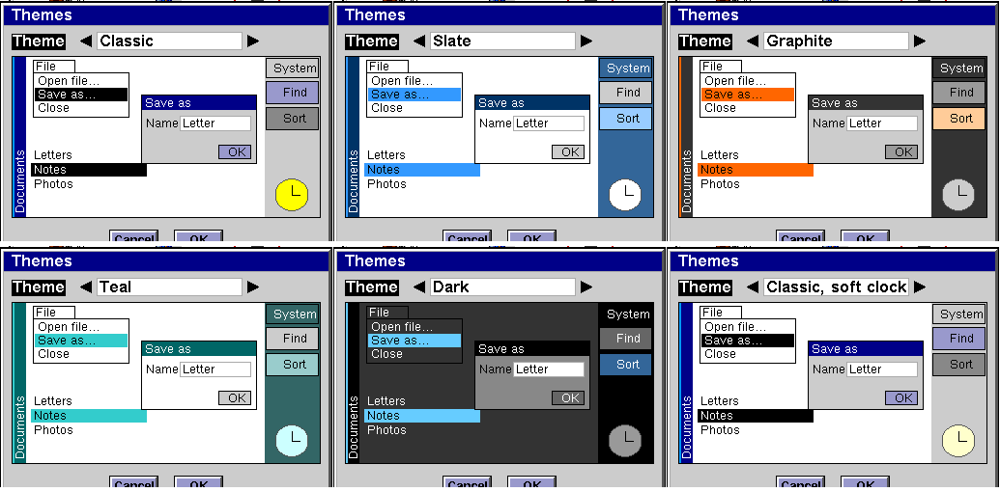
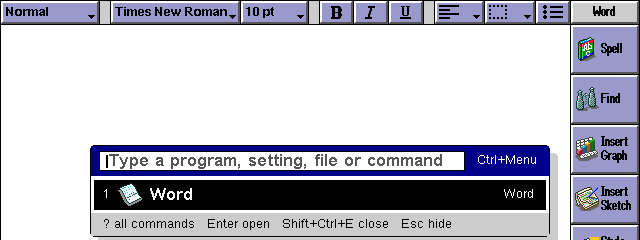

# Themes, and a tap on the program's name

*13 November 2026.*

## Colour themes

EPOC's interface draws everything from a list of about 56 colours: toolbar, buttons, menus, dialogs, highlights. On the netBook that list sits in one resource file in the ROM. My first themes were baked straight into the image: Classic (Psion's), Slate, Graphite and Teal, using only colours from the 6 x 6 x 6 cube that EPOC's palette has exactly, so nothing gets dithered. Dark came a day later.

Baking a theme in is fine for testing, but really you want to pick one on the machine. Each program builds its colour list as it starts, so I patched Eikon.dll to call a tiny library of mine (about 1 KB) just after that happens. It reads `C:\System\Data\PsiTheme.dat` and lays the theme's colours over Psion's. If the file is missing or mangled you just get Psion's colours. Programs pick up the new theme next time they start, and the System screen after a restart.

You choose it in the Control panel's Themes, which shows a preview. The chooser in all six:

Changing theme offers a warm restart, which keeps C:. I confirmed that on my netBook on the 14th. A cold restart from the card would wipe it.

The first version did something odd on the real machine: the System screen stayed in Psion's colours while everything I opened afterwards was in the new theme. The System screen only reads the theme when it starts, and I'd chosen the theme after that. The clock was being repainted straight away, which made the mismatch obvious. Now the clock waits for the restart too.

## A tap on the program's name

Every toolbar has the program's name at the top. On a Series 5, tapping it shows a list of open programs. In Coda the tap opens PsiHub instead. A 176 byte routine in the ROM finds PsiHub's window and pokes it, or falls back to Psion's list if PsiHub isn't running. Tap again and PsiHub goes away.

The patch checks the bytes before it touches them and finds its addresses by what's there, so the same code works on v1.05(254) and v1.05(450).

## PsiBoot, on the card

PsiBoot isn't in the ROM. It lives on the card so it's there whichever image is running, and it switches between Psion's image and Coda. The bootloader only ever looks for `D:\OS.IMG`, so the image you're not using waits under another name and PsiBoot works out which is which from their contents. Before a switch it offers to back up C:, and afterwards it offers to put it back.

I tested PsiBoot on the Series 5mx emulator, because the netBook one can't see the card. On the 14th it also got File > Update the card, which downloads only the changed bits of a new image. The download logic has a proper set of tests on the PC. My first go on the netBook fetched the files and then didn't put them in place, so now it keeps a step by step log and next time I'll know why.

## Where it's at

Picking themes on the netBook works on my machine. The name tap is tested both ways in the emulator. PsiBoot's switch and backup are tested on the 5mx emulator and used on my netBook. Update the card is still being sorted out.
