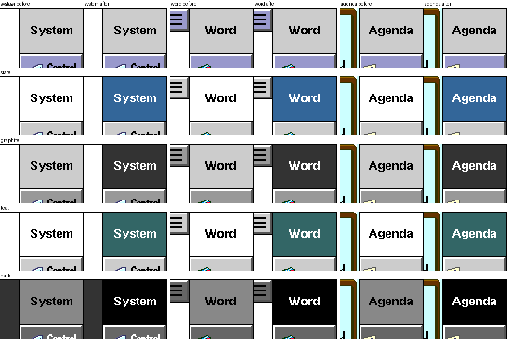
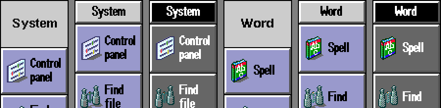
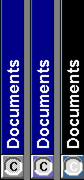
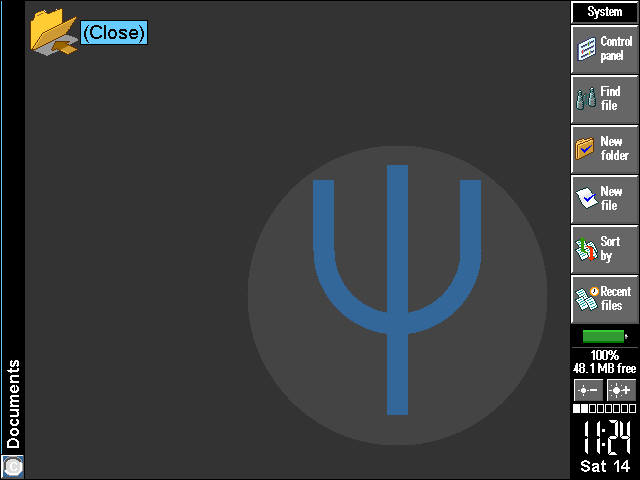
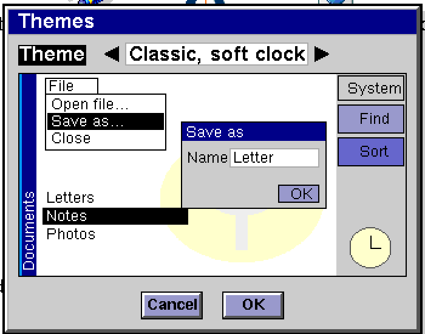

# Colour everywhere

*14 November 2026.*

Themes changed EPOC's colours, but bits of the screen didn't care. Each one turned out to need fixing somewhere different.

## The program's name on the toolbar

The name at the top of every toolbar was black on light grey, whatever the theme, which meant every theme had to keep that box light. It turns out the label sets a background colour but never a text colour, so the text comes out in the default black. I patched it to use the toolbar's text colour on a dark box and black on a light one. Classic looks exactly as Psion left it.

An early before and after across five themes, before I made the box shorter:

And how it looks now: Psion's System screen, then mine in the standard theme and in Dark, then the same three for Word.

My own programs use a plain label for their names, so theirs are still black. That's a job for each program.

## The Documents bar

The strip down the left of the System screen stayed navy regardless. It isn't actually a colour, it's two little tiled pictures. The image builder finds them and paints them in the theme's colours, and PsiStart repaints them if you change theme on the netBook. Psion, then my standard theme (which keeps Psion's navy), then Dark:

## The wallpaper's ground

The standard wallpaper sat on a white background, which on Dark's charcoal screen meant a big white rectangle. The picture's background now takes the theme's colour. This is Dark, with the Psi wallpaper drawn to match:

## The clocks

Both clocks follow the theme as well. They got [their own post](2026-11-14-the-clock.md).

## Classic, soft clock

The sixth theme, and the default since the 14th. It's Psion's colours with a pale cream clock face instead of the yellow. Themes in the Control panel shows a little mock screen of each one before you commit:

## The rule for colours

The netBook has a passive colour panel, and its controller dithers between levels frame by frame, so some colours shimmer. I stick to the 6 x 6 x 6 cube for themes and new pictures (red, green and blue each a multiple of 33 in hex). EPOC's palette has those exactly and they're the ones the panel shows steadily. EPOC's 40 extra entries, like the greys between the cube's steps, I leave alone. This came out of the [colour tests](2026-11-14-pictures-and-colour-tests.md).
