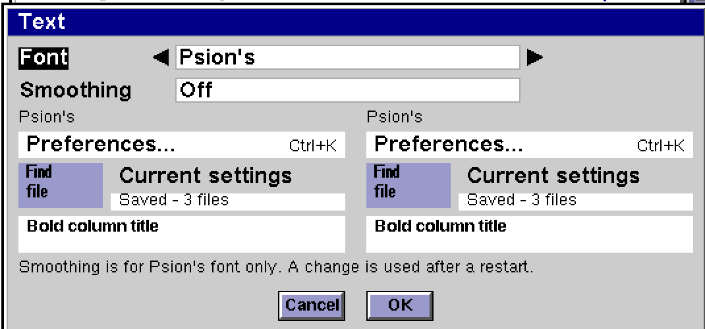
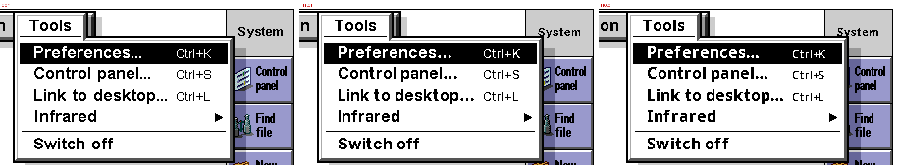

# Fonts

*14 November 2026.*

The netBook can change its system font now. Control panel > Text offers Psion's own, Inter, Noto Sans and DejaVu Sans, plus optional smoothing for Psion's font in a few styles. It kicks in after a restart.

The replacements are redrawn from each typeface at the exact pixel sizes EPOC uses, one bit per pixel, and kept within 4% of the width of Psion's letters so menus and dialogs still fit. The Tools menu in Psion's font, Inter and Noto Sans:

Honestly, none of them is clearly better than Psion's original yet. So Psion's stays the default, and the others are there if you want to play.
