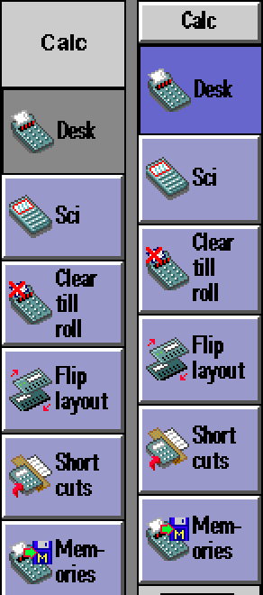
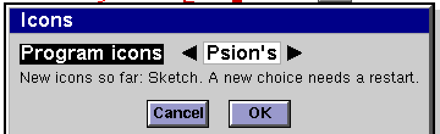
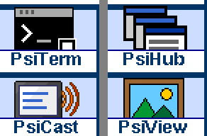
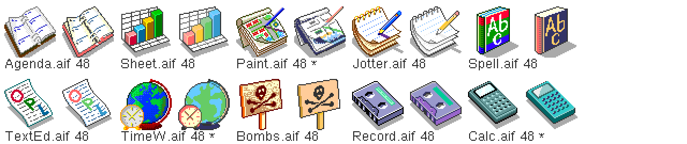

# Icons

*14 November 2026.*

The netBook's pictures came over from the Series 5. Lots were drawn in greys, some were dithered to fake colours the old palette didn't have, and a few are just blurry. Next to anything new they look tired.

## Cleaner pictures

The first pass works on Psion's own pictures at their own sizes, and only swaps one when the new version is clearly better. Out of 993 bitmaps in v1.05(254), 80 changed: the two clock faces redrawn, and the rest de-dithered, smoothed or both. Most of the others had nothing that could safely change, and 77 are dotted textures that smoothing would just smear.

Calc's toolbar shows the idea, Psion's on the left and mine on the right. The blue Desk button is [a separate fix](2026-11-14-the-review.md#classics-colours).

The clock faces got [their own post](2026-11-14-the-clock.md).

## Sketch, redrawn

Cleaning up isn't the same as looking sharp, and I wanted icons that feel high resolution. Sketch was the guinea pig, to settle on a style: vector shapes fitted to the pixel grid, cube colours only, drawn at 48, 32 and 24 pixels, with the tiny 12 and 9 pixel versions done by hand.

| Psion | New |
|---|---|
|  |  |

## Icons in the Control panel

New icons are optional. The Control panel's Icons lets you pick Psion's, which stays the default, or New:

It needs a restart because EPOC only reads program icons once, when it lists the programs at start. It also ignores icon files copied to C:, so the switch actually flips the ROM's own folder entries between two copies.

## The Psi programs in colour

Most of my programs only had their Series 5mx icons, four shades of grey. On the netBook they look flat, and on the Dark theme the black bits vanish. I've drawn colour icons for the published ones, each keeping its old idea: PsiTerm's terminal and padlock, PsiMail's envelope, PsiWeb's globe, PsiLinux's penguin, PsiCast's screen, PsiBoost's serial plug.

The catch is that one icon file has to serve both machines, since EPOC picks an icon by size and keeps one of each. So they're 8 bit colour with strong light and dark contrast, and on a 5mx they come out as clean greys.

The released programs still have their old icons until their next releases. This is how they look in the Extras bar today:

## Icon test

Icon test is a little program that puts Psion's pictures next to the new ones, page by page, on white, grey and dark backgrounds. Version 0.03 opens with PsiCast's Modern icon pack next to the netBook's own, mapped to EPOC's 256 colours without dithering, the way the netBook will show them:

It's what I used to check the clock faces and the mask behaviour.

## Waiting for my approval

I've also redrawn the last grey and dithered pictures in the ROM in the new style: Record's transport buttons, the page curl corners, the toolbar battery, Add/remove's icon, Data's arrow and the messaging envelopes. They're not in any image yet. Toolbar pictures stay Psion's until I've had a proper look.
