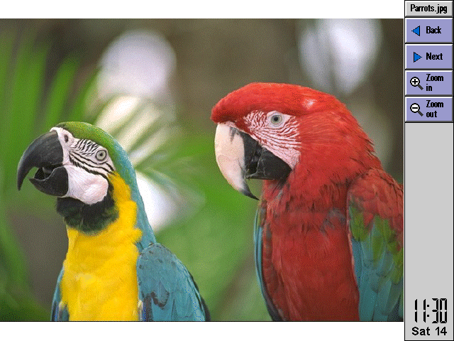
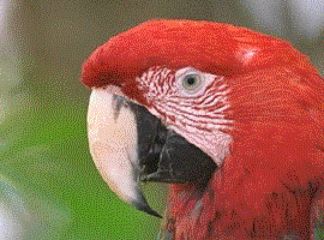
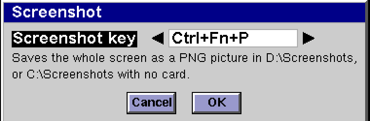

# Pictures and colour tests

*14 November 2026.*

The netBook shows 256 colours at once, picked from 4,096 (each palette entry has 4 bits each of red, green and blue). I wanted to know how much better it could look.

## Colour test

Colour test is a scratch program I install from the card. It isn't part of Coda. Versions 0.01 to 0.06 tried a few things.

The screen controller has a 12 bit mode, 4,096 colours at once, and it does work. But it flickered, and side by side it didn't look much better than 256 well chosen colours. Getting back out of it meant switching the screen off and on, and the little driver I wrote for that left the screen blank. So that idea's dead.

The one that worked was showing a photo first in EPOC's fixed palette and then in 256 colours chosen for that photo. On the panel the second was clearly better.

Later versions compared font rendering (see [Fonts](2026-11-14-fonts.md)) and added a page that just shows EPOC's own palette, so I could see which entries shimmer. The controller's frame by frame dithering can't tell the top two of its 16 levels apart, and some of EPOC's in between greys sit awkwardly on its steps. That's where the [colour rule](2026-11-14-colour-everywhere.md#the-rule-for-colours) for the themes came from.

## PsiView

That photo test turned into PsiView, Coda's picture viewer, which lives in the ROM. It opens PNG, JPEG, GIF and BMP, fits them to the screen, zooms, pans, and steps to the next or previous picture in the folder. Tap a picture on the System screen and it opens. The decoding happens in a separate process. Esc closes it.

Since 0.03 every photo gets its own 256 colours, chosen with a median cut over the colours the panel can actually show and then dithered with Floyd Steinberg. A handful of entries stay as EPOC's so the toolbar, clock and messages look right. Up close:

| EPOC's palette | The photo's own 256 colours |
|---|---|
|  |  |

The custom palette is only active while PsiView is in front with nothing on top. Open a menu, a dialog or another program and EPOC's palette comes back, with the photo drawn in EPOC's nearest colours in the meantime. A small guard process restores the palette if PsiView ever dies without doing it. If you'd rather not, Tools > Preferences (Ctrl+K) has "Photo colours": Chosen for each photo, or Standard.

The test photo is Kodak's parrots, the usual test image.

## Screenshots

PsiStart also listens for a screenshot key, Ctrl+Fn+P by default, which you can change in the Control panel's Screenshot. It saves the whole screen as a PNG on the card.

