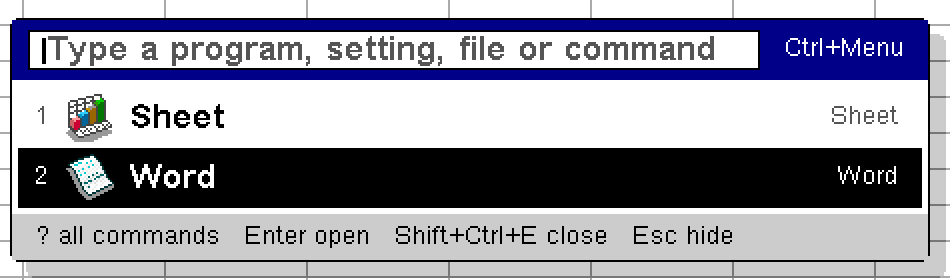
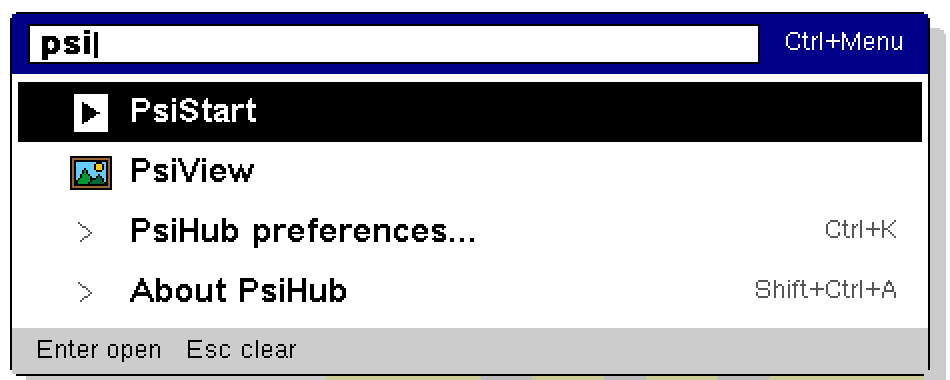
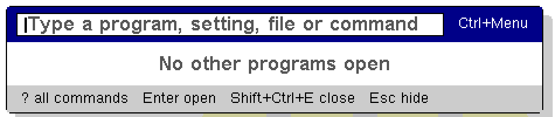
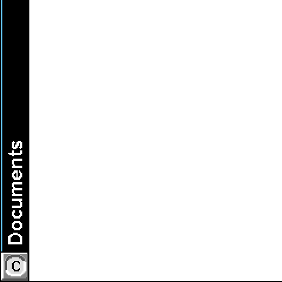

# PsiHub and PsiStart

*14 November 2026, covering PsiHub since the 12th.*

## PsiHub

EPOC has no quick way to hop between programs. The toolbar has a handful of fixed icons and everything else is on the System screen. PsiHub is a launcher along the lines of the ones on a modern desktop. Press **Ctrl+Menu** anywhere and a small panel appears over whatever you're doing.

If you don't type anything, it's a program switcher. Open programs come first, most recent at the top, with the one you were using before already selected. So Ctrl+Menu then Enter flips you back, much like Alt+Tab.

Start typing and it searches open programs, installed programs, Control panel items, its own commands, and files and folders on C: and D:, all at once. It's forgiving about how you type: `wo` finds Word, `mail` finds PsiMail, `pw` finds PsiWeb, `agnd` finds Agenda. Things you pick a lot drift to the top.

Type `?`, or use Tools > All commands, to see everything it can do with shortcuts. That includes closing all programs, restarting, switching off, a screenshot, setting the time, brightness, the battery, and Terminal, which drops you into [a Linux shell](2026-11-14-terminal.md).

With nothing else open it just tells you so:

I hit one nasty bug on the real netBook: typing in the panel could crash it with KERN-EXEC 3. I'd taken a command out of a list and left the count at 10, so every search read one entry off the end. The counts come from the lists themselves now.

PsiHub runs on my netBook. It should also install on its own, on Psion's image or a Series 5mx, as a plain launcher without Coda's extras, but I haven't tried that yet.

## PsiStart

PsiHub had gradually turned into the place where start up jobs lived: painting the clock in the theme, first start settings, the screenshot key, the restart. I wanted the launcher to be just a launcher. So from 0.27 PsiHub only launches, and a new program, PsiStart, does the rest.

PsiStart is an EPOC program that never shows anything. It's hidden from the System screen and the Extras bar, sits behind everything and never takes focus. The Shell starts it 5 seconds after boot and it starts PsiHub a second later, unless PsiHub's Preferences say not to. At start it repaints the clock, the Documents bar, the wallpapers and Calc's desk in the current theme and grabs the screenshot key. On a brand new C:, ten seconds in, it turns the PC link and key clicks off and SerialBoost and Internet time on. Every five minutes it handles summer time, Internet time's daily check and a palette tweak for Classic. And when asked, it does the warm restart: programs save and close, then the machine resets with C: kept.

There's nothing to see of PsiStart itself, only what it does. Here a Classic image has been told the theme is Dark, and PsiStart has painted the Documents bar to match (this is from before the toolbar change):

It uses about 40 KB of memory, and its code runs straight from the ROM.

Related fix: the Shell only ran its start up list on the very first start of a new C:. After a warm restart nothing started, PsiHub included. A small patch makes it run the list every time.

## Where it's at

PsiHub up to 0.20 is on my netBook; 0.27 is tested in the emulator. PsiStart is tested in the emulator, apart from the warm restart, which the emulator can't do. The start list fix is tested in the emulator.
