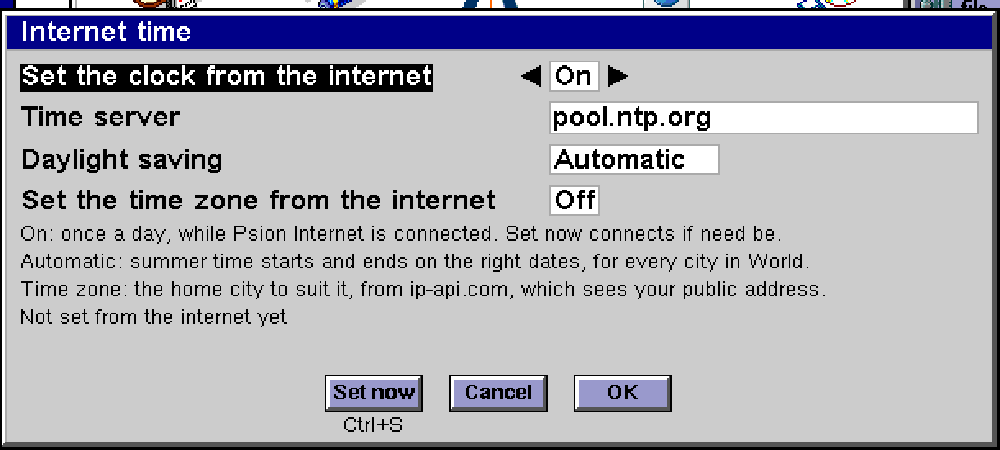
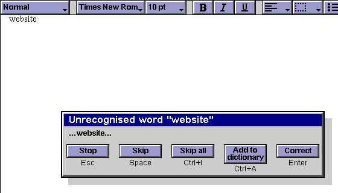
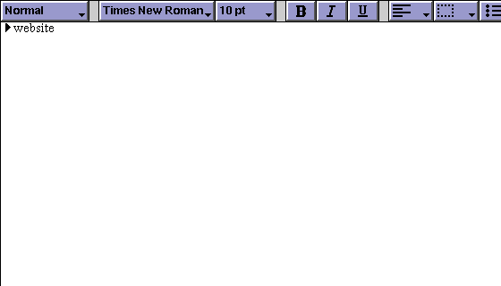

# Small additions

*14 November 2026.*

## SerialBoost

The netBook's serial driver tops out at 115,200 bps, even though the chip underneath can do 230,400. SerialBoost is the netBook version of [PsiBoost](https://github.com/danieledge/psiboost), built into the image. While it's on, any program that asks for 115,200 bps gets 230,400, twice as fast. That covers PsiTerm, PsiMail, PsiWeb, PsiCast and Psion's own dial up networking, over a Wi-Fi modem or a serial cable, without changing any of them. It's three small in place changes to the serial drivers plus a hook in a 1 KB library. Your modem has to be set to 230,400 too.

It's on by default (PsiStart switches it on the first time a new C: starts), and you can turn it off in Control panel > SerialBoost.

## Internet time

Control panel > Internet time sets the clock from a time server once a day while Psion Internet is connected, and flips summer time on and off on the right dates for every city in World. Set now does it immediately.

It can also work out your time zone. It asks a public geolocation service where the netBook's internet address is, then picks the matching city from World's own list. That means telling a third party your public address, so it's off by default.

## Spelling

Psion's spell checker is from 1995 and had never heard of email, website, broadband or Wi-Fi. Coda adds about 123,000 British English words (SCOWL size 60, with -ise spellings) alongside Psion's dictionary, which is untouched. The checker now asks both.

Typing "website" and hitting Spell, in Psion's Word and in mine:

| Psion | Coda |
|---|---|
|  |  |

## Word's zoom

Word's Zoom in and Zoom out had four sizes, hard coded. I added 1250 and 2000 to make six.

## First start settings

On a fresh C:, PsiStart turns the PC link and key clicks off and SerialBoost and Internet time on. When it works there's nothing to see, the netBook just starts up that way, and you can change any of them back in the Control panel.
