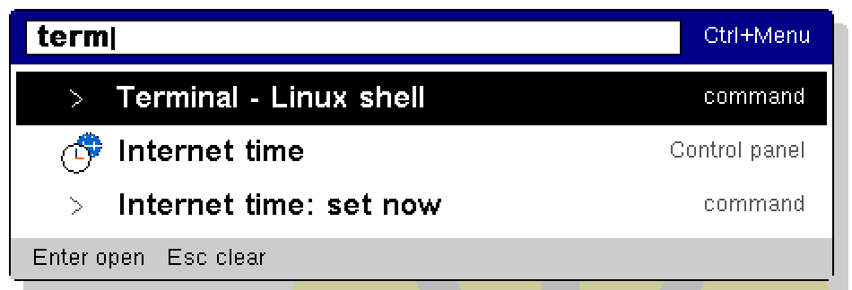

# A Linux terminal

*14 November 2026.*

[PsiLinux](https://github.com/danieledge/psilinux) runs Linux programs on EPOC. It's a small runner that loads ARM Linux binaries and handles their system calls, with PsiTerm's terminal on screen. Put Alpine Linux's root on the card (about 37 MB) and the netBook has a real Alpine shell, package manager and all.

In PsiHub, type `term`, `linux` or `shell` and press Enter. PsiLinux starts straight into Alpine's shell, or comes to the front if it's already running.

## Making it work on the netBook

It took two changes.

PsiLinux 0.27 added colour. The terminal now uses whatever the screen offers, 256 colours on the netBook and 16 greys on the 5mx as before. Programs' xterm colours get mapped to the nearest of the 256, text that's too close to its background is nudged lighter or darker, and on a colour screen it starts in light text on dark.

0.28 was the more interesting one: it brought PsiLinux to the netBook's StrongARM. That has separate instruction and data caches, and the data cache holds on to writes, which the 5mx's processor never did. So a small driver flushes the cache every time PsiLinux writes code. The StrongARM also doesn't have the BX instruction, so PsiLinux swaps it out of its own programs as they load.

## A screenshot

A photo of Alpine running on the netBook is coming here.
