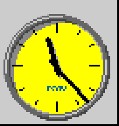
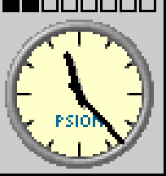
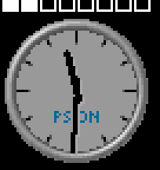
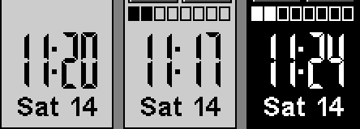

# The clock

*14 November 2026.*

The netBook's toolbar clock was bright yellow. Really yellow. And the little "PSION" printed on the face was such a smudge I only knew what it said because I already knew what it said.

So I redrew it. You can read the name now, and the standard theme has a pale cream face instead. If you miss the yellow, pick the Classic theme and it's back.

| Psion | Coda (standard) | Coda (Dark) |
|---|---|---|
|  |  |  |

## Redrawing the faces

There are two faces: the small one on the toolbar (61 pixels across) and the big one in Time & date. Psion's were dithered greys, which look fuzzy on this panel. I drew both again with solid greys, a bezel lit from the top left, hour marks that sit on whole pixels, and a PSION that is 3 x 5 pixels a letter and actually legible.

EPOC on this screen doesn't blend part-transparent mask pixels, so the mask is all or nothing, and a mid-grey outer ring stops the face looking haloed on light or dark toolbars.

## Theme colours

The inside of the face is a single colour that nothing else in the picture uses. That makes it easy to swap: when you change theme on the netBook, PsiStart repaints those pixels through a small driver. Cream for the standard theme, white for Slate, grey for Graphite and Dark.

Tap the clock and it goes digital. That version was grey with black digits whatever you did, because its colours are fixed in a resource file. They now follow the theme too.

