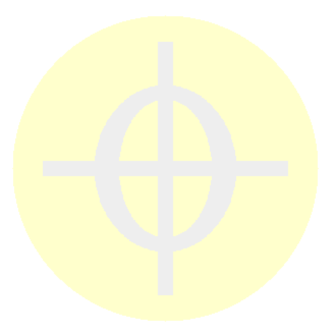
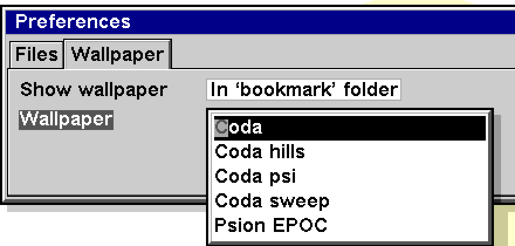

# The name: Coda

*14 November 2026.*

Until today I was calling this the "Psi edition". It's now **Coda**, or Coda for the Psion netBook if you want the full thing.

A coda is the closing passage that finishes a piece of music. The netBook was one of the last machines Psion made and its software never got finished, so this felt about right.

My programs keep their Psi names: PsiHub, PsiStart, PsiTerm, PsiMail and the rest. Only the edition changes. That means a new boot picture and build stamp, and the wallpapers become Coda (a new design around a coda sign), Coda psi, Coda hills and Coda sweep.

I've left the older posts and screenshots with the old name. They're a record of how things were at the time.

## Later the same day: the coda sign

The standard wallpaper is now the coda sign: an upright oval crossed by an upright and a level line that run past it, on the same quiet disc the Psi design used. It's drawn from code in the theme's colours, like the others, so it changes with the theme.

The Psi design stays as an extra choice, Coda psi, beside Coda hills and Coda sweep:

The System screen remembers the wallpaper you chose by its file name. A netBook that had chosen "Psi edition" would have found no picture after the rename, so PsiStart renames the saved choice, quietly, as the machine starts.

The boot banner and About netBook now say Coda, with a small coda sign:

