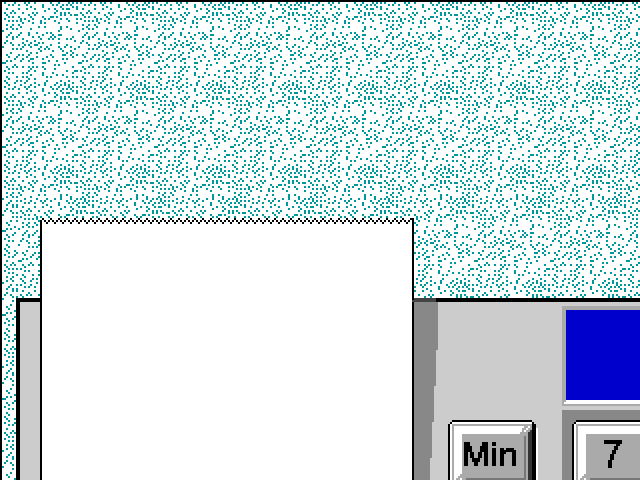
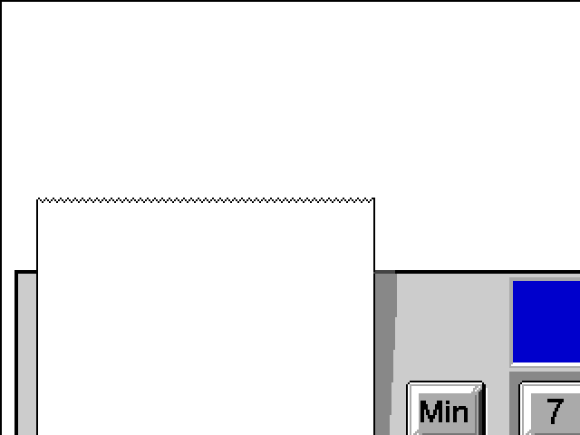
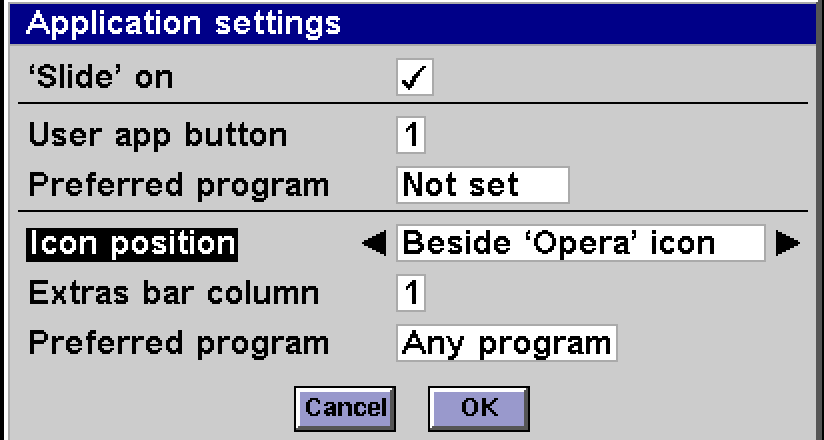
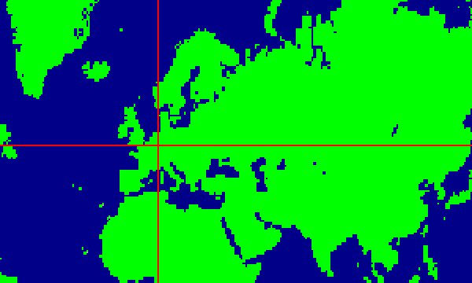
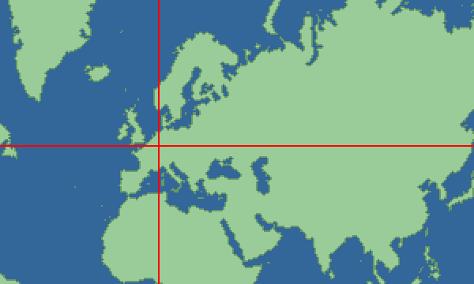
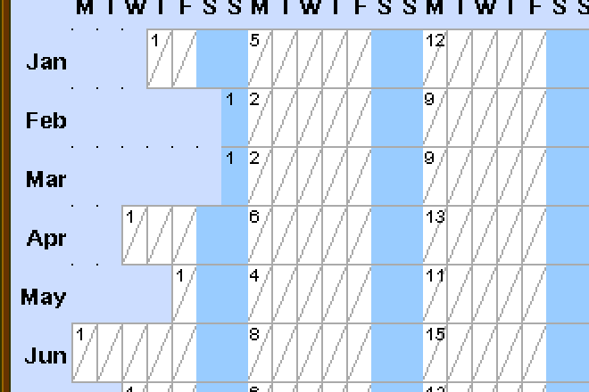
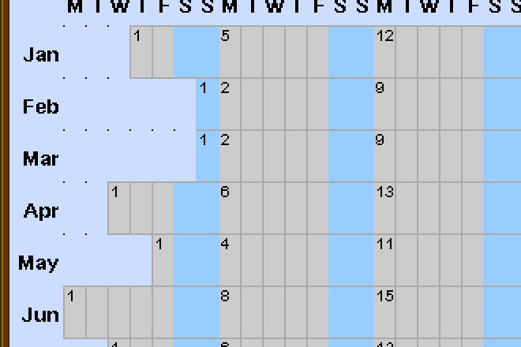

# The review of rushed parts

*14 November 2026.*

I went through every built in program looking for places where the jump from the Series 5 shows. These are the ones I've fixed so far. Every patch finds its target by what's there and leaves it alone if it doesn't look exactly right, so a different ROM release won't get mangled.

## The desk behind Calc, Record and Spell

Calc and Record still draw their Series 5 layouts, 640 x 240, in the middle of the screen. Psion filled the space around them with a tile of random teal dots on white, which on the netBook's panel fizzes like a badly tuned telly. It's now plain, in the theme's background colour, in all three places the tile turns up.

| Psion | Coda |
|---|---|
|  |  |

A proper full screen calculator is on the list for later.

## Stale names

Control panel > Applications still offered to put an icon "Beside 'Email' icon" or "Beside 'Opera' icon". In Coda those icons open PsiMail and PsiWeb, so now it says that.

| Psion | Coda |
|---|---|
|  |  |

## The contrast strip

Control panel > Screen gives you a strip to set the contrast by, and it's 15 greys from white to black. That made sense on a greyscale machine. On a colour panel the contrast that separates 15 greys isn't necessarily where colours look right, so the strip now has five greys and nine mid tone colours, all from the cube so nothing dithers. Same frame, same size.

## Classic's colours

The colours in Psion's own file include some that EPOC's 256 colour palette doesn't have, so the screen just shows the nearest one. Button faces came out lilac, a latched button came out a plain grey that matched nothing, and the Find bar in Data and Contacts was a startling cyan.

The buttons now use one family of cube colours, so Calc's latched Desk button is blue like the rest (you can see it on the Calc toolbar in [Icons](2026-11-14-icons.md)). The Find bar needed a sneakier fix. The screen controller rereads its palette from memory every frame, so you can change a single entry. On Classic only, PsiStart nudges EPOC's cyan entry to a paler blue, closer to what Psion's file asked for. It only touches the entry if it holds exactly EPOC's colour, and puts it back on any other theme.

| Psion | Coda |
|---|---|
|  |  |

## Time's world map

Time's map was bright green on navy in 16 colours, with coastlines like a staircase. I redrew it from Natural Earth's public domain data: blue sea, soft green land, a one pixel coast. Time positions its cities and crosshair with its own maths, so the new map had to match the old one's projection and edges exactly. I worked those out by fitting real coastlines to Psion's map.

| Psion | Coda |
|---|---|
|  |  |

## The Year planner's hatching

Agenda's Year planner crossed out every past day with diagonal lines, so by November most of the year was a dense hatch. The lines turned out to be a zigzag drawn in code, which I found by switching off Agenda's line drawing calls one at a time until they disappeared. The diagonal step now just moves the pen, and past days get a plain light grey.

| Psion | Coda |
|---|---|
|  |  |

## Word's font name

Word's toolband chopped the font name to "Times New Rom". The style list next to it has far more room than "Normal" needs, so I moved 16 pixels across.

## Fax programs removed

Once Email was gone, the Fax editor and Fax viewer crashed at start. Nobody faxes from a netBook these days, so they went, along with their engine, printer driver and templates. Nothing else depended on them: the Extras bar and Contacts carry on as before (see [the starting point](2026-11-12-the-starting-point.md)).

## Looked at, left alone

The Browse dialog cuts long names off without a "...". Its widths are in code rather than a resource, so I haven't touched it yet. Sketch's colour picker only offers EPOC's 16 old colours, and those come from code too. Sketch files are 16 colour drawings, so giving it more colours would mean rewriting part of Sketch and making files other machines can't open. Not doing that.
