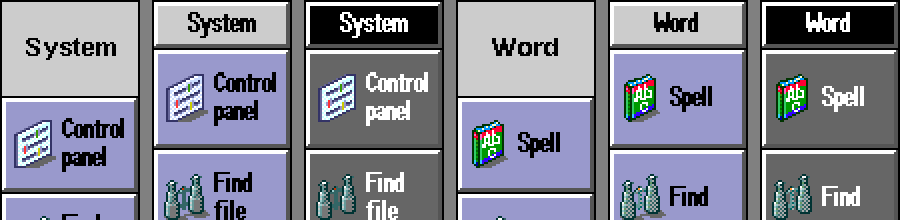
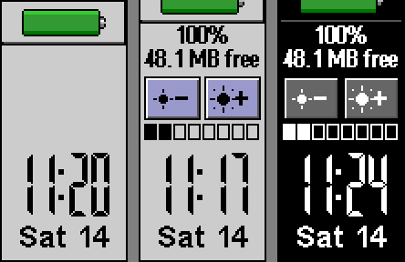
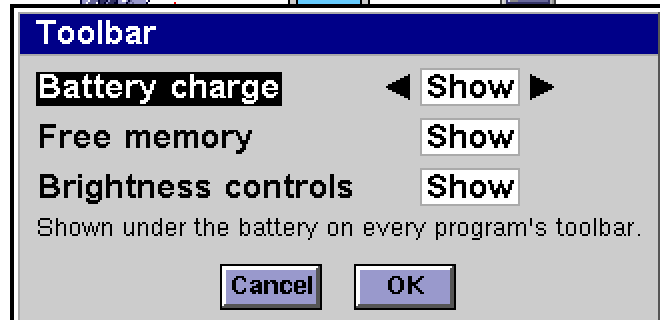

# The toolbar

*14 November 2026.*

## The name box

Looking at my netBook, the program's name box at the top of the toolbar just looked unfinished. It was as tall as a button but flat, with a thin little name floating in the middle. I mocked up four options and went with a shorter box that matches the buttons.

Two words in Eikon.dll do the look: the box gets the buttons' raised edge and their bold condensed font. That font is also about a quarter narrower, so longer document names fit. Then, as the image is built, every built in program's toolbar is rewritten so the name box is 24 pixels instead of 48 and each button gets 2 pixels taller. That's 19 toolbars in 15 files. If a toolbar doesn't parse cleanly to the end, it's left alone.

Psion's System screen, mine in the standard theme and in Dark, then the same for Word:

## Battery, memory and brightness

I wanted a battery percentage and a brightness control under the battery. The netBook shows neither.

The battery bit is a guess, honestly. The netBook reports the battery voltage but has no fuel gauge, so PsiBatt estimates the charge from a lithium ion curve, averaged over the last four readings 30 seconds apart. Once it settles it's within about 10 points. While charging it reads high, so it says "87% charging" and you take it with a pinch of salt.

Brightness was easier than I expected. The netBook's own Control panel uses three system calls that aren't in the SDK, and PsiBatt uses the same ones. Two buttons step it up and down, eight cells show the level, and you can tap or drag along the cells. The netBook's own brightness key, Ctrl+Fn+Space, shows up within 10 seconds.

There's also free memory, updated every 30 seconds. Tap it and the memory manager opens, if you have one installed.

Psion's toolbar bottom, then mine in the standard theme and in Dark:

Under the hood it's a control type of my own, added after the battery in each toolbar. EPOC's control factory hands unknown types to a 56 byte hook, which makes mine. If anything looks wrong the hook makes an empty spacer instead and you get Psion's toolbar. Its timer only runs while its program is in front.

## Control panel > Toolbar

You can hide any of the three lines:

Hide all three and it takes no room and runs nothing.

## Where it's at

All tested in the emulator on v1.05(450), and built for v1.05(254). How bright each step really is, and what voltages a real battery reports, I'll only know on the netBook.
