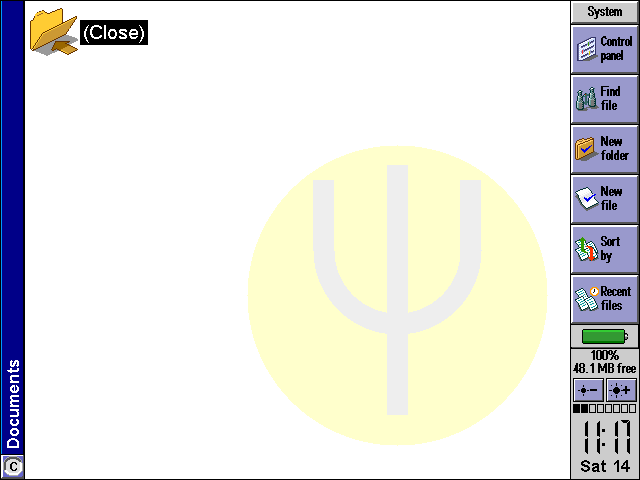
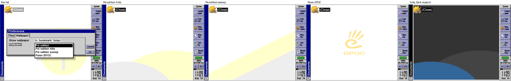

# Wallpapers

*14 November 2026.*

The System screen's default wallpaper was Psion's EPOC logo. I wanted something of my own, so I wrote the wallpapers as code: big flat shapes in three colours, the System screen's background plus two quiet tints of the theme, with no dithering and no fiddly thin lines. Each one is about 5 KB in the ROM.

The default has a large Psi on a disc in the bottom right, well clear of the file list:

## Using EPOC's own setting

My first attempt added a Background option to Themes. On my netBook it did precisely nothing. The Shell only used my picture while its own wallpaper setting pointed at it, and that setting's list opened on Psion's picture, so pressing OK in Preferences for any reason quietly switched back to Psion's.

So I binned the Background option and went through EPOC's own setting instead: System screen, Tools > Preferences (Ctrl+K) > Wallpaper. The list now opens on mine, and Psion's logo is still there as "Psion EPOC". Hills and Sweep sit alongside as ordinary wallpapers. In the strip below: the list, Hills, Sweep, Psion's, and Hills repainted for Dark.

Each one is drawn in the image's theme, and if you change theme on the netBook PsiStart repaints the colour bytes in place. I checked the repaint on the PC against the builder's own picture for each theme, pixel for pixel.

## New names

With the [rename to Coda](2026-11-14-the-name-coda.md) they become Coda (a new design built around a coda sign, which I'm still drawing), Coda psi, Coda hills and Coda sweep. The screenshots above still have the old names.

## Where it's at

Choosing wallpapers through Preferences, and the repaint for a new theme, are tested in the emulator. The Coda design and the new names are in progress.
