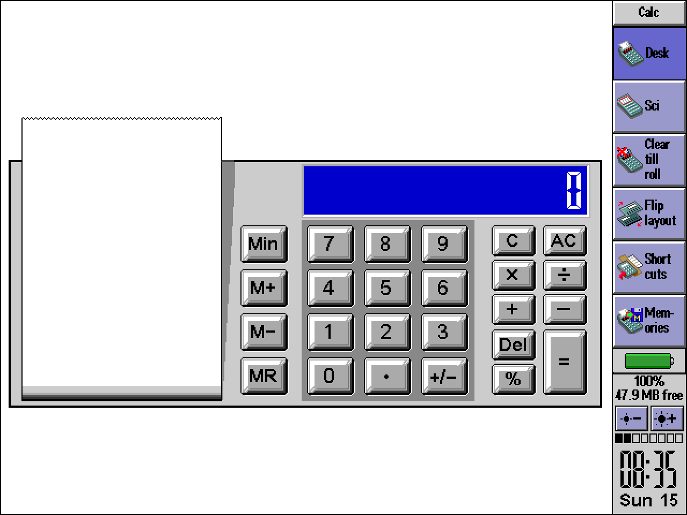
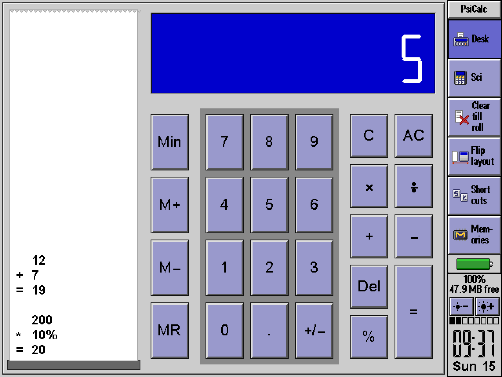
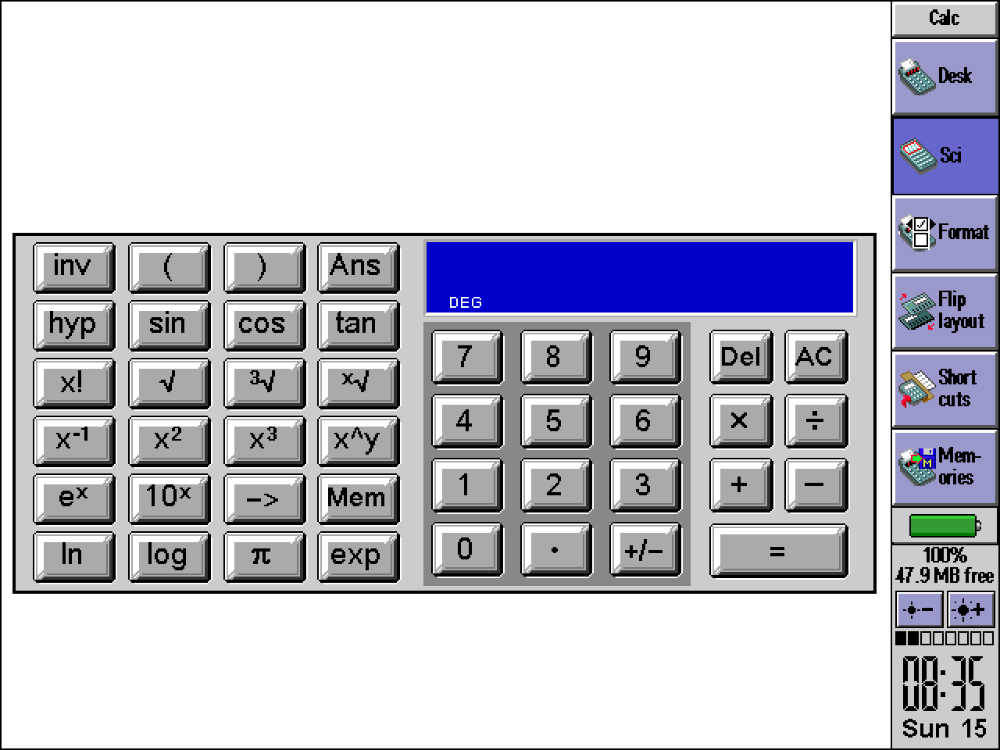
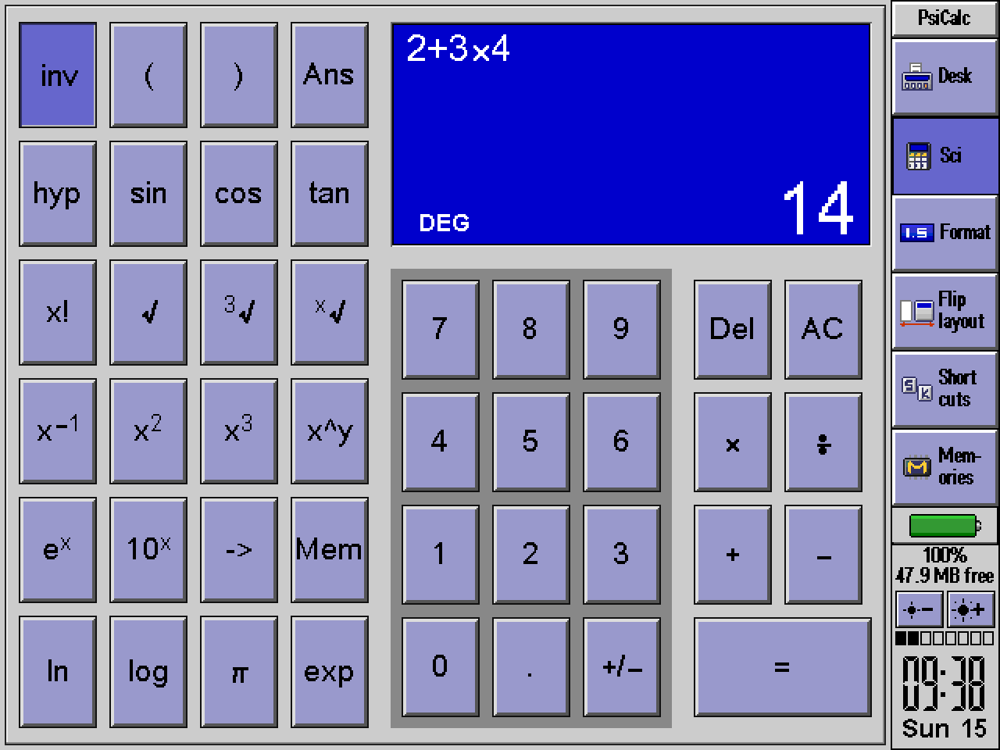
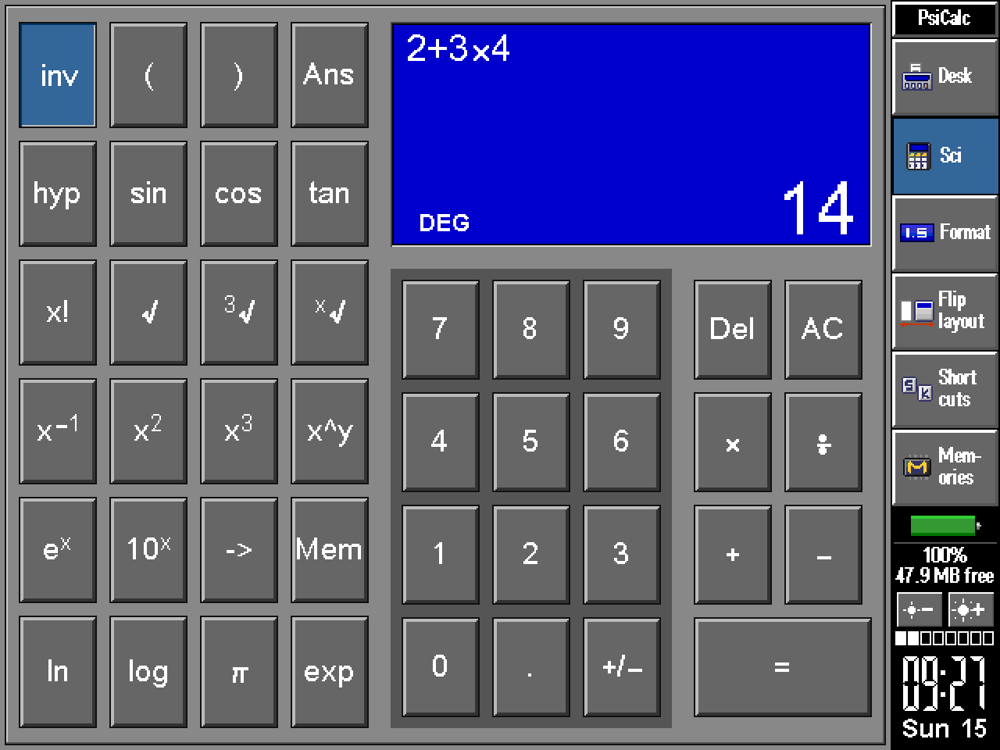
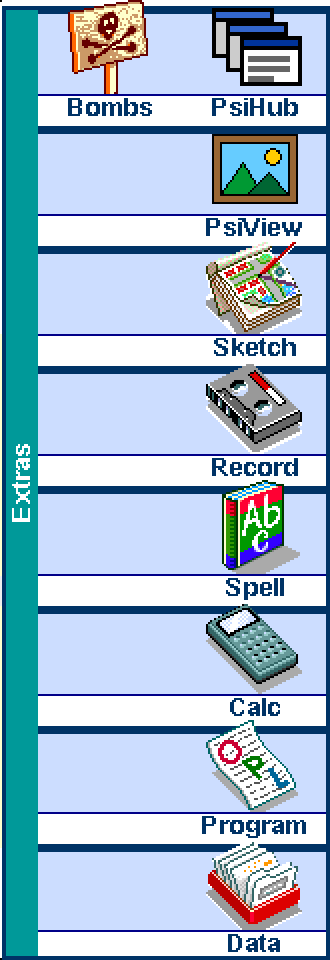
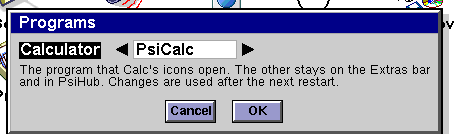

# PsiCalc

*15 November 2026.*

The netBook has a 640 x 480 screen, and Calc uses the top half of it. Well, the middle half. It draws the Series 5's calculator, 240 pixels high, slap in the middle of the screen and leaves the rest as empty desk. It's a nice calculator. It just looks like it's been posted through the letterbox.

So I made PsiCalc: the same calculator, laid out again for the whole screen.

| Psion's Calc | PsiCalc |
|---|---|
|  |  |
|  |  |

## Keeping it Calc

I didn't want a modern calculator app. I wanted the thing Psion would have shipped if they'd redone Calc for the netBook. So I spent a while poking at the real one in the emulator first: every key, every menu, every dialog, and sixty sums typed in and read off its display.

PsiCalc keeps all of it. The Desk view is still an adding machine with a till roll down the left, Min, M+, M- and MR, and the slightly odd percentage key that finishes the sum for you. The Scientific view still has its four columns of functions, inv and hyp, Ans, the A to Z memories with the little -> key, Formats, and Base conversion. The menus have the same words in the same places, the toolbar has the same six buttons, Flip layout still swaps sides, and the keyboard shortcuts are Calc's (s for sin, k for square root, Shift and a letter for a memory).

It also writes numbers the way Calc does. Calc has its own rule for when to show 0.125 and when to show 3.33333333333E-01, and I checked PsiCalc against everything I'd read off the real one.

## Bigger keys

The keys are drawn the way the System screen draws its buttons: a raised edge, lit from the top left, pressing in when you tap them. They take the theme's button colours, so they're lavender in the standard theme and grey in Dark. The display stays Calc's blue with white segment figures, because that's what Calc looks like.

| Coda | Coda (Dark) |
|---|---|
|  |  |

Ctrl+T hides the toolbar and the calculator takes the full width. Ctrl+M makes the till roll and the expression bigger. Your memories, the till roll and your settings are kept for next time.

## Which calculator?

Calc's icon now opens PsiCalc. Psion's Calc hasn't gone anywhere: it moves to the Extras bar, with its files and memories just as they were.

If you'd rather have Psion's back on the icon, there's a new item in the Control panel called Programs. It has one line for now, Calculator, with Psion's Calc or PsiCalc. Whichever you don't pick sits on the Extras bar. It takes effect after a restart, and it's offered there and then.

It's built to take more pairs later, for the next of Psion's programs that gets the same treatment.
