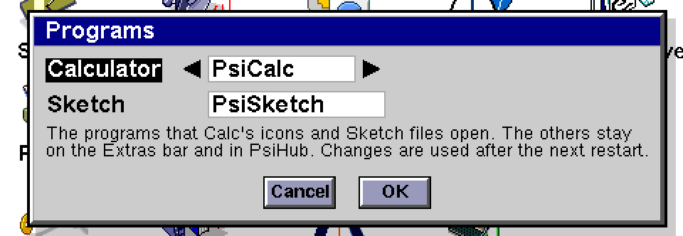
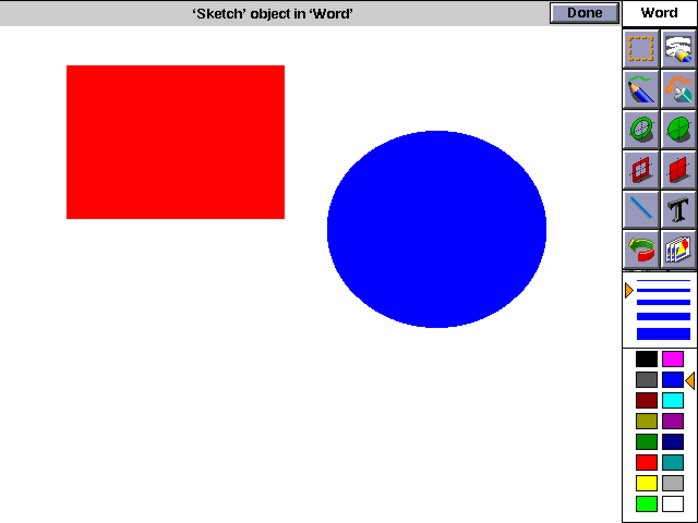
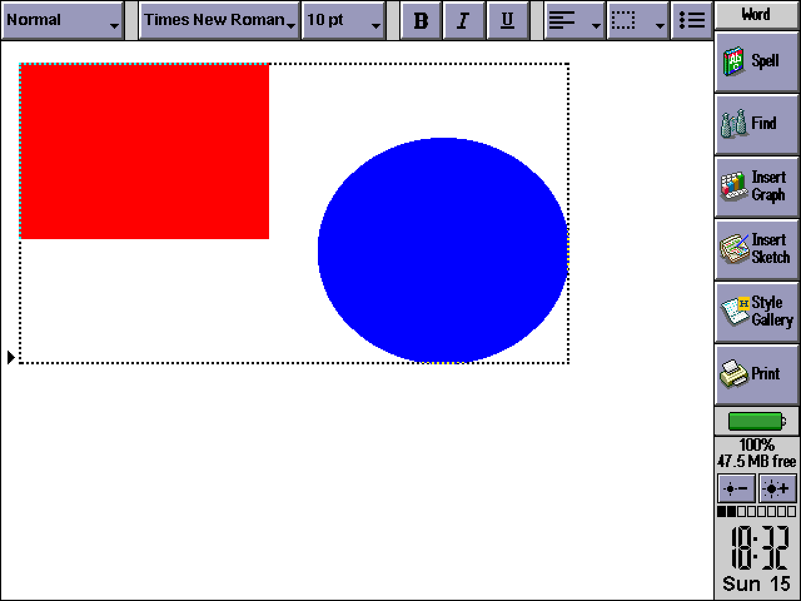
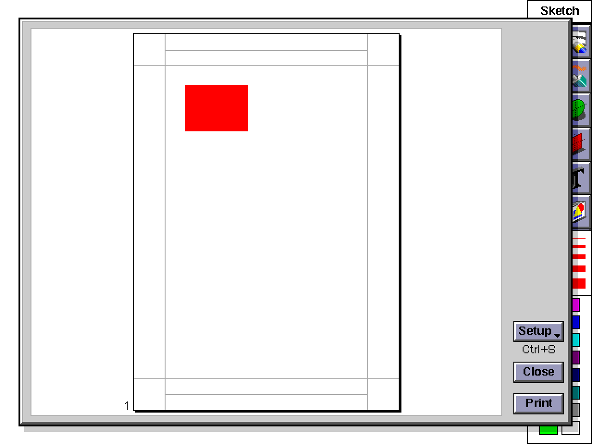
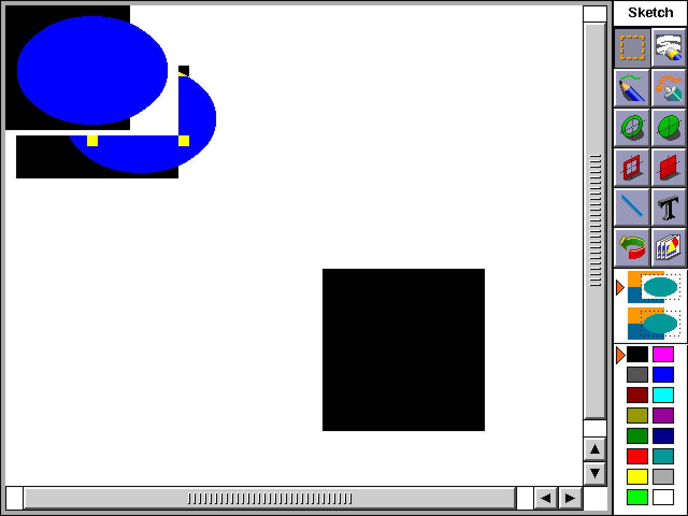
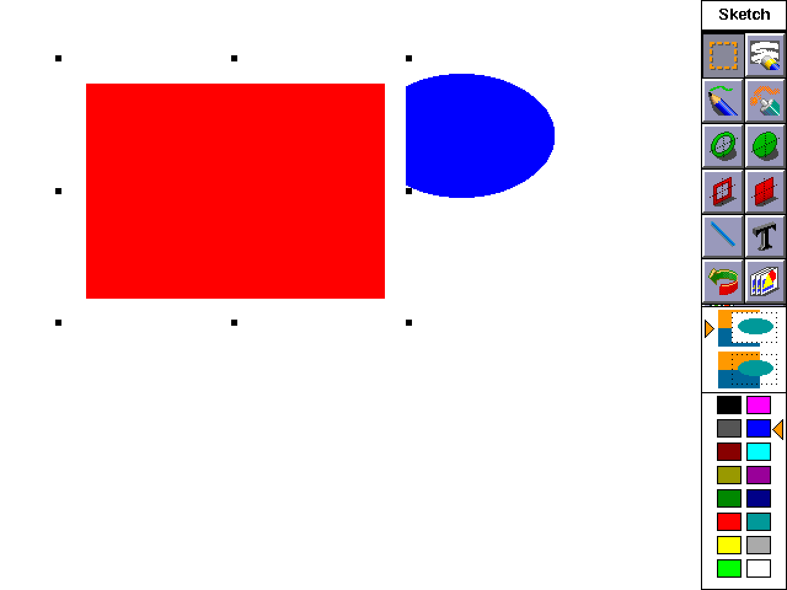
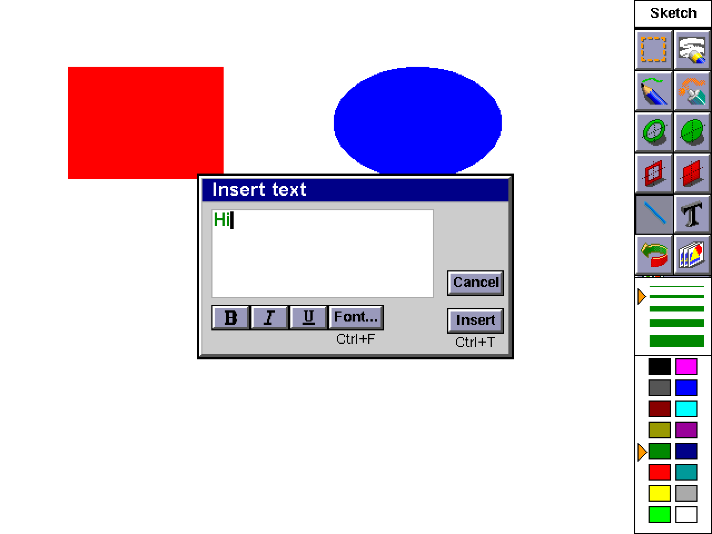
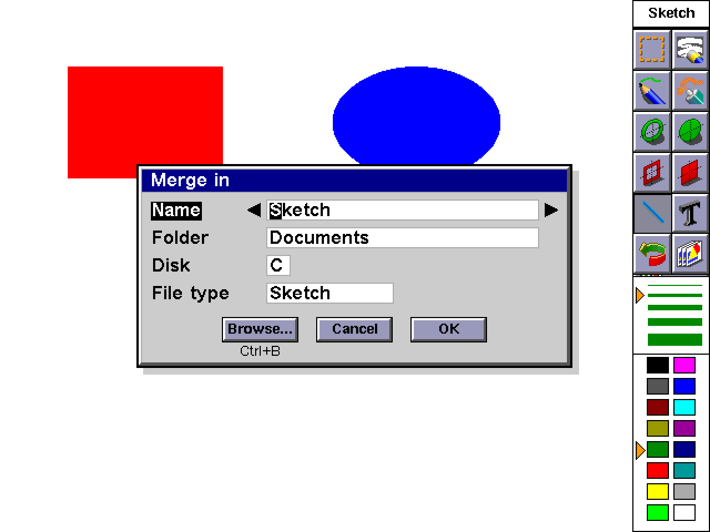

# PsiSketch

*15 November 2026.*

The netBook's screen can show 256 colours. Sketch, its drawing program, lets you pick 16 of them. It also draws a picture a little smaller than the screen and puts a grey frame round it.

The odd thing is that Sketch already stores its pictures in 256 colours. It just never gave you a way to choose the other 240.

So I made PsiSketch: Sketch, built the way Psion might have built it for the netBook.

| Psion's Sketch | PsiSketch |
|---|---|
|  |  |

## Keeping it Sketch

I started by taking Sketch apart in the emulator: every menu, every shortcut key, every dialog, the toolbar, and the little strips of line widths and colours under it.

PsiSketch keeps all of it. The toolbar has the same twelve buttons in the same two columns, drawn with Sketch's own pictures. The menus have the same words in the same places, and the shortcut keys are Sketch's. The tools work the same way: Select area, Freehand, Line, Erase, Spray, the four shapes, Insert text and the clip art. So do Resize, Crop, the Transform menu, Merge in, Export and the System wallpaper commands.

The drawing now uses the whole screen beside the toolbar. Zoom goes up to eight times, with Sketch's grid between the pixels.

## All 256 colours

The 2 by 8 strip of colours is still there, where it always was. Tap the colour you're already using and the Colour tool opens. It's also in Tools > Palette tools, as it was in Sketch, and on Ctrl+L.

| Psion's Sketch | PsiSketch |
|---|---|
|  |  |

The big chart is the colour wheel unrolled. Hue runs across, from red through yellow, green, cyan, blue and magenta. Lightness runs down, with the palest colours at the top and the strongest across the middle. Below it are rows of greys, reds, greens and blues. Every square is a colour the screen shows exactly, so nothing is dithered.

The colours you picked last sit underneath, and the colour you've chosen is shown with its name. Pick from sketch takes a colour straight off your drawing.

The line widths under the toolbar are now drawn in the colour you're using, so you can see your pen at a glance.

## Your files

PsiSketch's files are Sketch files. Psion's Sketch opens them, colours and all, and PsiSketch opens Sketch's. There's also File > More > Export as PNG, for taking a drawing to a computer.

## Which Sketch?

PsiSketch starts with the netBook, so tapping a Sketch file on the System screen opens it in PsiSketch. That works even after you've closed PsiSketch: the file still goes to PsiSketch, which starts again to open it. Psion's Sketch is still on the Extras bar, next to PsiSketch, and its icon there still opens Psion's Sketch.

The Programs item in the Control panel, which already chooses the calculator, now has a line for Sketch too. It takes effect after a restart.

## Sketches in Word

Word's Insert Sketch now opens PsiSketch. You draw in it as usual, with Sketch's band across the top naming the document the sketch goes into, and Done takes you back to Word with the drawing in place. Select it later and Shift+Ctrl+Z opens it in PsiSketch again. The Programs choice covers this too: pick Psion's Sketch and Insert Sketch opens Psion's Sketch, as before.

| Drawing a sketch for Word | Back in Word |
|---|---|
|  |  |

## Printing

File > Printing has Sketch's four commands: Page setup, Print setup, Print preview and Print. They use the netBook's own print dialogs and print through a PC, as Sketch does. The preview shows the drawing on the page.

## Copy and paste with Sketch

PsiSketch now uses the same clipboard format as Psion's Sketch. Copy part of a drawing in one and paste it into the other.

## More of Sketch's touches

Undo now goes back up to 16 steps, and Redo forward again.

The selection's eight handles stretch it, as in Sketch. Drag a corner or an edge and the picture follows.

Insert text has Sketch's layout: the text box with a row of bold, italic, underline and Font buttons under it. The text comes out in the colour you're using.

Merge in has Sketch's File type line, to choose between Sketch files and EPOC pictures.

At two times, the view now works as Sketch's does. There are no scroll bars: small ticks on the right and bottom edges show where you are, and dragging the pen to an edge moves the view along.

There's also Sketch's keyboard cursor. The arrow keys move it a pixel at a time, or eight with Ctrl. Space or Enter taps, and Shift with the arrows draws.
