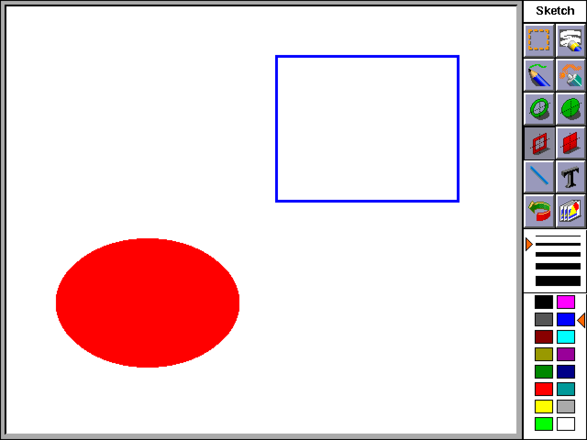
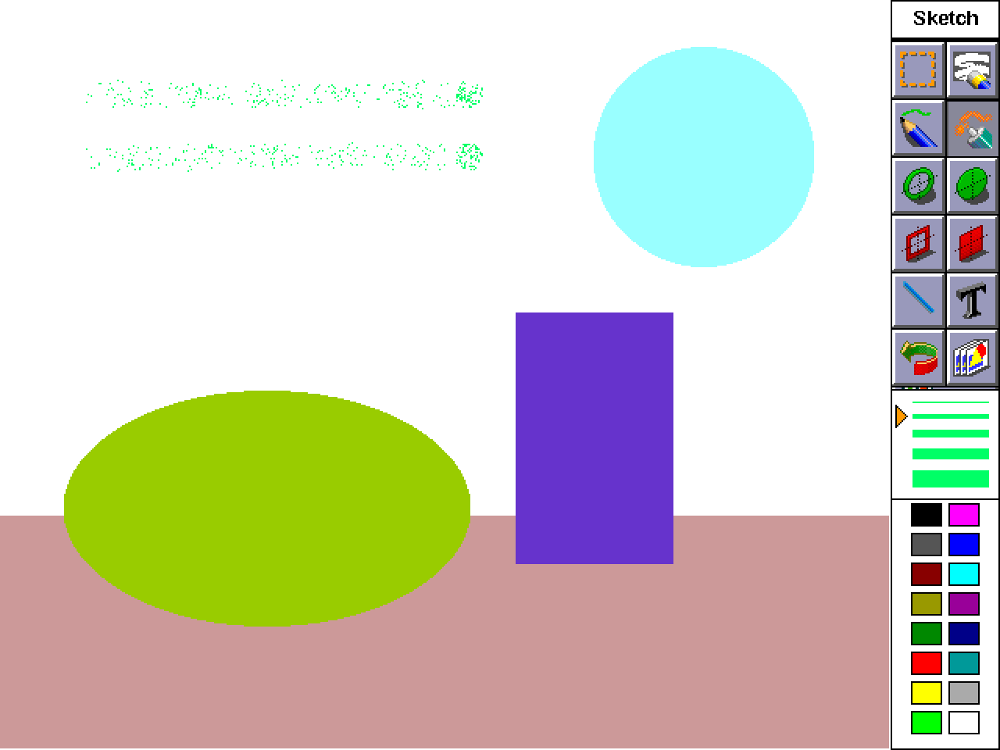
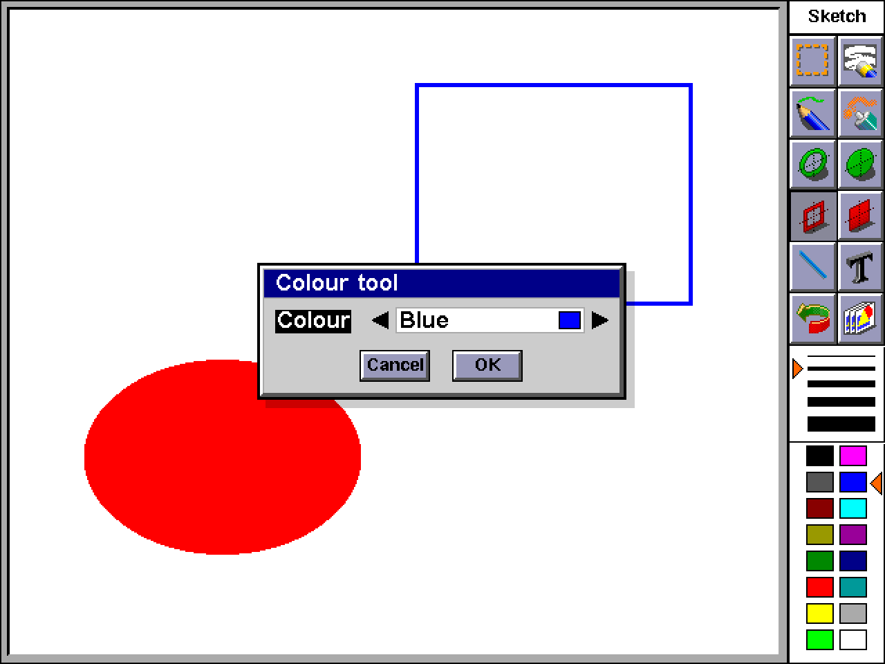
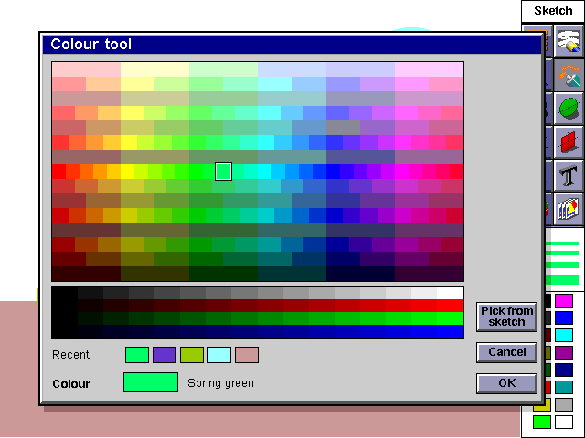

# PsiSketch

*15 November 2026.*

The netBook's screen can show 256 colours. Sketch, its drawing program, lets you pick 16 of them. It also draws a picture a little smaller than the screen and puts a grey frame round it.

The odd thing is that Sketch already stores its pictures in 256 colours. It just never gave you a way to choose the other 240.

So I made PsiSketch: Sketch, built the way Psion might have built it for the netBook.

| Psion's Sketch | PsiSketch |
|---|---|
|  |  |

## Keeping it Sketch

I started by taking Sketch apart in the emulator: every menu, every shortcut key, every dialog, the toolbar, and the little strips of line widths and colours under it.

PsiSketch keeps all of it. The toolbar has the same twelve buttons in the same two columns, drawn with Sketch's own pictures. The menus have the same words in the same places, and the shortcut keys are Sketch's. The tools work the same way: Select area, Freehand, Line, Erase, Spray, the four shapes, Insert text and the clip art. So do Resize, Crop, the Transform menu, Merge in, Export and the System wallpaper commands.

The drawing now uses the whole screen beside the toolbar. Zoom goes up to eight times, with Sketch's grid between the pixels.

## All 256 colours

The 2 by 8 strip of colours is still there, where it always was. Tap the colour you're already using and the Colour tool opens. It's also in Tools > Palette tools, as it was in Sketch, and on Ctrl+L.

| Psion's Sketch | PsiSketch |
|---|---|
|  |  |

The big chart is the colour wheel unrolled. Hue runs across, from red through yellow, green, cyan, blue and magenta. Lightness runs down, with the palest colours at the top and the strongest across the middle. Below it are rows of greys, reds, greens and blues. Every square is a colour the screen shows exactly, so nothing is dithered.

The colours you picked last sit underneath, and the colour you've chosen is shown with its name. Pick from sketch takes a colour straight off your drawing.

The line widths under the toolbar are now drawn in the colour you're using, so you can see your pen at a glance.

## Your files

PsiSketch's files are Sketch files. Psion's Sketch opens them, colours and all, and PsiSketch opens Sketch's. There's also File > More > Export as PNG, for taking a drawing to a computer.

## Which Sketch?

PsiSketch starts with the netBook, so tapping a Sketch file on the System screen opens it in PsiSketch. Psion's Sketch is still on the Extras bar, next to PsiSketch.

The Programs item in the Control panel, which already chooses the calculator, now has a line for Sketch too. It takes effect after a restart.

