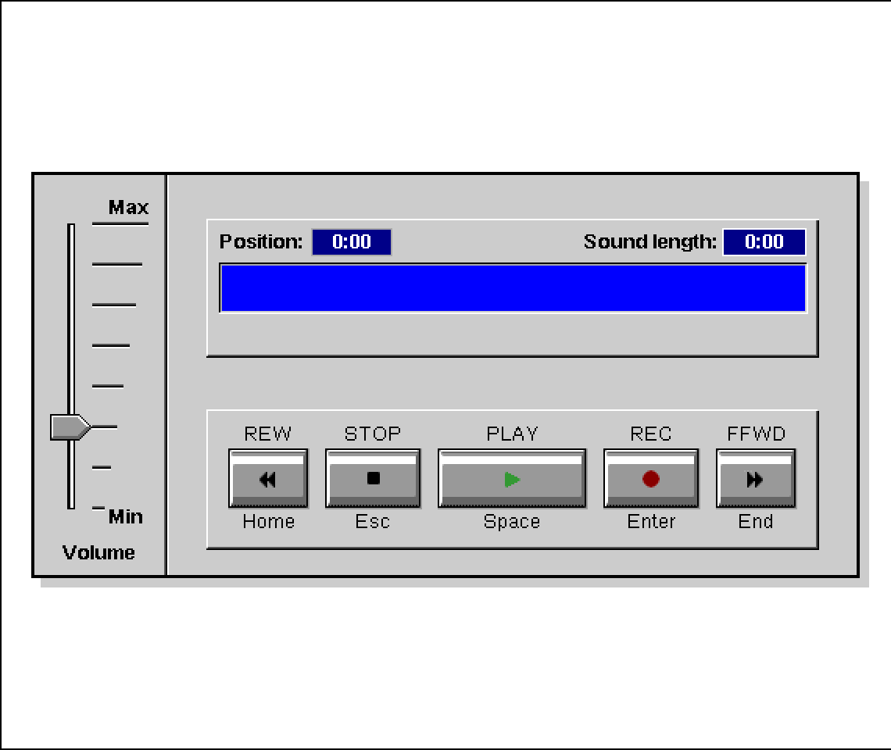
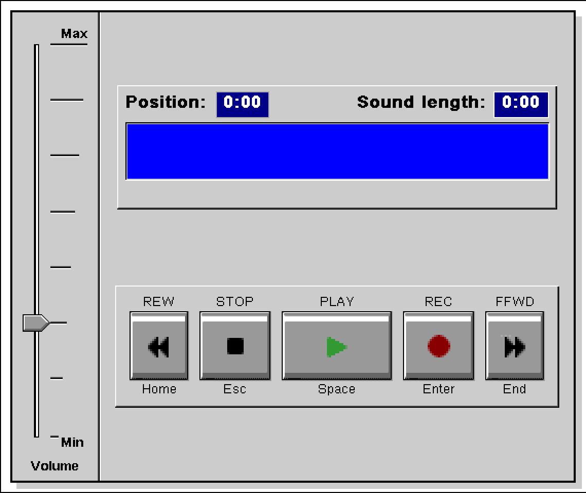
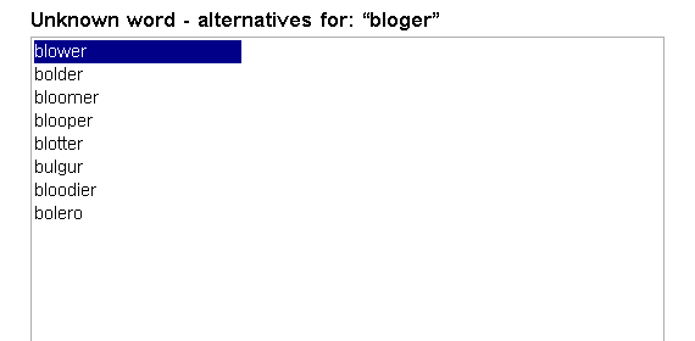
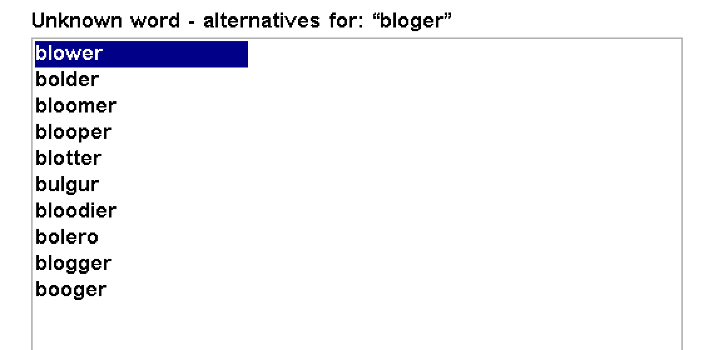
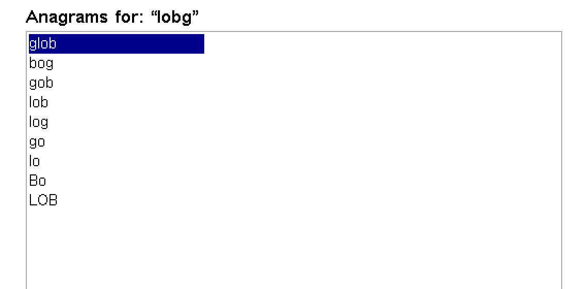
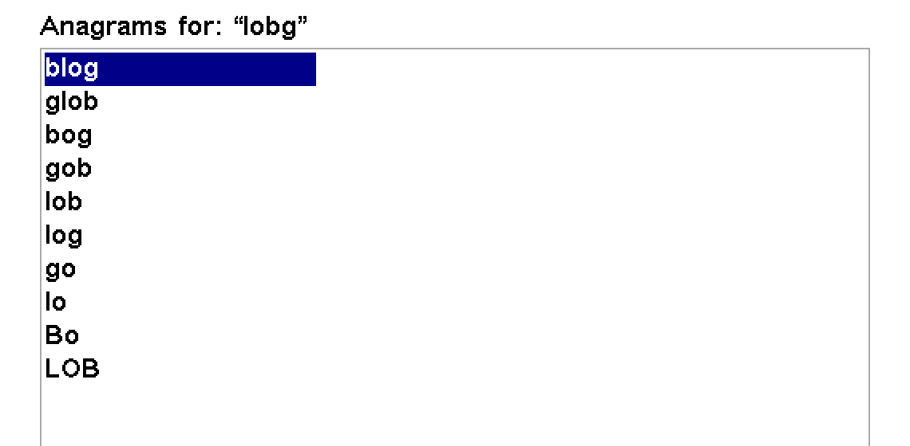

# Record and Spell

*15 November 2026.*

## Record

Record still drew its Series 5 panel: half the netBook's height, with the rest of the screen empty. Its layout turned out to come from a handful of numbers in the program, so I changed those rather than writing a new one.

The panel now fills the screen beside the toolbar. The buttons are 68 pixels high instead of 39, made from Psion's own button pictures, with the edges kept sharp. The position display and its blue bar are bigger, the readouts use a larger font, and the volume slider runs the full height. Hide the toolbar and the panel widens to fill that too.

Everything else is Record as it was: the same keys, Erase, Repeat, Crop, Go to time and Save as alarm sound, and the same files.

| Psion | Coda |
|---|---|
|  |  |

## Spell

Coda's word list, about 123,000 British English words, already sat beside Psion's for checking spelling. Now Spell uses it for its suggestions, its anagrams and its crossword answers as well, after Psion's own. So "bloger" offers "blogger", and the letters "lobg" make "blog".

The results were in a small font with lots of room to spare. They're now larger, and the word box runs the full width under them.

| Psion | Coda |
|---|---|
|  |  |
|  |  |
