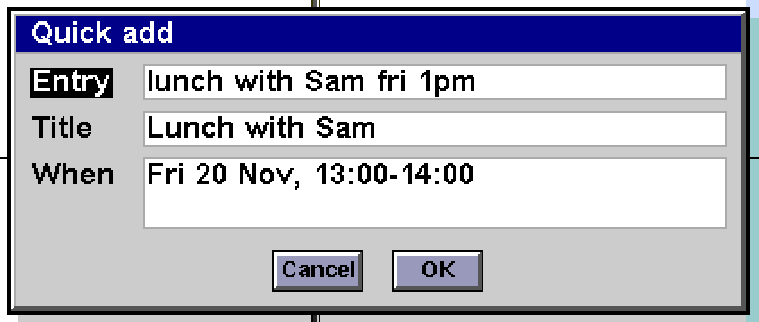
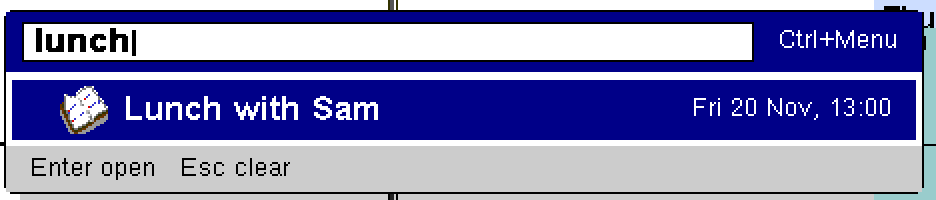
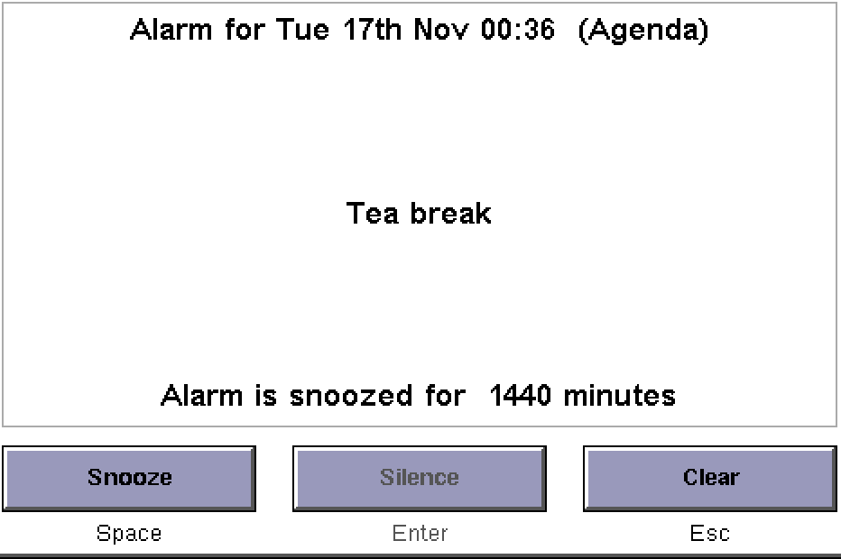
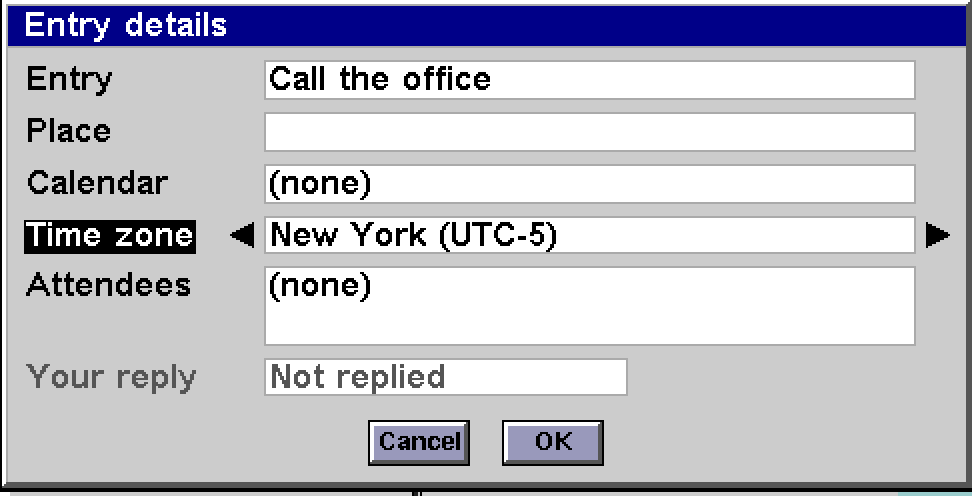

# Agenda: Quick add and search

Psion's Agenda is a good diary, but adding to it is slow. A lunch next Friday is a new day entry, then the date, the start time, the end time, the text, each in its own line of a dialog. A weekly meeting adds the repeat dialog. A birthday is another kind of entry from another menu.

So Agenda now has Entry > Quick add... (Ctrl+Y). You type the entry the way you would say it:

- lunch with Sam fri 1pm
- dentist 3 Dec 9:30 for 45 min
- every Monday 9am standup
- Sam's birthday 12 March
- todo buy milk

As you type, the dialog shows the title it has taken and when the entry will be. OK adds it as the right kind of entry (a day entry with a time, an event without one, an anniversary for a birthday, a to-do after "todo") with its repeat, alarm ("alarm 15 min before") and place ("at the Plough"), and Agenda goes to that day. Dates are British: 3/12 is the 3rd of December. A time from 1 to 7 with no am or pm is in the afternoon, and "next Friday" is Friday next week.

It is still Psion's Agenda. The new menu item and the new code sit beside it, and everything it did before works as it did.

PsiHub does the same from anywhere: type the line and the first row is "New Agenda entry: Lunch with Sam" with the time beside it. Enter adds it. PsiHub also finds Agenda's entries now, by any of their words or their place, and Enter opens Agenda at that day.

On a Series 5mx the Agenda is in the ROM, so there is no menu item, but Ctrl+Y in Agenda does the same, and PsiHub's rows work as on the netBook.

## Reminders

An alarm's Snooze used to add five minutes a press, an hour at most. Now each press steps through 5 minutes, 15 minutes, an hour and a day, so putting a reminder off until the same time tomorrow is four presses of Space. Silence and Clear work as before.

PsiHub, opened with nothing typed, now ends its list with "Up next": the next thing in Agenda this week, with its time. Enter opens Agenda there.

## Calendars, entry details and time zones

Agenda already lets each entry carry a symbol, a letter shown in a coloured box, and the netBook lets you pick the colours (Tools > Entry symbol colours). Coda uses those as calendars. Type "team meeting thu 2pm /work" (or #work) in Quick add and the entry gets the W box, and W is named Work. View > Calendars shown... hides a whole calendar, in every view, and calendars that come from the calendar sync are listed with your own.

Edit > Entry details... shows the entry under the cursor: its place, calendar, time zone, the people invited and your reply. A time zone keeps an entry at its moment, by that place's own summer time: a call at 2pm New York shows at 7pm in London, or at 6pm in the fortnight of March when New York has changed its clocks and London hasn't, and if the netBook's own zone changes (Internet time can set it from where you are), the entry and its alarm move with it. When an invitation comes in through the calendar sync, Accept, Decline or Tentative there goes back with the next sync.

I also looked at whether Agenda needed a new week view for the bigger screen. It doesn't: Psion laid out the netBook's Agenda for 640 x 480, and the week, day and year views already fill it.

