# First impressions

*16 November 2026.*

I went through Coda as someone seeing it for the first time and wrote down everything that felt off in the first ten minutes. None of it was big. All of it was the kind of thing you notice before you notice anything good. This is the first batch of fixes.

## A new Word file you can read

A new Word file started in 10 point Times at Psion's standard zoom. On this screen that is about 9 pixels high: fine for a Series 5 in 1999, small for anyone now.

New files now start at 12 point, one zoom step up. The text is about 14 pixels high. Files you already have, and files from other machines, keep their own sizes.

| Psion | Coda |
|---|---|
| 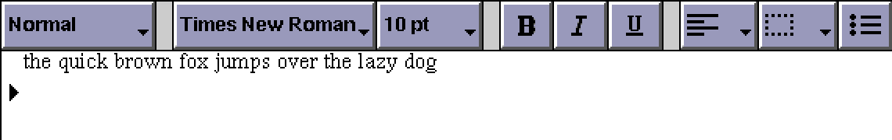 | 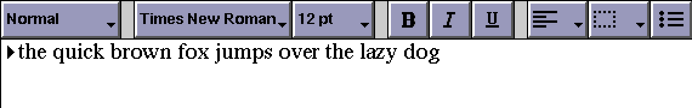 |

## One name for each program

Calc, Sketch and Record each have a new version for the whole screen. They had three different naming habits between them. PsiHub said "PsiCalc", the toolbar said "Calc", and Record's version was "PsiRecord" everywhere, even in the name of the file it made.

Now there is one rule. The new programs take the names you already know: Calc, Sketch and Record. Psion's originals are still there, on the Extras bar, as Psion Calc, Psion Sketch and Psion Record. The Programs item in the Control panel is the one place that names both, because that is where you choose between them.

The Extras bar's cells are a little wider, so "Psion Record" fits under its icon.

| Psion | Coda |
|---|---|
| 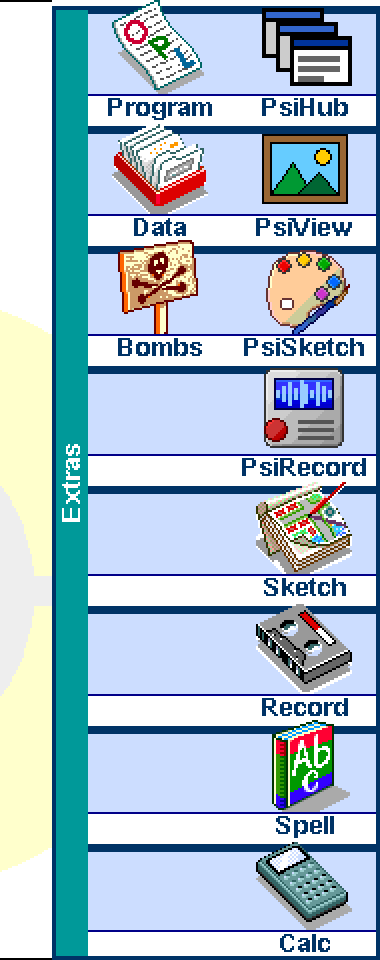 | 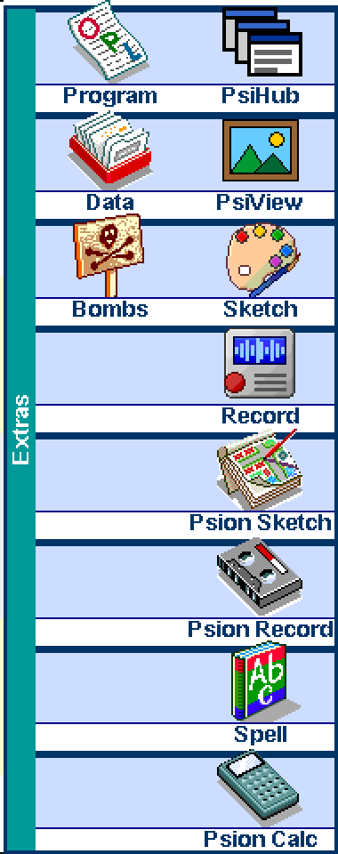 |

Record also made a file called "PsiRecord" in Documents every time the netBook started, before you had recorded anything. Psion's Record never did that. Now Record makes its file the first time you open it, and calls it "Record". In its place in Documents there is a short Welcome file (below).

| Before | Now |
|---|---|
| 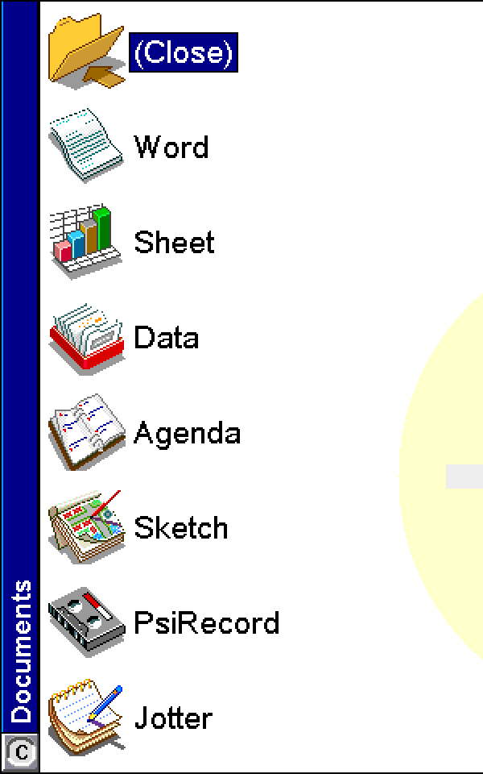 | 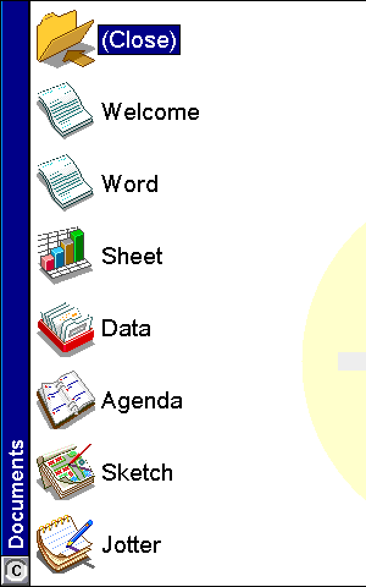 |

## PsiHub forgives

Typing "calc" into PsiHub listed Psion's Calc first, so Enter opened the small Series 5 layout, while the Calc icon opens the new one. Now PsiHub puts whichever one you chose in the Control panel first.

| Before | Now |
|---|---|
| 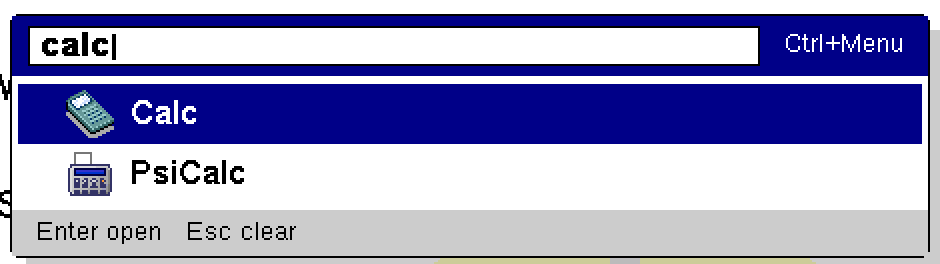 | 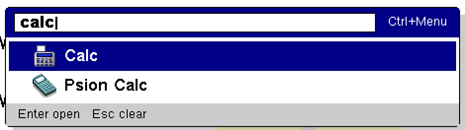 |

It also knows other words for things. "wifi", "network" and "online" find the Internet, Dialling, Modems and Ethernet settings, and PsiWeb if it is there. "email" finds PsiMail, "ssh" PsiTerm, "settings" the Control panel, "calculator" Calc, "photos" PsiView, and so on.

| Before | Now |
|---|---|
| 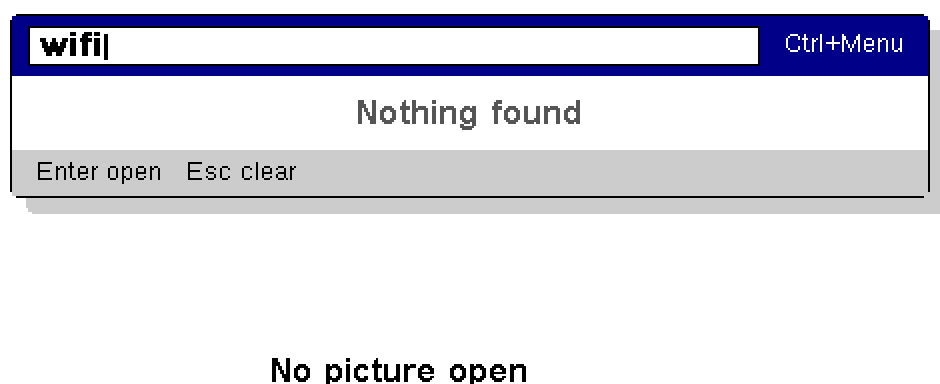 | 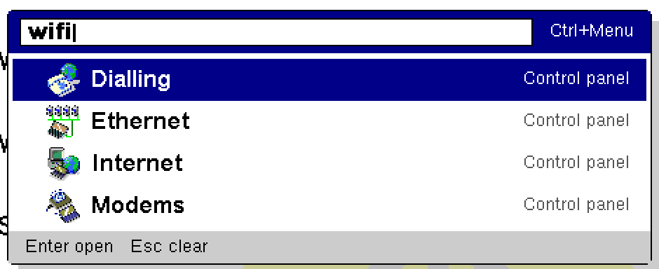 |

And a typing slip no longer means "Nothing found". If nothing matches what you typed, PsiHub tries one letter wrong, missing, extra or swapped.

| Before | Now |
|---|---|
| 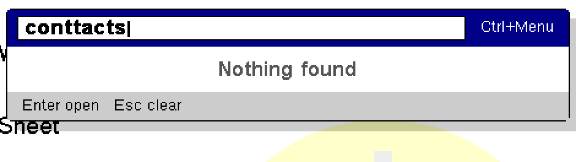 | 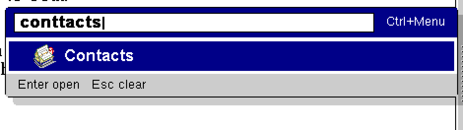 |

## The Control panel

The Control panel had 22 items in no particular order. Five of them were about getting online and they were spread across three columns. "Programs" sat next to "Applications", which sounds like the same thing and isn't. And "SerialBoost" was the only item named after a product.

Now the items go in columns by kind. After Psion's own, the connection items sit together next to Dialling, then the look of things, then programs. "Applications" (which programs the Extras bar shows) is called "Extras bar", which is what Psion called it on the Series 5mx. SerialBoost is now "Serial speed". Nothing was removed.

| Before | Now |
|---|---|
| 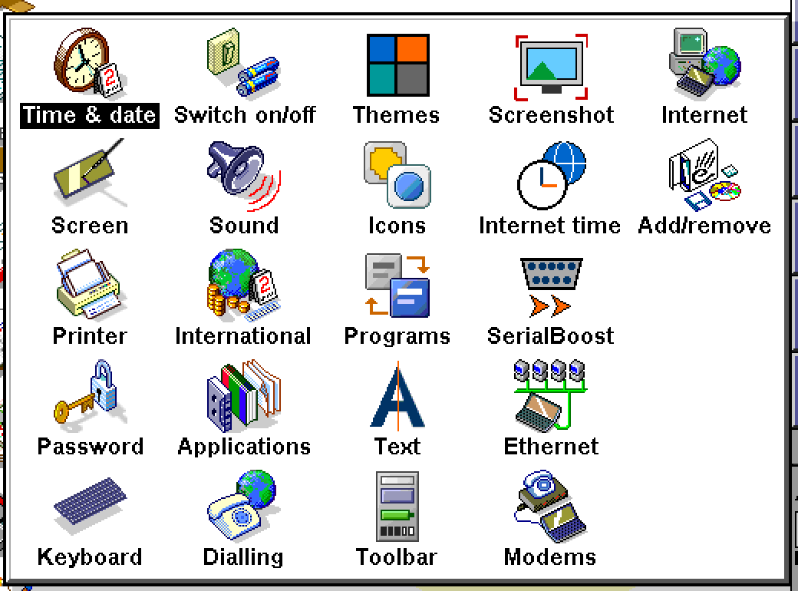 | 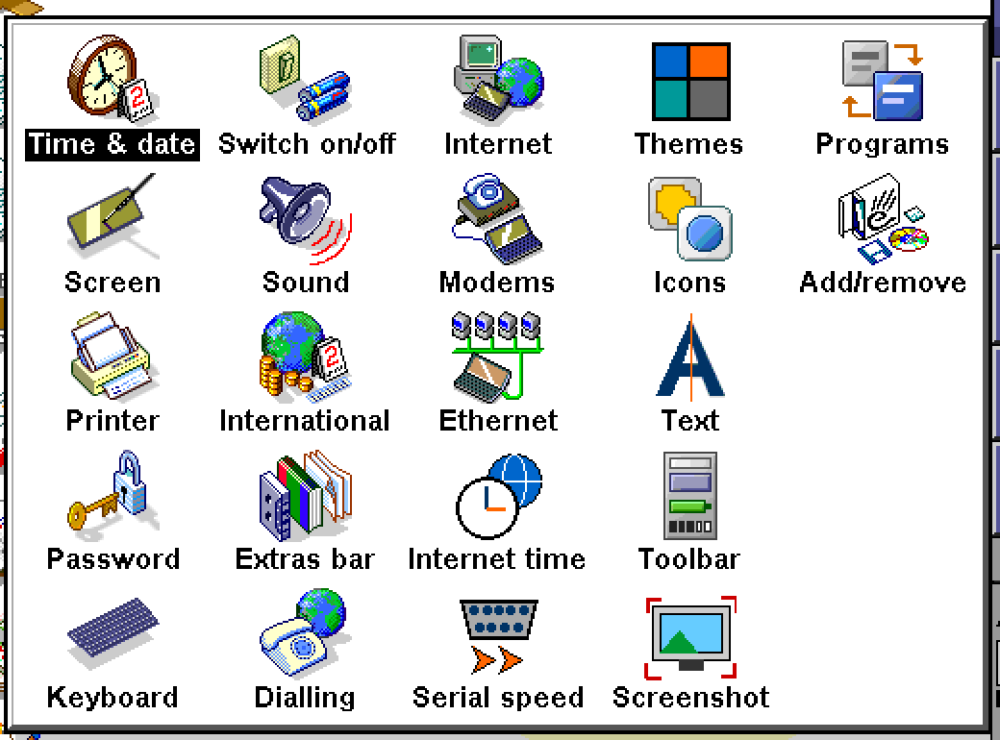 |

## A Welcome file

Psion's netBook came with a "Welcome to netBook" document. It went with the other sample files, and nothing replaced it. Now a short Welcome file appears in Documents on a new machine, made while Coda prepares itself. It covers PsiHub, the themes, the new programs, Linux and where to find help. It is a Word file, so delete it once you have read it.

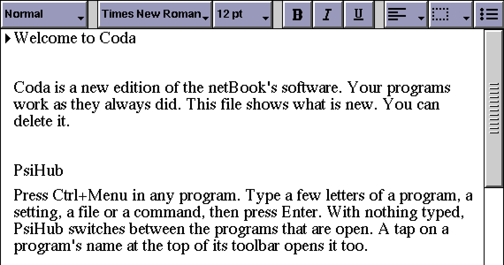

## Saving as you go

The netBook keeps your files in memory. A flat battery or a cold start loses whatever was not saved. Word and Sheet now save your changes every 5 minutes, the same way Ctrl+S does, with a small "Saved" in the corner. They don't save when nothing has changed, or while a menu or dialog is open. There is a tick box to turn it off in the Programs item of the Control panel.

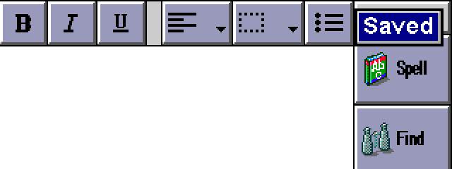

| Before | Now |
|---|---|
| 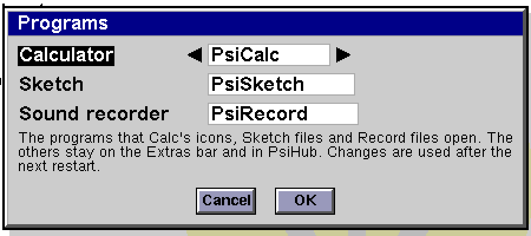 | 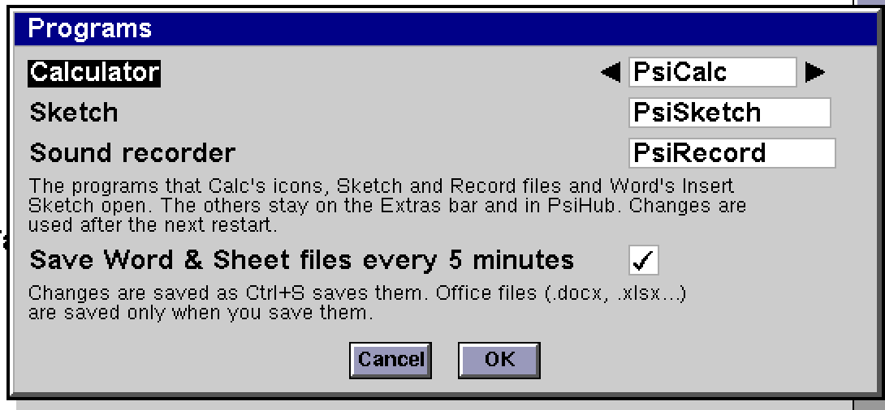 |

## PsiView's toolbar

"Previous" was cut to "Previou". The arrows now sit on narrower pictures, so the word fits.

| Before | Now |
|---|---|
| 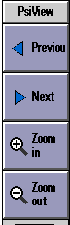 | 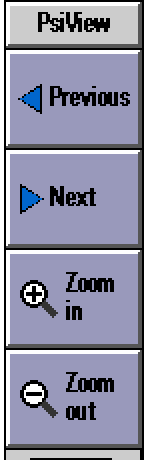 |
