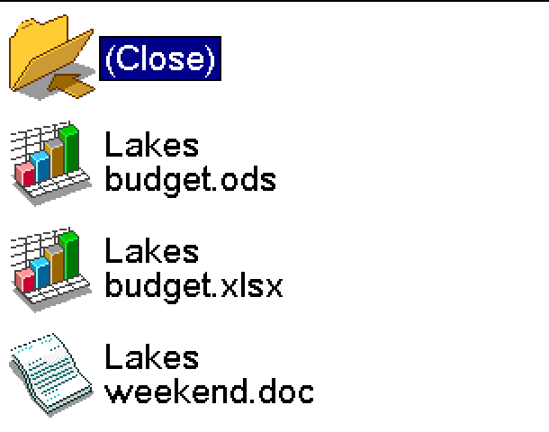
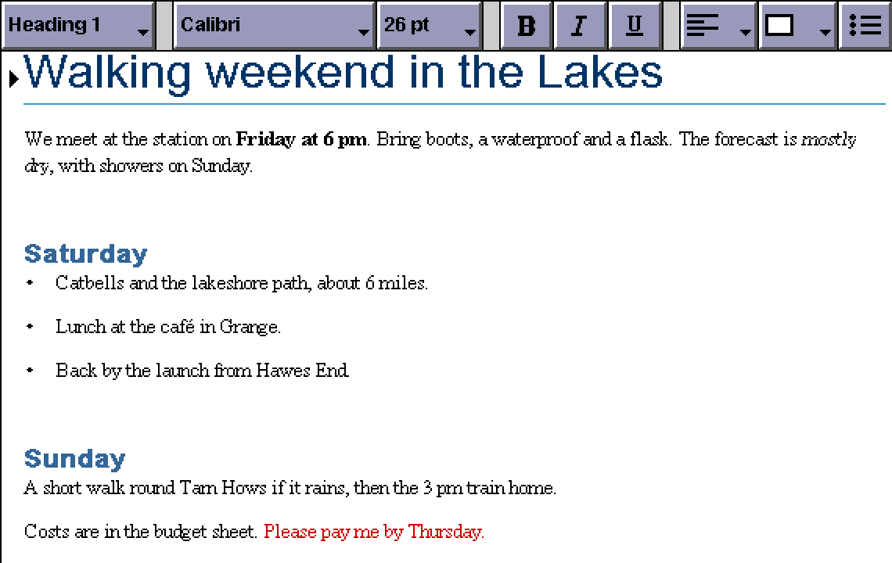
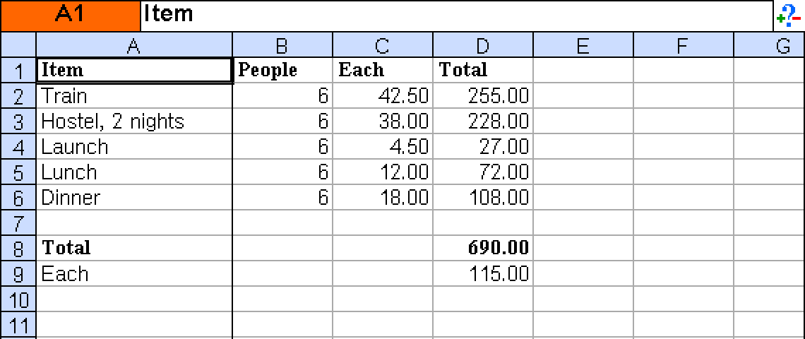
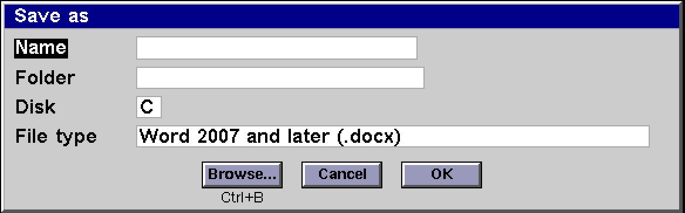
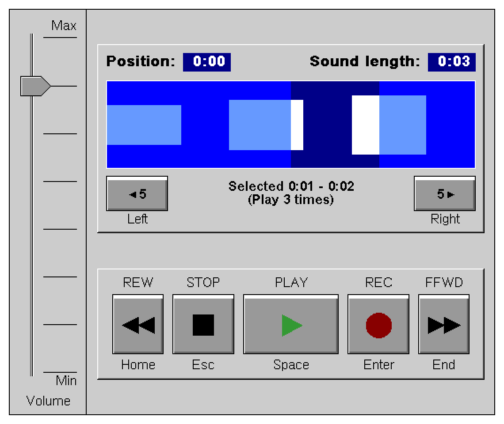
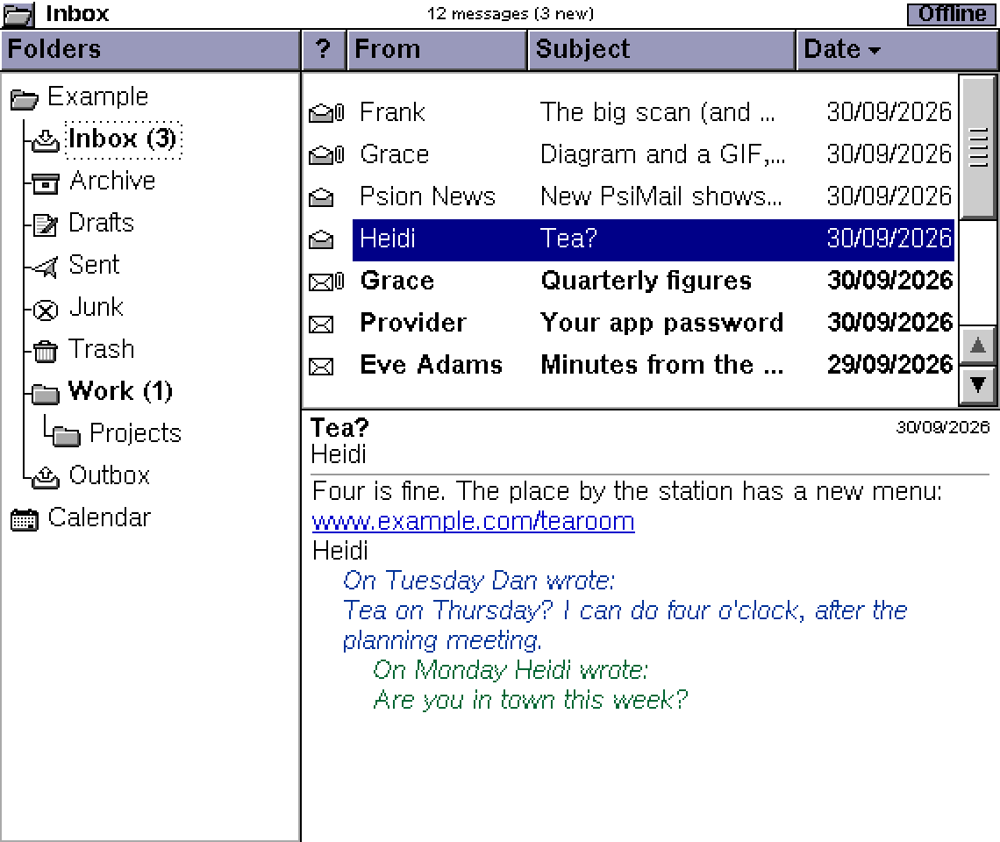

# Office files, the new Record, and PsiMail on the netBook

*16 November 2026.*

## Office files in Word and Sheet

Psion's Word read old Word files through a viewer that opened a copy, and Sheet read nothing from outside. Word and Sheet now open and save other people's files themselves, on the netBook, with no PC in between.

- Word: .docx, .doc, .rtf, .odt and .txt.
- Sheet: .xlsx, .xls, .ods and .csv.

On the System screen these files show Word's and Sheet's icons, and a tap opens them in Word or Sheet with their own names. Text keeps its fonts, sizes, bold, italic, colours, headings and lists. Sheets keep their numbers, formats and formulas.

Save as has a new line, File type. It starts at the file's own type, so Ctrl+S on a .docx saves a .docx, and you can pick any of the others, or Psion's own Word or Sheet file. Word's Export does the same.

Pictures in a .docx, .odt or .rtf come in as Sketch objects, the same as Word's Insert Sketch makes, so a tap opens them in Sketch. Saving puts them back as pictures in the file.

All of it is in the ROM: the converters, the file recogniser and a small hook that gives Word and Sheet the new types.

## The new Record

Record already had its panel enlarged to fill the screen. The new Record goes further. It's written afresh, with Record's panel, buttons, menus, keys and files, so Psion's Record and the new one open each other's files.

What it adds:
- the recording drawn as a waveform in the bar;
- a selection, to play, erase or crop to;
- skip back and forward 5 seconds with the arrow keys, 30 with Ctrl;
- a Recordings list (Ctrl+L), to open any of your recordings;
- WAV files in and out, under File > More.

It's what the Record icon opens and what Record files open in. Psion's Record is on the Extras bar as "Psion Record", and the Control panel's Programs item swaps the two.

## PsiMail on the netBook

PsiMail 0.96 knows it's on a taller colour screen. The list of messages has a preview of the chosen message under it, so you can read through the inbox without opening each one. It takes the system's colours, with links, quotes, flags and the calendar in colour, and compose and Help use the full height. On a Series 5mx nothing changes.

## PsiLinux

PsiLinux 0.33 reads the machine's name from EPOC for /proc/cpuinfo, so Linux tools show the netBook's StrongARM SA-1100.
