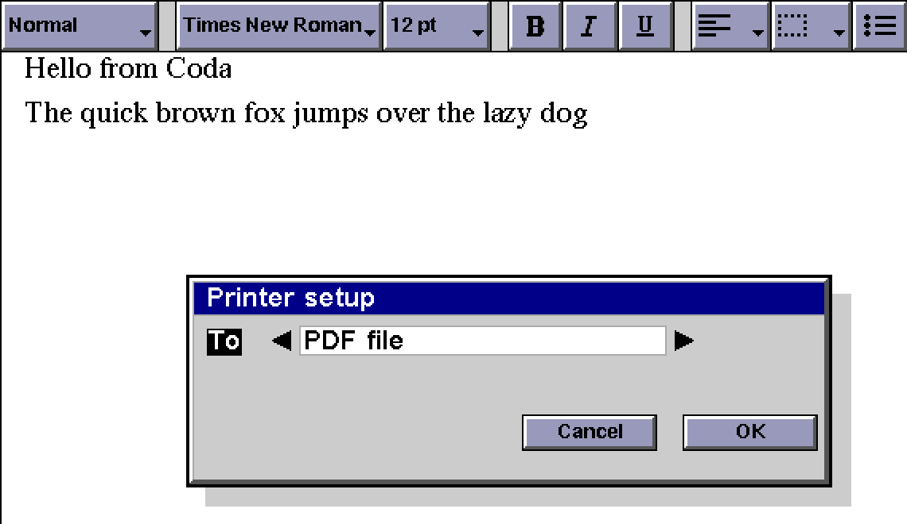
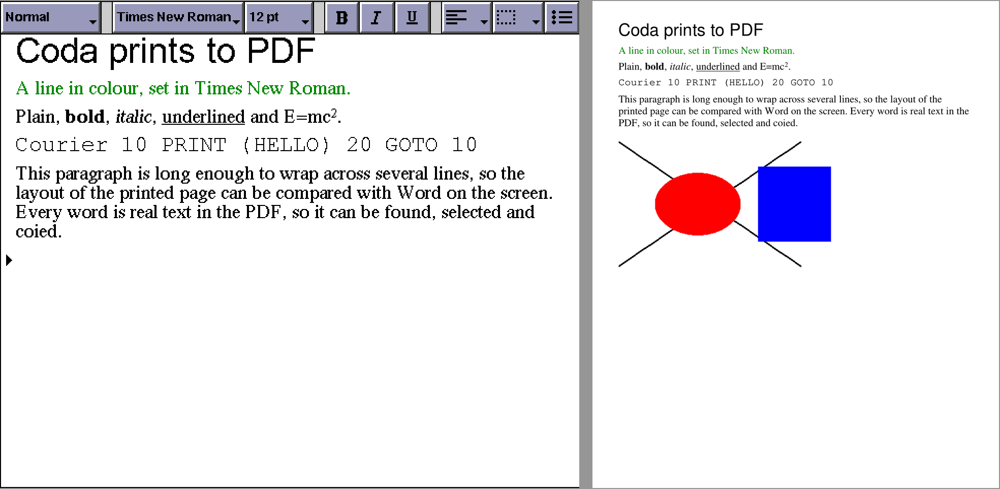

# Print to PDF

*16 November 2026.*

Every program on the netBook can print, and Print is on six toolbars. But the printers it knows are a Canon Bubblejet, an Epson, two HP LaserJets and "Printer via PC", all from 1999 and all wanting a cable. So the button has had nothing to do.

Now there's one more printer in the list: **PDF file**.

Pick it once in Print setup and print as usual. The PDF goes next to the document with the same name, so printing the Word file "Letter" gives "Letter.pdf" in the same folder, and the netBook says "Saved as PDF - Letter.pdf". Printing again replaces it. A document that lives somewhere you can't write to puts its PDF in Documents on the internal disk instead.

What goes into the PDF:

- **Text as text**, in PDF's own Times, Helvetica, Courier and Symbol, standing in for Times New Roman, Arial, Courier and Symbol. You can search it, select it and copy it. Bold, italic, underline, colours, sizes and superscripts all come through.
- **Lines and shapes** as lines and shapes, so they stay sharp at any zoom.
- **Pictures**, such as a Sketch inside a Word file, as images.
- The **page size and margins** from Page setup, A4 or Letter, one PDF page for each printed page.

The fonts the driver offers have the PDF fonts' exact widths, so Word lines things up for the PDF as it would for a real printer, and Print preview shows the same pages before you print.

I've tried it with Word, Sheet (with grid lines and labels), Agenda, Jotter and Sketch. It's a printer driver like Psion's own, so anything that prints should work the same way.

Not there yet: a choice of where the PDF goes and what it's called, and fonts beyond those four families (the rest are matched to the nearest one).
