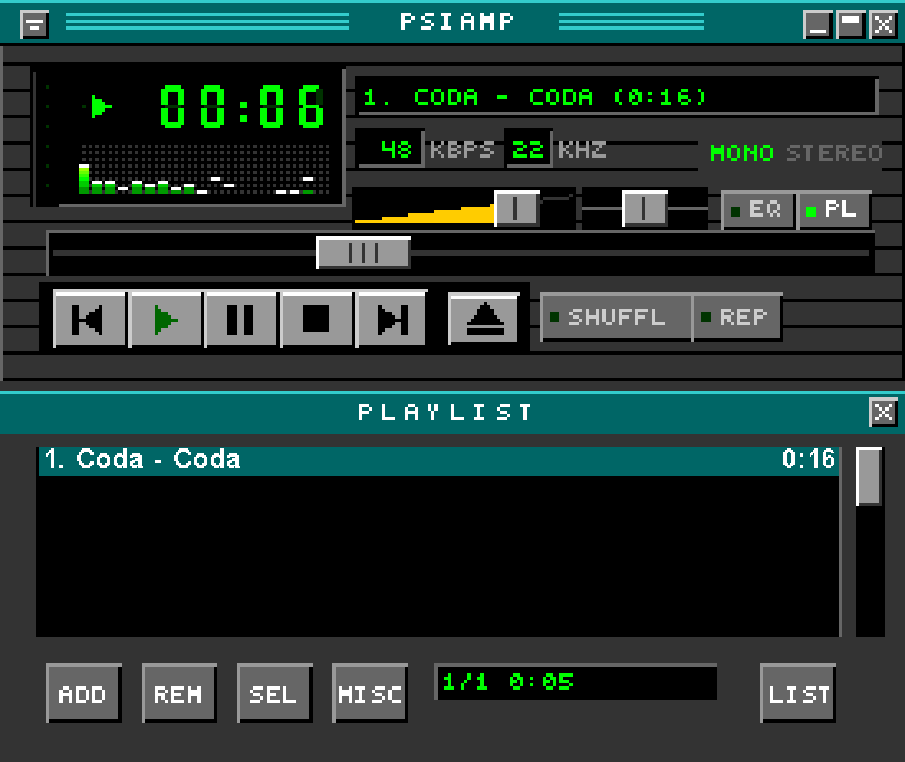
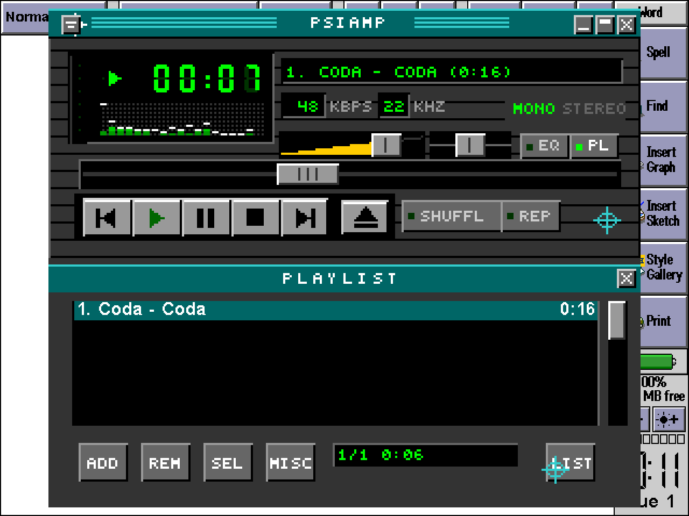
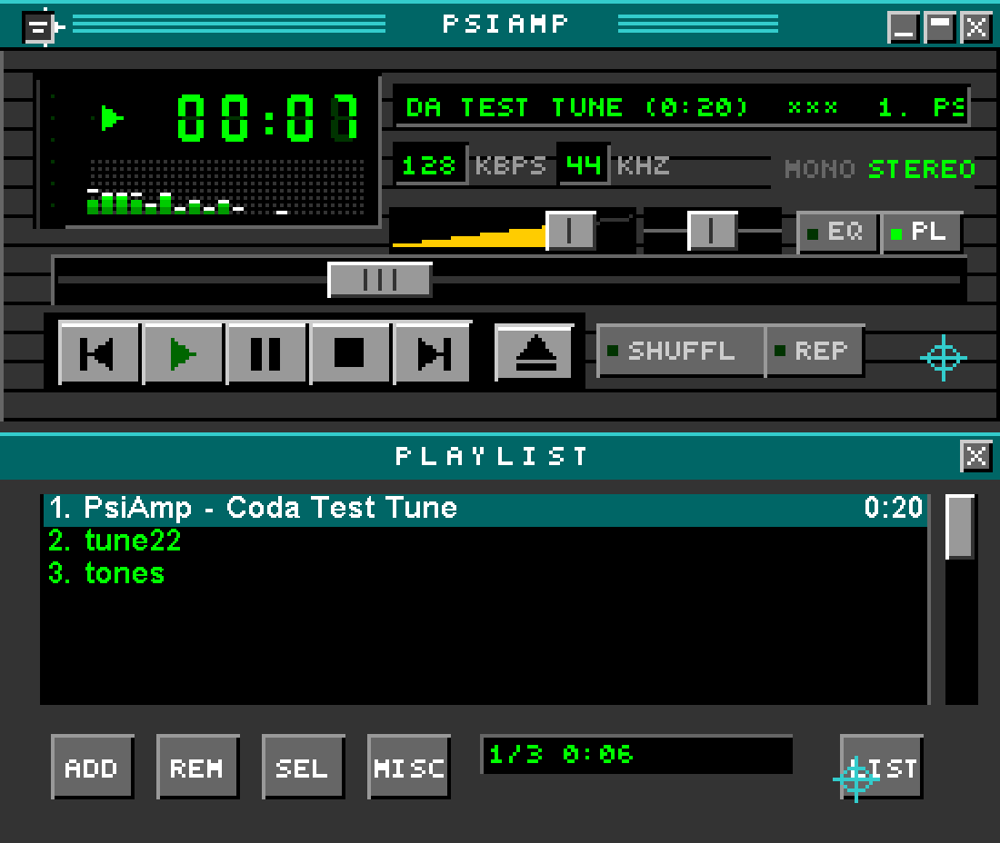
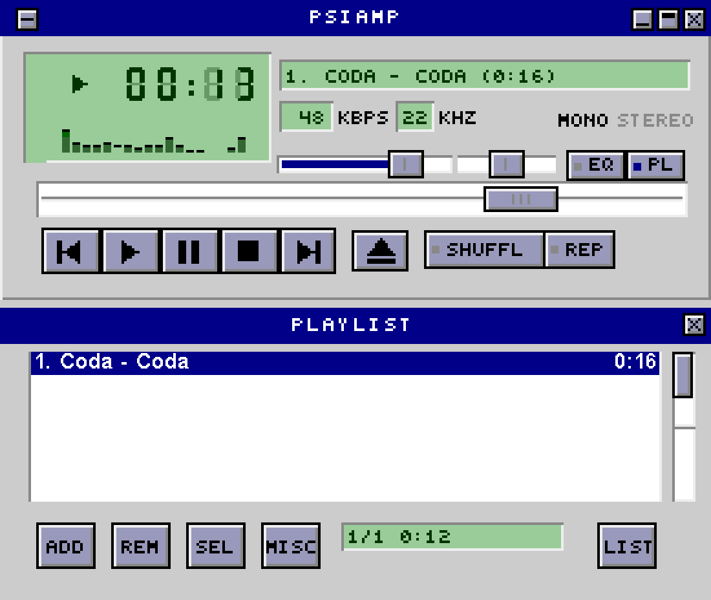
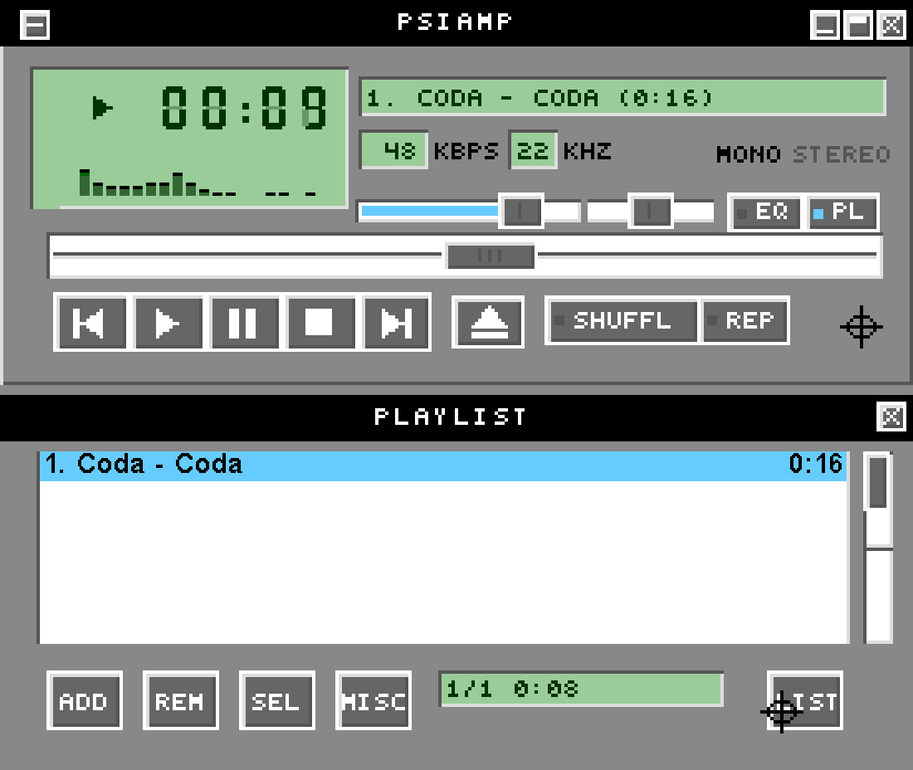
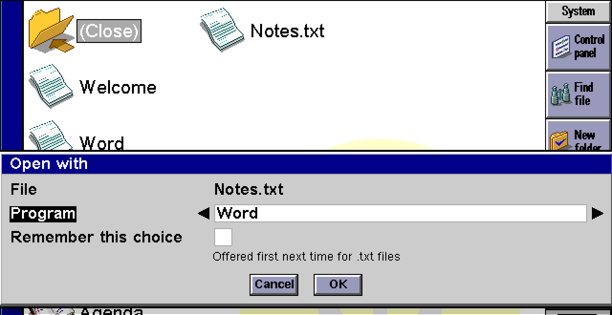
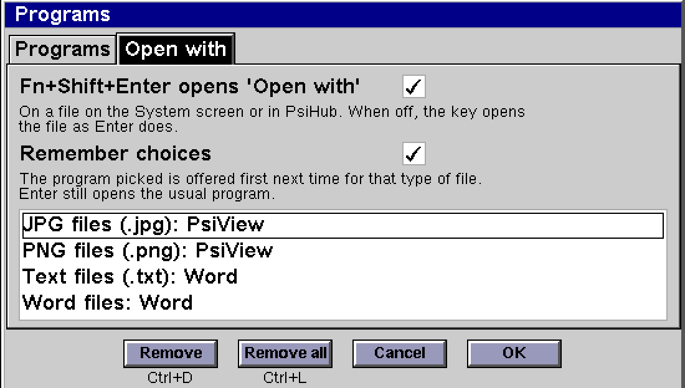
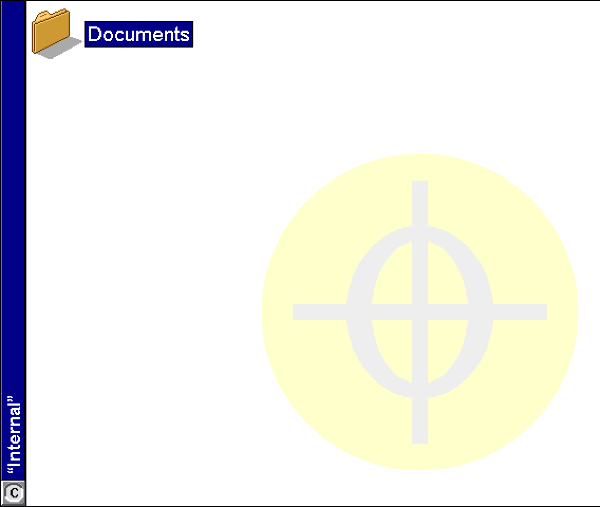
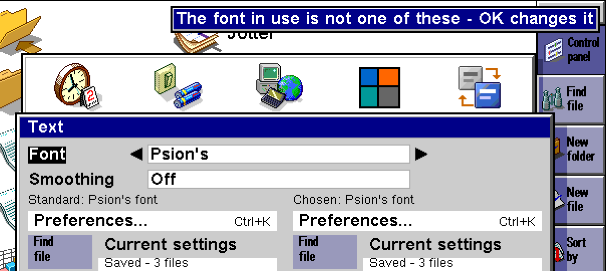

# PsiAmp, Open with and more

*16 November 2026.*

## PsiAmp

The netBook has a speaker and room for a lot of music on a card, but nothing to play an MP3. So now there's PsiAmp, a music player in the look of the classic skinned players: a small dark window with green LED digits, a scrolling title, a visualiser, a position bar and a volume slider, with the playlist under it.

It plays MP3 and WAV files. Tap one on the System screen and it opens in PsiAmp. File > Open folder takes a whole folder at once, and .m3u playlists open too. Shuffle and repeat are on the buttons, as you'd expect, and the keys are simple: Space plays and pauses, Z and B go back and on a track, Left and Right move through it.

PsiAmp floats over whatever you're doing, the way PsiHub does. Press Esc and it gets out of the way but keeps playing. From any program:

- **Ctrl+Fn+A** shows it or puts it away.
- **Ctrl+Fn+X** plays or pauses.
- **Ctrl+Fn+Z** and **Ctrl+Fn+B** go to the previous and next track.

A short note pops up to say what's playing. If you'd rather have those keys back, Tools > Preferences turns them off.

The first time it starts, the playlist holds one track, Coda, a short chiptune made for it.

### Skins

PsiAmp comes with two skins of its own. Coda is the dark one above. EPOC is drawn in the netBook's own style and takes its colours from the theme, so it's grey with navy titles on Coda and Classic, and dark on Dark.

| EPOC | EPOC on Dark |
|---|---|
|  |  |

It also reads classic .wsz skins. Put them in a Skins folder on the internal disk or the card and they're in View > Skin with the other two. K goes round them, and a .wsz tapped on the System screen is put straight on.

## Open with

Every file used to open in the program its type belongs to, and only that one. Now Fn+Shift+Enter on a file on the System screen asks which program to use, with the usual one chosen first. PsiHub has the same on a file it has found, as File > Open with. Tick "Remember this choice" and that program comes first next time for that type of file. Enter and a tap still open the usual program.

Control panel > Programs has an Open with page. It lists the programs remembered, such as "Text files (.txt): Word", with Remove and Remove all, and two tick boxes turn the key or the remembering off. Changes count straight away.

## Sketch's Fill button

Sketch's Fill tool has a button now, across the top of the strip under the toolbar. Tap it and Fill is the tool. It stays down until you pick another.

## Wallpaper in every folder

The System screen used to show the wallpaper only in Documents. Now it's there in every folder and on every disk. If you've chosen something else in Preferences > Wallpaper, that choice is kept.

## The font in use

Control panel > Text now shows the font the netBook is really using. If that font isn't one of Text's choices, Text says so, and OK puts the chosen one in place at the next restart.

Backups leave the system font out too. PsiBoot doesn't copy it into a backup or put it back in a restore, so after a restore the netBook starts in Psion's font and you choose another in Text as usual. A restore also keeps the new image's connection settings and copies your dial-up services, modems and locations into them.

## Dialogs

Every dialog Coda adds is now sized like Psion's own.
