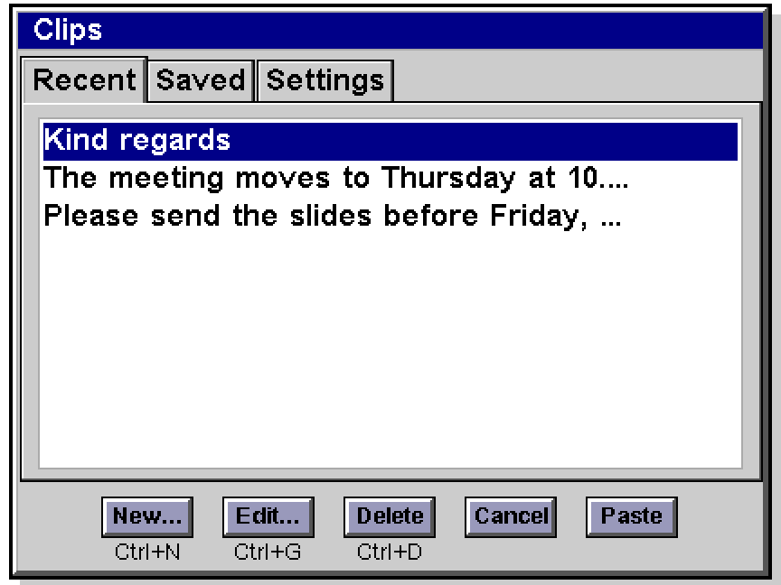
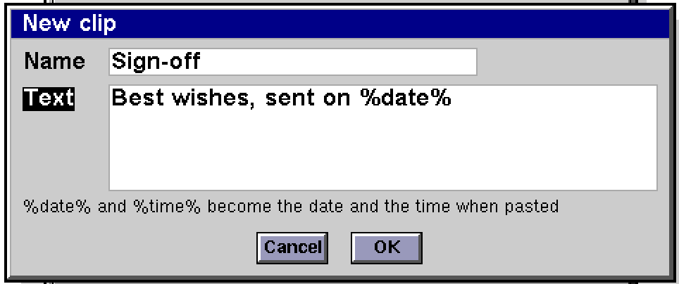
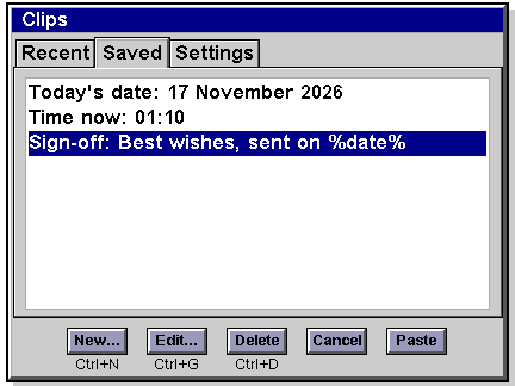
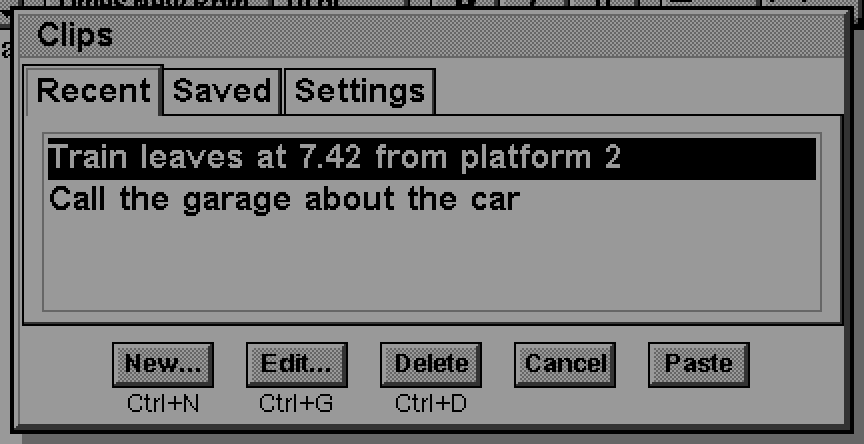

# Clips

*17 November 2026.*

## What the Psion crowd kept writing

I went back through the old Psion software archives to see which add-ons people loved most, and which of them Coda should simply have built in. One idea turned up again and again, from 1997 to 2001: somewhere to keep the bits of text you type over and over, and more than one thing on the clipboard. Henry Hirst's HotKeys had a glossary and a ClipBook. Pascal Nicolas' SwitchTask, later Macro5, pasted ready-made text with the date filled in. RMRAutoText, sold on as MagicKeys, collected and pasted several items and even came in a netBook version. ExtraBars had its ClipText shortcuts, and John McAleely's StationeryPad kept templates for any program. Five programs doing the same job, two of them shareware people paid for.

So Coda now has it built in, and it's called Clips.

## How it works

Copy text in any program as you always have. Clips keeps the last twenty things you copied.

Press **Ctrl+Fn+V** in any program and Clips opens over it. Recent shows what you've copied, newest first. Pick one and press Enter, and it goes straight into the program you were in, at the cursor.

Saved is for the text you type again and again: a sign off, an address, a standard reply. New... gives it a name and the text. Put %date% or %time% in it and they're filled in when you paste. Today's date and the time are always there at the top too.

It pastes the way you would, with the program's own Ctrl+V, so it works in Word, Jotter, Agenda, Contacts, Data and the boxes in dialogs, without changing any of them. Edit... on a recent copy keeps it among the saved ones. Settings turns the remembering off (and empties Recent) and says how many copies to keep.

It's on the Series 5mx too, the same program, laid out for the shorter screen.

The idea is theirs; Clips was written afresh from what their programs did. Thanks to all of them.
