# Files, clips, sharing and a smarter Agenda

*17 November 2026.*

A long night of work, and most of it is about the things you do every day: finding a file, passing it on, pasting the same line again, and knowing what's next in the diary. Here's the round up. Each change has its row, with more screenshots, in [STATUS.md](../STATUS.md).

## PsiFiles

Tab on the System screen opened a folder browser sized for the Series 5, with names cut short and nothing to do but make a folder. Ctrl+Q popped up a small list of disks.

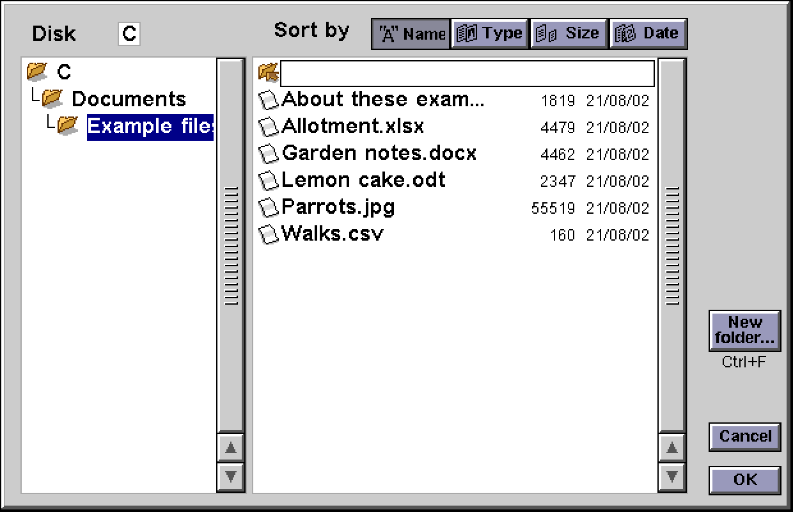

Both now open PsiFiles, Coda's own file manager. Tab opens it at the folder you are in, Ctrl+Q at a page of the disks with how full each is. On the left is a tree of every disk and the Trash. On the right are the files, with each program's icon, size, date and type.

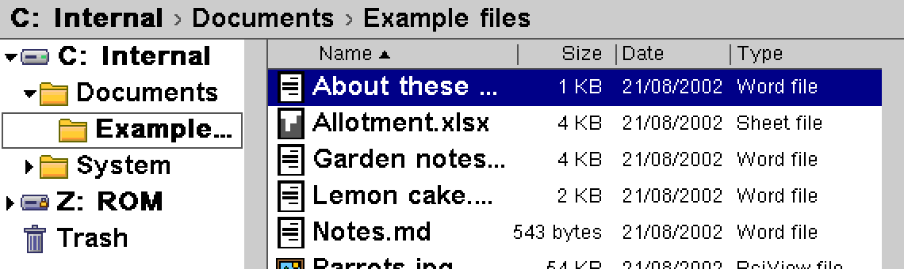

There are three views: Details, Compact and Pictures, which shows thumbnails. Space shows a preview of a picture or a text file. Cut, copy, paste, rename, Find, Properties and favourite folders are all there. Favourites sit at the top of the tree with a star.

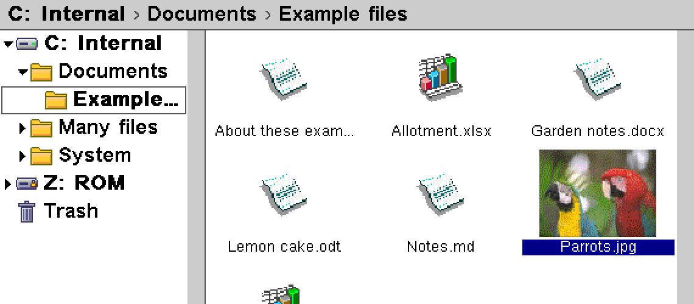

Copies are made with care. Each one is written under another name, read back and checked, and only then given its name. A full disk or a card pulled out never leaves half a file. A name that is already there asks what to do: Replace, Keep both or Skip.

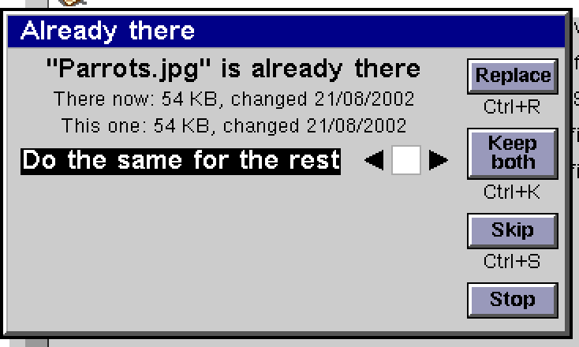

Delete goes to a Trash, and Ctrl+Z undoes the last rename, move, copy or delete. Several copies or moves queue up behind each other, with a line saying how far each has got. Drag the pen down the list to mark several files at once.

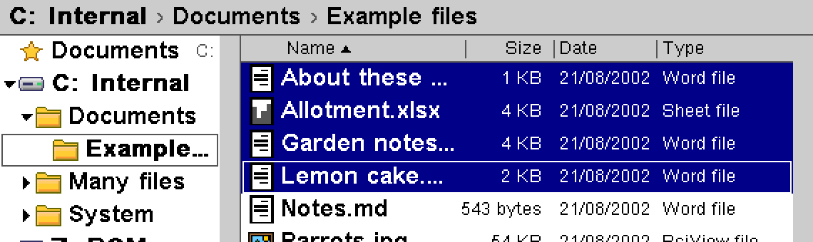

Prefer Psion's? Control panel > Programs has a Files page with a tick box for Tab and Ctrl+Q. PsiFiles is on the Series 5mx too, in greys, with thumbnails.

## Share

The Infrared icon down the left of the screen is now Share. Tap it and a small list offers what fits the file in front of you: Email (a new PsiMail message with the file attached), Save as PDF (beside the file), Copy to card (into a Shared folder) and Infrared, Psion's own as before.

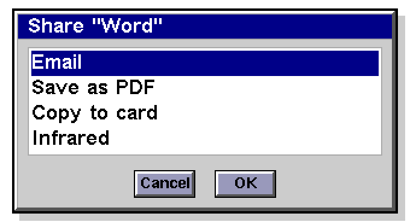

Nothing is ever replaced. A second PDF is "Word (2).pdf" and a second copy on the card is "Report (2)". In PsiFiles, File > Share... or the same icon sends the files you've chosen. Control panel > Programs > Share can make the icon go straight to one of the four.

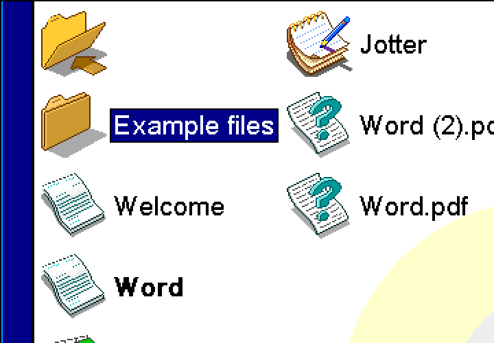

## Clips

Ctrl+Fn+V in any program opens Clips: the last things you copied, and texts you've saved to paste again. It has [a post of its own](2026-11-17-clips.md).

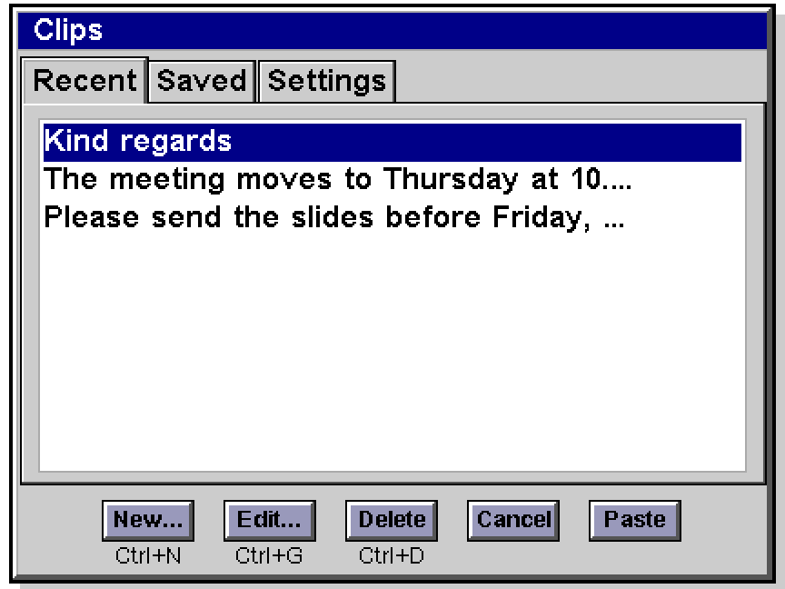

## Agenda

Agenda had a good night.

- **Quick add.** Ctrl+Y and type "lunch with Sam fri 1pm". Agenda makes the entry. Repeats, alarms and birthdays work too, and "#work" puts it in the Work calendar. [More](2026-11-16-agenda-quick-add.md)
- **Calendars.** Agenda's entry symbols can have names, so W is Work and H is Home, in Agenda's own colours. View > Calendars shown... hides one in every view, the Year planner too.
- **Entry details.** Edit > Entry details... shows an entry's place, calendar, time zone, attendees and your reply.
- **Time zones.** Give an entry a time zone and it shows at your time. It follows that place's own summer time and yours, so a call at 2pm New York on 20 March shows at 6pm in London.
- **Snooze.** Each press of Snooze puts an alarm off for longer: 5 minutes, 15 minutes, an hour, then a day.
- **Up next.** Open PsiHub with nothing typed and the last row is your next entry in the coming week.

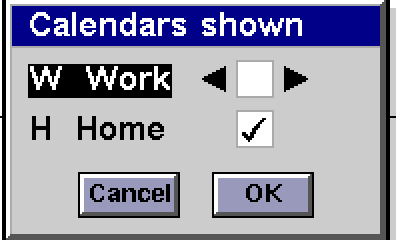

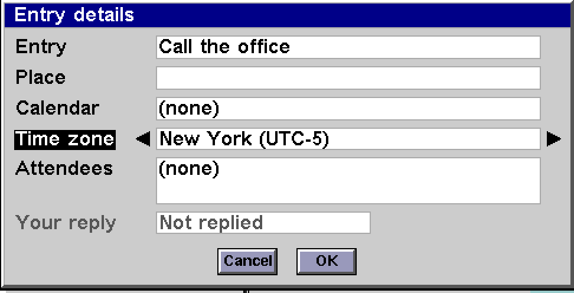

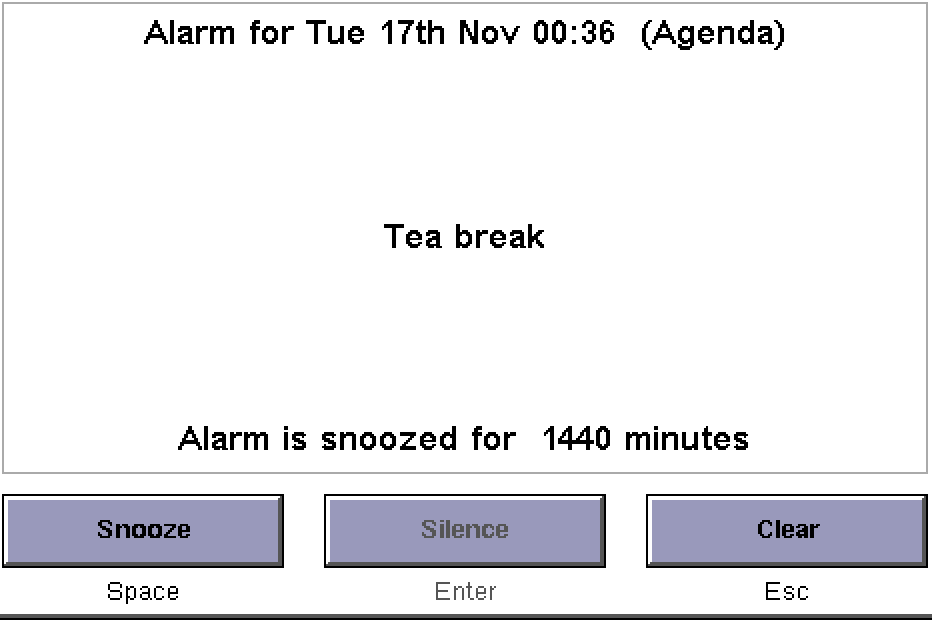

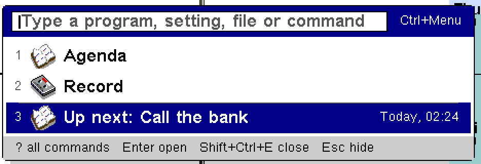

## Calendar and contacts sync

Sync, a new item in the Control panel, keeps Agenda in step with an online calendar and Contacts with an online address book (CalDAV and CardDAV, which most calendar services speak). It syncs at the times you set, when a connection comes up, or on Sync now. It never dials on its own unless you let it.

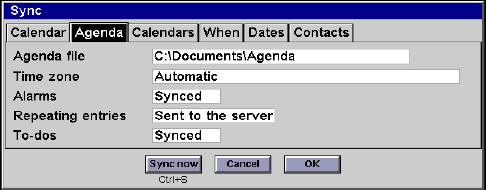

Changes made on both sides are both kept. Each calendar can be in Agenda or not. Its to-do lists come too, and birthdays from your contacts turn up in Agenda. Repeating entries go up as one series. An invitation keeps its guests: Entry details shows who has replied, and Your reply sends yours.

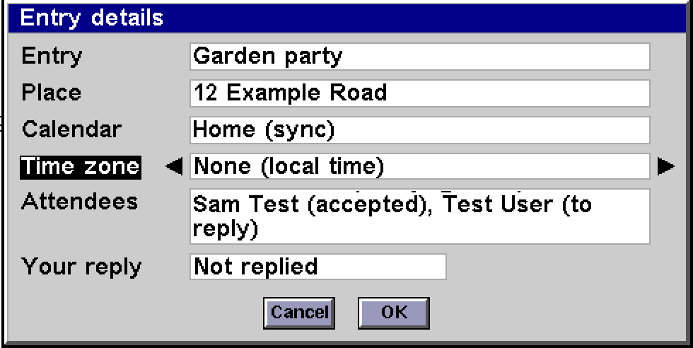

Type "sync" in PsiHub to sync straight away. A .vcf file tapped on the System screen goes into Contacts. Sync works on the Series 5mx too.

## Alarms

The idea comes from Alarm+ by Robin Hood (2002). An alarm used to ring until somebody cleared it. Time's Preferences now have two more pages beside Psion's own. On Ringing, an alarm can ring for a set time and stop, or snooze a few times and then stop. Ringing until cancelled is still the standard.

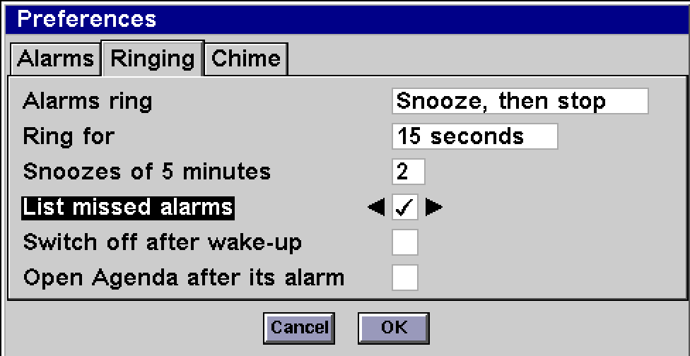

Alarms that stopped with nobody there are listed when you next switch on. The netBook can switch itself off again after an alarm woke it. Agenda can be opened after one of its alarms. The Chime page beeps every 15, 30 or 60 minutes, with quiet hours.

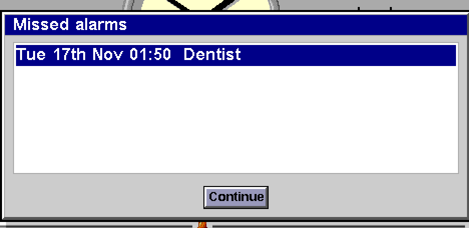

## The start-up list

Control panel > Start-up opens programs and files after every start, in your order, each in front or in the background. Hold Shift while the netBook starts to skip them once.

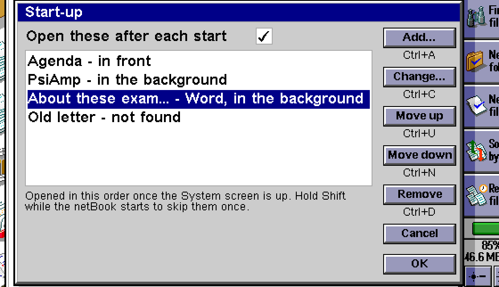

## PsiHub

- **Switching.** Hold Ctrl and press Menu again to step through the open programs (Shift+Menu goes back), then let go of Ctrl to switch, as Alt+Tab does on a PC. View > Switching preferences... leaves programs out by name or pattern.
- **Free memory.** Type "free": every program's unused heap memory is handed back to the system, and PsiHub says how much was freed ("Freed 116 KB - 48,760 KB free"). Nothing closes and nothing is lost.
- **Last restart and Recent files.** Type "last" to see why the netBook last restarted, or "recent" for the files your programs opened lately.
- **Paste.** Ctrl+V and the Clipboard icon paste into PsiHub's search box, and Control panel items opened from PsiHub now open the right one (Start-up had opened Programs).
- **Shortcut keys.** Ctrl+Fn and a letter starts a program from anywhere. Ctrl+Fn+A is PsiAmp's as standard.
- **Files found by several words**, in any order, from a list kept up to date in the background.

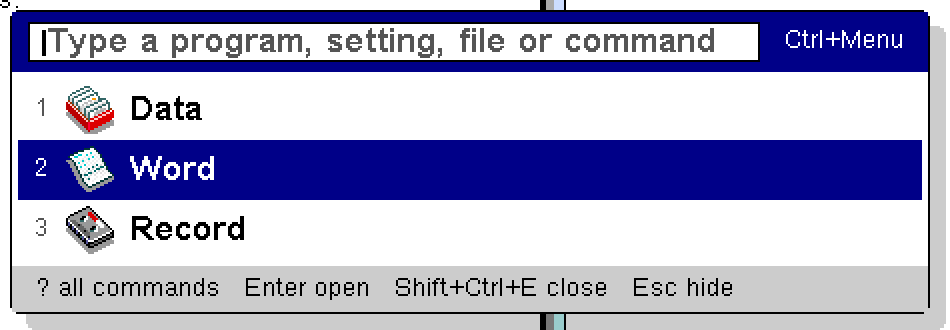

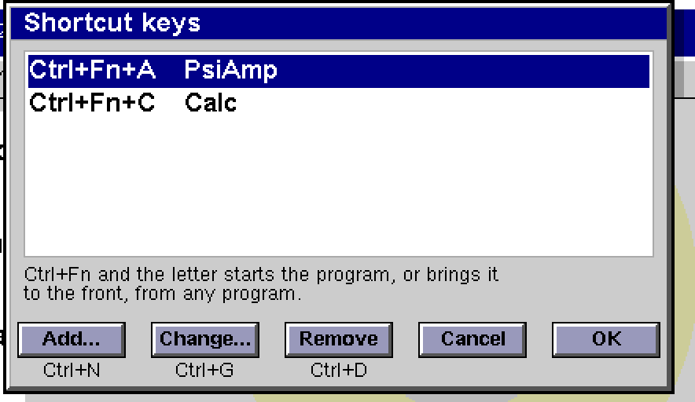

## A PDF viewer

Coda could print to PDF but not read one. PsiPDF, on the card, opens a PDF tapped on the System screen, fitted to the width of the screen. It zooms, fits the page, goes to a page, finds text and opens files with a password. The next page is ready before you get there.

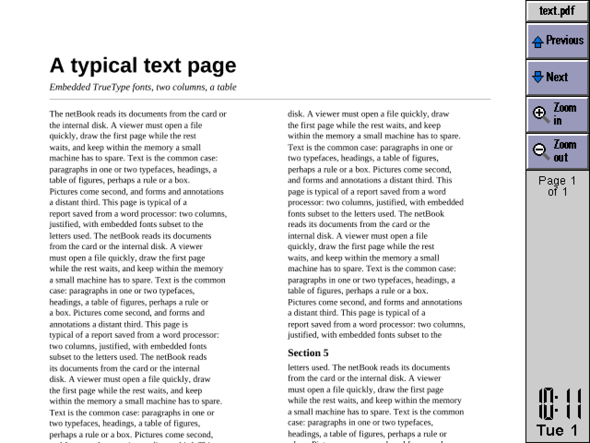

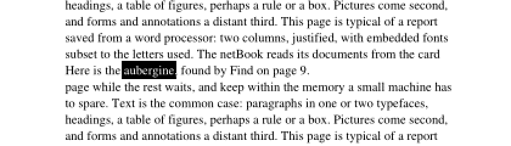

## And the rest

- **Time's cities.** 91 cities had the time zones of 1999. Moscow, Istanbul, São Paulo and Vancouver now show the right time, and Apia in Samoa is there.
- **The coda sign** on the wallpaper and the boot screens is a true circle now. It was an upright oval.
- **Calc's Clipboard and Zoom icons** work. PsiView zooms on the Zoom icons too.
- **Markdown in Word.** A .md file opens formatted and saves back as Markdown. Notes.md in Example files shows how.
- **Linux.** PsiLinux sees the Psion's disks under /psion, and its `epoc` command opens files in their programs, lists the tasks and uses the clipboard.

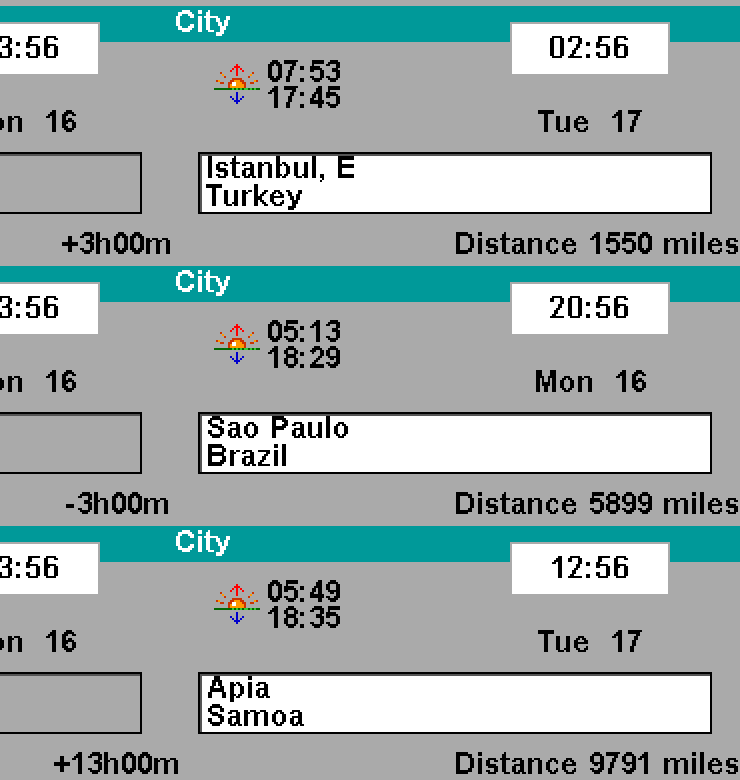

