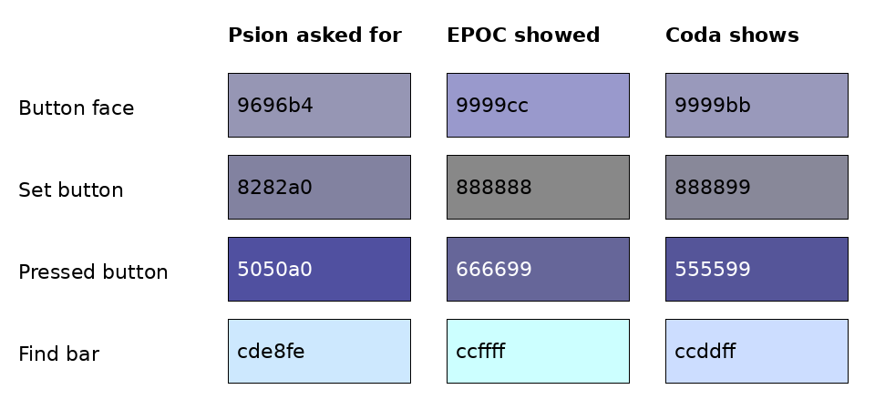
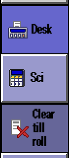
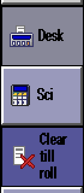
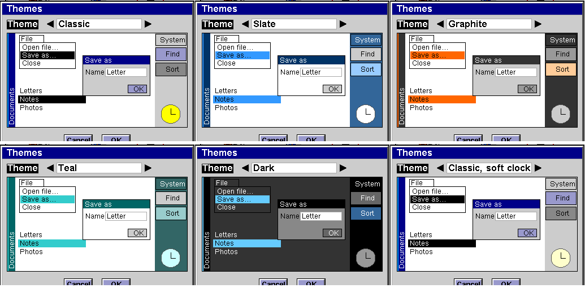

# How Coda is made

*17 November 2026.*

People have asked how any of this works, given there's no source code for the netBook's operating system. Here is the whole process, from Psion's own image to a card in the machine, and the setup I use to build and test it.

## Starting from Psion's image

The netBook doesn't keep its operating system in a chip. It loads it from the CF card at switch-on: a single file, OS.IMG, about 14 MB. Coda starts from Psion's last English release, v1.05(450), with the community c1.60a patch by Poke^Patisoners (2005), which already fixed a handful of Psion's own bugs: colour icons, the console's colours and so on.

That file is a ROM image: a tree of folders and files, laid out at fixed places in memory. The programs in it run straight from the ROM, where they sit, without being copied into RAM. That's what makes the job hard. Psion built each program to run at one exact address and kept no record of the addresses inside it, so normally nothing in the image can be moved.

<b>Technical detail: the image format</b>

- OS.IMG is a 256-byte "EPOCARM ROM" wrapper followed by the ROM itself. The wrapper records the ROM's size and its own length; the ROM header that follows gives the address the ROM is built to run at, its size (iRomSize) and a pointer to the root folder list.
- A folder is a length word followed by entries of { size, address, attributes, name length, 8-bit name }, each padded to 4 bytes. The length word counts the entries only, not itself: the kernel walks from just after it, and getting that wrong is an instant data abort at boot. The file server searches entries in order, so they don't need sorting.
- Nothing checks the header's checksum. The community images change content and leave it alone, and so does Coda.
- Programs in the ROM are "execute in place": their code runs from the ROM's own address, and there is no relocation table, which is why nothing stock can move.
- The c1.60a patch fixes are made in place inside Psion's files, so the layout of the image is unchanged from Psion's 450 build.

Tools: **romlib** reads and writes the whole ROM tree, and converts programs to execute-in-place images as it places them; **rom8** lists, extracts and replaces single files, and is the everyday tool for looking inside an image.

## Taking things out

The first step is making room. Opera and Java came out (nearly 5 MB between them, and PsiWeb and PsiLinux do their jobs better now), along with Psion's old Email program, the plain FTP program, the old Comms terminal, the fax programs, which crashed without Email anyway, and a few viewers Word no longer needs.

Each removal is checked first. The build tool looks at what every remaining program imports and refuses to take out anything still in use, naming the program that needs it. Messaging stays, for example, because Contacts' "Send" uses it even with Email gone.

<b>Technical detail: checked removals</b>

- Every EPOC program and DLL carries a DLL reference table: the libraries it imports and the ordinals it uses from each. Before anything is removed, the tool compares every staying program's table with the entry points and tables of everything going. If a staying program would lose an import, the build stops and names it.
- What went, roughly: Opera and its engine (2.3 MB), Java with its recognisers (2.6 MB), the Email program (134 KB; the messaging engine underneath stays for SMS and Send), FTP (144 KB), Comms (57 KB), Psion's example files (272 KB, replaced by Coda's own), the fax programs (240 KB), the wireless-card status program, and the .doc and .txt viewers (28 KB) now that Word opens those files itself.
- A path that isn't in a given base is skipped, so the same removal list works on other v1.05 builds.

## Putting things in

The build tool reads the image's tree, takes things out, adds Coda's programs, pictures and settings, then writes the tree back. It keeps a few strict rules:

- **Psion's files stay exactly where they are.** Nothing Psion built is moved, so nothing breaks.
- **New files go in the gaps,** biggest first, each into the smallest gap it fits. A program has to be in one piece, and PsiWeb alone is 2 MB.
- **The folder lists are written fresh,** pointing at the new files, while the original lists the system still points into are left alone.
- **Nothing may overlap.** If any two files would share a byte, the build stops.

If it all doesn't fit, it drops the least important extras in a set order (spare wallpapers first, then extra typefaces) and tries again, and says what it left out.

<b>Technical detail: how the image is written</b>

- Files that stay are never moved. Files replaced by something the same size or smaller are written in place and keep their address, so anything pointing at them still works.
- Space freed by removals, and the space between the end of the image and iRomSize, becomes a list of free areas. Neighbouring areas separated only by alignment padding are merged (Opera's and Java's 4.7 MB become one run).
- New files are placed biggest first, best fit, because each ROM program must be one contiguous block.
- Every folder is written afresh into free space and the root list repointed. The original folder blocks are never overwritten, because the kernel keeps pointers into them from the ROM header.
- Before writing, every file's byte range is checked against every other; any overlap refuses the image.
- When there isn't room the build drops extras in a fixed order: spare wallpapers (about 250 KB each), then extra typefaces, then font choices, then the smooth-text styles, and tries again, printing a note for each.

Tools: **mkimage** runs the whole build: removals, resource edits, pictures, the theme, Coda's programs from their installers, the hooks, the write, then the patches. Every step prints a note, so the build log is a full list of what changed. **cardkit** assembles the card folder: the image, the bootloader picture, installers, the card-resident programs and Psion's original image beside them. **branding** makes the 640 x 540 bootloader picture, including the strip the bootloader draws its "Loading" bar from.

Coda's programs are mostly built to run from the ROM too, so they take no RAM for their code. The bigger ones (PsiLinux, PsiPDF and others) live on the card instead and are installed or run from there.

## Room and memory

The ROM's size decides how much RAM you get: whatever the ROM doesn't use of the memory bank it's loaded into is RAM, in whole megabytes. On a 32 MB netBook a 14 MB ROM leaves about 18 MB. So freeing space inside the ROM gives Coda room for programs; it only gives you more RAM once the ROM's end drops past a megabyte boundary.

There's a way to go further. Psion released the same v1.05 software in several languages, and the same program sits at a different address in each. Comparing two builds word by word shows which words are addresses: a word that differs between them, and points to the same place in each, is an address. With five builds as witnesses that recovers the missing records for most of the image. Rebuilding a program at another build's address with them gives exactly Psion's bytes, every time (607 out of 607). It turns out someone did the same on the Series 5mx about twenty years ago. It works on the emulator as a prototype; it isn't in Coda's images yet.

<b>Technical detail: ROM size, RAM and moving Psion's code</b>

- The kernel reads iRomSize from the ROM header alone and rounds it up to the next megabyte, because the ROM is mapped in 1 MB sections. The rest of that 16 MB memory bank becomes RAM. The wrapper's size field isn't used for this.
- iRomSize still has to cover every file: with the header saying 12.5 MB and files reaching 13 MB, the System screen lost its icons, because the file server uses the unrounded value as the end of the ROM drive.
- In the emulator a 14 MB ROM against a 16 MB one changed total memory from 50 MB to 48 MB. On a real 32 MB netBook, 14 MB should leave 18 MB of RAM; that figure is worked out, not yet measured.
- **Recovering the addresses.** The v1.05 builds for the UK, US, France, Germany, Spain and the MalayBook are six witnesses. Compare one file across two builds: a word that is identical isn't an address (or points at something that didn't move); a word that differs must point into the same file at the same offset in both builds, or it isn't an address at all. Add what each file's own structure gives anyway (header fields, import table, DLL reference table, export directory) and you have its relocations.
- Results: 222 ROM programs in the 450 build, 331,178 address words found. Recover from some builds, rebuild at the address a held-out build used, and compare: 607 of 607 rebuilds byte-identical to Psion's. The 92 lowest files (the kernel side, the file server, the drivers, Eikon) sit at the same address in all five 45x builds, so there is only one witness for them; they are left where they are, and nothing needs them moved.
- Traps the tool handles: text that happens to look like an address (the four letters "DHCP" in one network driver, for instance; 91 such words in all), the import table's length, which isn't in any header, pointers to a file's very end, and files that are a different version in one build.
- A third-party Series 5mx Pro image in the community collection, 11 MB where Psion's are 16 MB, turns out to have been laid out afresh the same way; predicting it from Psion's own five 5mx builds gives 193 of 194 files byte-identical. So it was done on real machines around 2004.
- **Moving files down.** The prototype packs a base image: it removes Opera, Java, FTP and the wireless status program, then moves everything above 9.5 MB down (186 data files and 23 programs, 13,332 address words rewritten). It refuses to move any program that two builds haven't moved, any whose rebuilds aren't all identical, and any Coda has patched. Then it checks every word of the finished ROM: anything still pointing into a moved file's old place stops it. The count is zero.

Tools: **relocdiff** recovers relocations from the witness builds; **rebase** moves programs and rewrites their addresses; **shrink-check** boots an original and a packed image through the same scripted sessions in the emulator and compares the screens pixel for pixel.

## Changing Psion's programs without their source

There's no source code for Word, the System screen or the rest, so they're changed in four ways, from gentlest to deepest:

1. **Resources.** Menus, dialogs, texts and lists live in resource files, which can be edited and put back. The System screen's start list, the silkscreen icons and many of Coda's texts are done this way.
2. **Pictures and colours.** Icons, wallpapers and the colour schemes are just files in the image, replaced with new ones.
3. **Small byte changes.** Where a program does one wrong thing, the one instruction that does it is changed. Every change finds its target by its content, not by a fixed address, so it can't land in the wrong place.
4. **Hooks.** To add behaviour, one instruction in Psion's code becomes a jump to a tiny piece of code of ours. It does what the replaced instruction did, calls one of Coda's libraries, then carries on where it left off. That's how the toolbar gets its widgets and clock faces, how text gets smoothed, how themes are applied, and how Ctrl+Menu opens PsiHub. Each hook passes on anything it doesn't handle, so Psion's own behaviour is unchanged.

<b>Technical detail: resources, patches and hooks</b>

- **Resources** are compiled .RSC files: arrays of records for menus, dialogs, texts and lists. The tools decode them, change or add records, and write them back. The System screen's two UID lists (the silkscreen icons and the start list) and the Eikon colour list behind the themes are edited this way.
- **Byte patches** run after the image is written, because only then are the final addresses of Coda's own files known. Each one locates its target by searching for the surrounding instruction bytes, and refuses to apply if the bytes aren't exactly as expected. Stock code never moves, so a patch found once is found the same way on every build of that base.
- **Hooks**: one instruction in Psion's code becomes a branch to a small stub stored as a file in the ROM. The stub saves the registers it needs, does what the replaced instruction did, calls an exported function in one of Coda's DLLs (also in the ROM), and returns to the instruction after the branch. The stubs are a few dozen to a couple of hundred bytes of ARMv4 assembly; their address words are filled in after the image is written.
- Examples:
  - **the toolbar:** Eikon's control factory, CreateByTypeL. Its "any other type" path now hands Coda's two new control types to Coda's toolbar library, and every other type goes on exactly as before. That's where the widgets and the clock faces come from.
  - **smooth text:** the graphics library's text drawing, at the call that draws each character. Coda's font library draws what it handles; everything else is drawn by EPOC as before.
  - **themes:** where Eikon stores its colour list at start-up. Coda overlays the chosen theme from a settings file.
  - **PsiHub:** Eikon's task list call, so Ctrl+Menu opens PsiHub when it's running, and the stock task list when it isn't.
  - **Open with:** the System screen's open-file function, after the full filename is built.
- **Keys:** Coda only ever takes Ctrl+Fn+letter and Ctrl+Menu globally. New Ctrl keys in Psion's programs are only given letters the program's own hotkey table leaves free, checked when the image is built.

Tools: **keytest** generates a standard block of keys and taps (cut, copy and paste between programs, undo, find, zoom, the Command icons and so on), runs it against Psion's image and Coda's in the emulator, and puts the results side by side. Anything that differs is either by design, and written down, or a bug. **sheetmenus** checks a program's hotkey table for free letters before a new shortcut is added.

Every key and Command icon is checked afterwards against Psion's own image with the same script, so the shortcuts you know keep working.

<b>Worked example: Word and Sheet opening and saving Office files</b>

The aim was for Word and Sheet to open and save .docx, .doc, .rtf, .odt and .txt, and .xlsx, .xls, .ods and .csv, as if Psion had built it in: tap a file on the System screen and it opens, Save writes the same file back in its own format, and Save as offers a File type. All without the source of Word or Sheet.

**What was already there.** EPOC has a converter architecture (CONARC): converter libraries in `\System\Convert\`, each described by a small file listing which formats it converts between. Agenda and Contacts use it for vCard and vCalendar. Word and Sheet don't. Psion's netBook also had separate .doc and .txt viewers that made a throwaway copy you could never save back.

**Four new pieces, all in the ROM:**

1. **The converters.** A converter library in CONARC's own place and format: 18 converters, each Office format to and from Word's or Sheet's own. Underneath is a plain C++ engine with a document model (paragraphs, runs, styles, lists, tables, pictures, page setup) and a workbook model (cells, formulas in Excel's syntax, number formats, fonts, column widths, several sheets), with a reader and writer for every format: ZIP and a streaming XML reader for the 2007 formats and OpenDocument, OLE2 compound files for the 97-2003 ones. The same engine builds on Linux, so every format is tested on the host with round trips and random documents before it goes near the Psion. About 370 KB.
2. **A recogniser**, so the System screen knows a .docx is a Word file: it checks the file's signature (a ZIP holding `word/` or `xl/`, an OLE2 file with a WordDocument or Workbook stream, `{\rtf`, or the name for .txt and .csv). Word's and Sheet's own program information files are given those types, so the files show Word's and Sheet's icons and open in them.
3. **A hook library in Word's and Sheet's import tables.** Every EPOC program calls the user-interface library through an import table, one slot per function. The build finds the slots in Word.app and Sheet.app that point at a handful of Eikon functions, checks each one holds exactly what's expected, and points it at Coda's version instead. Each of Coda's versions calls the real one, then adds its part:
   - **Opening a file** (`ProcessCommandParametersL`, and `ProcessMessageL` for switching files): a foreign file is converted to a Word or Sheet file in a temporary folder and that is opened, then the document's file name is set back to the original, so the title bar, Save and Save as all act on Report.docx.
   - **Save** (`CEikDocument::SaveL`): Psion's own save runs first; if the document's name is a foreign type, the document is converted to it and written beside the original, swapped in only when it's complete, so a failure never leaves a half-written file.
   - **Save as**: the dialog gets a "File type" line inserted, and choosing a type sets the name's ending.
   - **Word's Import text file**: a foreign file comes in with its formatting.
4. **Templates.** A Sheet engine made from nothing has a grid Sheet can't draw and a print setup it crashes on, so each new Sheet file is made from Psion's own sample spreadsheet, emptied and refilled.

**What it keeps.** In Word: text, character and paragraph formatting, styles by name, bullets, page size, margins, headers and footers. Tables become tabbed rows, because EPOC Word has no tables. Pictures become Sketch objects inside the document, as Insert Sketch makes, and go back out as PNGs when saving. In Sheet: values, formulas (functions translated both ways; a formula Sheet can't compute keeps its last value), number formats, fonts, alignment, column widths, several sheets with their names. An infoprint after opening says what was left out.

**Things found on the way:** Psion's .doc viewer's recogniser grabbed .doc files before Coda's, so the viewers came out once Coda's converters could open those formats. The File type list first made Save as 640 px wide, because a choice list's width follows its longest name, so its width is now fixed and the names shortened to fit, keeping the dialog Psion's size. Every hook slot is checked before it's changed, and the step is left out with a note if anything isn't as expected, so a different base image can't be damaged.

<b>Worked example: a new Data menu in Sheet</b>

Sheet keeps several worksheets in its engine but gives you no way to see another one, and has no fill, filter or summary. Coda adds a Data menu.

1. **The menu is a resource change.** Sheet's menus live in Sheet.rsc. The build tool finds Sheet's menu bar through its EIK_APP_INFO record, adds two new resources at the end of the file (the Data menu and its Worksheet cascade), rewrites the menu bar's titles to put Data before Tools, as the EIKON style guide orders menus, and adds the new shortcut keys to the hotkey table, only on letters Sheet leaves free. Fill down, Fill right, Fill series..., Filter..., Show all rows, Summarise..., and Worksheet > Switch, Create new, Rename and Delete.
2. **The commands need a home.** A menu command goes to the program's ProcessCommandL. Sheet doesn't override that one; it calls Eikon's through its import table. So the same hook library takes that slot, passes every one of Sheet's own commands straight on, and runs only the new ones itself.
3. **Reaching Sheet's insides.** The new commands need Sheet's spreadsheet engine and its grid, which Sheet creates and keeps to itself. The hook watches for them instead: Sheet calls the engine and grid libraries through more import slots (creating the engine, restoring a file, drawing the grid), and the hook notes each object as it goes past. The grid's private members are reached by compiling its public header with its private section opened, in that one file only.
4. **The details that bit.** Each worksheet in Sheet's engine has its own layout, so a newly shown worksheet has to be given Sheet's zoom, or its rows draw five times too tall. Switching back drew column A twice until the grid's area was set in the right order. A descriptor taken past its end closed Sheet at the end of a switch. Filter hides rows by giving them a height of zero, which Sheet already saves in its file, just as Excel saves hidden rows. SUMIF and COUNTIF, which Sheet's engine lacks, become a sum of IFs over up to 16 cells, the longest formula Sheet allows.

It was tested in the emulator with keys and taps, then checked with the same key script against Psion's Sheet to be sure nothing Sheet already did had changed.

## Every kind of change

Changing Psion's programs is only part of it. Here is every kind of change Coda makes, from the gentlest to the deepest:

| Kind | Example | Done |
|---|---|---|
| Removing files | Opera, Java, Email, fax | at build, checked against every import |
| New files and programs | PsiHub, PsiFiles, PsiCalc | at build, converted to run from the ROM |
| Plug-ins EPOC already looks for | Office converters, the PDF printer, recognisers, Control panel items, typefaces | at build, in EPOC's own folders and formats |
| Resources | Sheet's Data menu, the start list, texts | at build |
| Pictures, colours and data | icons, themes, the world map, time zones, the word list | at build |
| Byte changes | Word's zoom steps, the wallpaper in every folder | at build, after the image is written |
| Hooks in Psion's code | the toolbar widgets, smooth text, PsiHub on Ctrl+Menu | at build |
| Hooks in import tables | Office files in Word and Sheet, Agenda's Quick add, Time's alarm settings | at build |
| Device drivers | SerialBoost, the serial port at 230,400 bps | at build, switched on and off at run time |
| Programs started at boot | the hidden helper that sets up themes, alarms, Internet time | at build, runs every start |
| Changes made while running | repainting the clock in the chosen theme, the Control panel's choices | on the netBook, through a kernel driver of Coda's own |

### Psion's colours, seen for the first time

One of my favourite changes is also one of the smallest. Psion designed the netBook's buttons and Find bar in soft blue-greys that the screen hardware, as EPOC set it up, couldn't show, so every netBook since 1999 has shown the nearest colours it had instead. Coda changes four numbers in the screen's own colour palette so those colours finally appear as Psion meant them. The middle column is what every netBook has shown until now; the right-hand one is what yours shows with Coda:

Calc's toolbar buttons before and after: the face back to Psion's soft blue-grey, and the pressed button to its deep blue.

 

Which is pretty cool: colours designed in 1999 that nobody ever actually saw on a netBook, shown properly for the first time. The technical detail is in "colours, the palette and the themes" below.

### Photos in their own 256 colours

The same palette trick goes much further in PsiView, Coda's picture viewer. EPOC gives every program the same fixed 256 colours, which suits menus and icons but not a photo. The screen hardware can show any 256 out of 4,096, so when you open a photo full screen, PsiView works out the best 256 colours for that particular photo and loads them into the palette while it's in front. Here's Kodak's parrots, the usual test picture, up close in the emulator:

| EPOC's fixed 256 colours | The photo's own 256 colours |
|---|---|
|  |  |

Same screen, same 256 colours at once, but chosen for the picture: the parrots get 227 colours EPOC doesn't have, and the average error per colour channel roughly halves, from about 15 to 8. The moment a menu, dialog or another program comes in front, EPOC's palette goes back and the photo is redrawn in EPOC's nearest colours, so nothing else on screen ever looks wrong. Also cool.

<b>Technical detail: choosing a photo's 256 colours</b>

- The decoder (a separate process, so a bad file can't take the viewer down) keeps the decoded picture whole as RGB.
- It builds a histogram over the 4,096 colours the panel can actually show (4 bits a channel), not over 24-bit colour, so no palette slot is wasted on a difference the screen can't display.
- Median cut over that histogram: repeatedly split the box with the most pixels times its longest side, at the median, until there are enough boxes. Each box's mean, rounded to 4 bits a channel, becomes a palette entry; duplicates are topped up with the most frequent colours.
- A handful of entries stay exactly EPOC's, so the toolbar, the clock and infoprints still look right while the photo is up.
- Then a serpentine Floyd-Steinberg dither to that palette. The nearest entry for each colour the dither meets is searched once and cached in a 32 x 32 x 32 table.
- Small pictures (under 160 x 120) and pictures with 64 colours or fewer (drawings, icons, greys) keep EPOC's palette, dithered as before.
- The palette is only up while PsiView is in front, has the focus and has no menu or dialog open, checked on every focus change and once a second. Putting EPOC's back only touches entries still holding what PsiView wrote, and never the pixel-size bits in entry 0.
- A guard process holds a copy of the saved and written palettes. If PsiView ever ends without putting the palette back (a crash, or killed), the guard does it.
- In the emulator a 569 x 427 photo decodes in 1.64 s and gets its colours in 0.67 s (0.14 s choosing, 0.53 s dithering); a full 640 x 480 screen in 0.80 s.
- Tools > Preferences (Ctrl+K), "Photo colours", switches between "Chosen for each photo" and "Standard".

<b>Technical detail: device drivers, and SerialBoost</b>

EPOC talks to hardware through two layers of driver: a physical device driver (.pdd) for each piece of hardware, and a logical device driver (.ldd) that programs reach through a channel. Above them, comms servers such as the serial server's ECUART.CSY turn requests from programs into calls on that channel.

SerialBoost runs the netBook's RS-232 port at 230,400 bps, twice what Psion allowed:

- EPOC R5 has no setting for 230,400 bps at all, and the serial driver's table of speeds stops at 115,200. So the image's serial driver has one table entry changed: the slot for 110 bps (which nobody uses) gets the UART's divider for 230,400 bps instead. The infrared port's driver gets the same treatment, its 110 bps slot set to 115,200.
- The serial server reads and sets a port's settings with two calls on the driver's channel. Those two calls are pointed at a small DLL of Coda's instead. It runs inside the serial server's own thread, with the same arguments.
- When SerialBoost is on, and the port is the RS-232 one (told apart from the infrared and PC card ports by what its driver says it can do), a request for 115,200 bps goes to the driver as 110, which now means 230,400. Reading the settings back turns it into 115,200 again, so programs see exactly what they asked for and need no changes.
- Anything else passes straight through untouched. The DLL has no writable data, because it runs from the ROM in a process that never loads it in the usual way.
- On or off is a file the Control panel item writes; the DLL looks for it each time a port is set up.

Tools: **serialpatch**, with the SerialBoost DLL and its Control panel item.

<b>Technical detail: changing the ROM while it runs</b>

- On the netBook the "ROM" is really RAM: the bootloader copies OS.IMG from the card into memory and the system runs it from there, mapped read-only. A small kernel driver of Coda's own can write into it.
- At build time mkimage notes where every picture it may want to recolour sits in the image (the clock faces, the digital clock's colours, the Documents bar, the wallpaper, the desks, the Extras bar) and writes the list into a data file in the ROM.
- At start, and every five minutes after, the hidden start-up helper repaints those in the theme chosen now, through the driver. So a theme chosen on the netBook takes effect without rebuilding the image.
- The Control panel's Icons and Programs choices change the ROM in memory the same way, a byte at a time and only where the bytes are exactly as expected. They also change OS.IMG on the card, but only if its header and that exact place match, so the choice survives the next time the image is loaded. The System screen reads its lists as it starts, so they offer a warm restart.
- The palette tune changes the screen's colours directly too: see the next section.

<b>Technical detail: colours, the palette and the themes</b>

**How the netBook makes colour.** The screen is 640 x 480, a passive colour panel run in dual-scan mode by the StrongARM SA-1100's LCD controller. EPOC drives it at 8 bits a pixel (`WINDOWMODE COLOR256`), so every pixel is an index into a palette of 256 entries. Each palette entry is 12 bits: 4 bits each of red, green and blue, so the panel can show 4,096 colours in all, 256 at a time. The controller reads the palette from memory just in front of the frame buffer, 512 bytes, on every frame. Entry 0's top bits also hold the pixel size.

**EPOC's 256 colours.** EPOC fills that palette with its own fixed set. Most of it is the 6 x 6 x 6 colour cube, every mix of red, green and blue at 00, 33, 66, 99, cc and ff, with extra greys and a few others in the rest. Any colour a program asks for that isn't one of the 256 is shown as the nearest one that is. Each entry's channels are multiples of 0x11 at 4 bits, so 33 is shown as 3 and cc as c.

**Where the scheme lives.** The colours of menus, dialogs, buttons, toolbars and highlights are a list in EikPriv.RSC: 56 entries of { logical colour; red, green, blue }, once for grey screens and once for colour. Entries 0 to 52 are EIKON's logical colours (window background, dialog title, button face, menu highlight and so on); 53 to 55 are three of the netBook's own: the ground behind the toolbar's program name, the Find bar in Data and Contacts, and an orange. Eikon reads this file from the ROM at a fixed path, so the build rewrites the list in place, same size, nothing else moving. Which logical colour draws what was found in the emulator by giving each of the 56 a different colour and reading the screen back.

**The themes**, picked from the cube wherever the look allows, so they show without dithering:

| Theme | Titles | Toolbar | Highlight | Buttons (face / set / pressed) | Clock face |
|---|---|---|---|---|---|
| Coda (standard) | Psion's navy | Psion's | navy 000080, white text | 9999cc / 6666cc / 666699 | cream ffffcc |
| Classic | Psion's navy | Psion's | black | 9999cc / 6666cc / 666699 | yellow ffff00 |
| Slate | 003366 | 336699 | 3399ff | cccccc / 99ccff / 6699cc | white |
| Graphite | 333333 | 333333 | orange ff6600 | 999999 / ffcc99 / ff9933 | cccccc |
| Teal | 006666 | 336666 | 33cccc | cccccc / 99cccc / 669999 | ccffff |
| Dark | 000000 | 000000 | 66ccff | 666666 / 336699 / 003366 | 999999 |

**The problem with Psion's own colours.** Psion's Classic scheme asks for colours that aren't among EPOC's 256, so on a real netBook they never showed as designed:

| What | Psion asked for | EPOC showed |
|---|---|---|
| Button face | 9696b4 | 9999cc |
| A set (latched) button | 8282a0 | 888888 |
| A pressed button | 5050a0 | 666699 |
| The Find bar | cde8fe | ccffff |

**The palette tune.** Coda first puts the buttons on one family of cube colours (9999cc, 6666cc, 666699), then changes the panel's own palette entries for those colours to the nearest the 12-bit panel can show of what Psion wanted:

| Palette entry (EPOC's colour) | Now shown as | Psion's colour |
|---|---|---|
| 9999cc, the button face | 9999bb | 9696b4 |
| 6666cc, a set button | 888899 | 8282a0 |
| 666699, a pressed button | 555599 | 5050a0 |
| ccffff, the Find bar and Sheet's headings | ccddff | cde8fe |

The Find bar goes to ccddff, not the closer-looking cceeff, because the SA-1100's dithering shows 14 and 15 alike on a channel, so cceeff would look exactly like ccffff.

Because it's the hardware palette, every pixel of that colour changes, in every program and picture. That's why the colours Psion already used were tuned, rather than repointing unused entries: the same colour appears in a few dozen of Psion's own pictures (9999cc in 21, 666699 in 31, ccffff in 15, 6666cc in 6), and each moves by only a step of the same hue. If a game or EPOC itself resets the palette, Classic simply looks as it always did until the next check, never a wrong colour. Smooth text, which blends each letter's edges with the colour beneath, blends with a colour one step away rather than a far one.

**How it's done safely.** The start-up helper runs it at start, every five minutes and when you change the setting, in a thread of its own, so if EPOC ever refused access to screen memory only that thread would end. It writes only when the palette looks like EPOC's 8-bit one (the pixel-size bits right, nothing above bit 11, at least 128 entries exactly EPOC's), and changes an entry only while it holds exactly EPOC's colour (to tune) or exactly the tuned one (to put back). It's all four entries or none, so the buttons are never half one family and half the other. It's on for Classic and Coda only, and "Psion's exact colours" in the Control panel's Themes turns it off. Teal's clock face and the Slate, Teal and Dark backgrounds use those same colours, so it stays off for them.

Tools: **themes** holds every theme and the tune list; **themes-h** writes the same list for Coda's own programs; **themepatch** applies the theme chosen on the netBook; **colourtest**, a test program, measured what the panel really shows.

<b>Technical detail: starting at boot</b>

- The System screen keeps two lists of program UIDs in its resource file: the 14 silkscreen icons, and the programs it starts in the background at boot. A UID is swapped for a UID, so the file keeps its size; where a list grows, the resources after it are moved along.
- Psion's System screen only ran its start list on the very first start. One byte change makes it run every time.
- Coda's start-up helper takes Jotter's place in that list, about 8 seconds after boot. It's an ordinary EIKON program that shows nothing: hidden, at the back, never taking the focus. It paints the theme's pictures, starts PsiHub, makes the first-start settings, runs Internet time and Coda's alarms, holds the screenshot key, handles the warm restart, and opens your own Start-up list.
- The start list starts programs through the application architecture, so only programs (.app) can be in it, not plain executables.

<b>Technical detail: plug-ins EPOC already looks for</b>

EPOC was built to be extended, and a lot of Coda goes in through doors Psion left open, in EPOC's own folders and formats, without touching any program:

- **Recognisers** (`\System\Recogs\`, .mdl) tell the system what kind of file something is, so a tap opens the right program: pictures for the viewer, Office files for Word and Sheet.
- **Control panel items** (`\System\Controls\`, .ctl) appear in the Control panel by themselves. Coda's go after Psion's in the folder, so the system's index of Psion's own items doesn't move.
- **Converters** (`\System\Convert\`) for the converter architecture: the Office formats.
- **Printer drivers** (.pdr and .pdl): "PDF file" appears in every program's list of printers, and printing to it writes a PDF with real text.
- **Typefaces** in `\System\Fonts\` appear in every program's font list.
- **Program information files** (.aif) carry the file types a program claims, so Word and Sheet are given the Office types and the System screen shows those files with their icons.

<b>Technical detail: putting a program in place of Psion's</b>

Where Coda has its own version of a Psion program (PsiCalc for Calc, PsiSketch for Sketch, PsiRecord for Record), the choice is yours in the Control panel, and both stay.

- The System screen opens a native file with the program of the file's UID, or a running program that has that UID. Swapping the two programs' UIDs was tried first, and Psion's Sketch then refused to start, because its code checks its own UID.
- So the swap is made in the start list instead: the program you chose starts at boot in Psion's slot, and Coda's version gives its task Psion's UID while it runs, so files tapped on the System screen go to it.
- A tiny hidden stand-in keeps that working after the program is closed, and sends the Extras bar's icon to whichever program is chosen.
- Word's Insert > Sketch embeds a program by a UID constant inside Word. One byte change points it at PsiSketch when PsiSketch is chosen, and PsiSketch can be embedded as Sketch could: its drawing goes in Word's file in Sketch's own format, so Psion's Sketch still opens it.

## My setup

**The machine.** Everything is built on a Linux box with no special permissions, in a Docker image based on Ubuntu 24.04. It holds only the tools; the SDK sits outside it so builds are quick.

**The SDK.** Psion's EPOC Release 5 C++ SDK, the one Symbian shipped in 1999-2000, in the Linux packaging from the psion_cpp_sdk_linux project. Its compiler is Psion's GCC 3.0 (psion-98r2) targeting ARM, with Psion's binutils 2.9 (psion-98r2). Psion's own Windows tools from the SDK (the resource compiler, the bitmap converter, the installer maker) run under Wine 9.0. Everything is built for the ARMv4 instruction set of the netBook's StrongARM, and also runs on the Series 5mx's ARM710T.

**Other tools.** GCC 13.3 builds the host-side tests and tools. The image tools themselves (reading and writing ROM images, building the image and the card, checking keys) are written in TypeScript and run on Node 22. Pictures, icons and the boot screen are made with Python 3.12 and Pillow. The few tiny hook stubs are written in ARM assembly.

<b>Technical detail: building a program</b>

- Each program is a project with an .mmp file. The SDK's makmake turns it into a makefile; GCC compiles each source file to ARM objects; dlltool and ld link against the SDK's import libraries; petran converts the result into an EPOC executable with its UIDs.
- Resources are compiled with rcomp, bitmaps with bmconv (four-grey or 256-colour, with separate masks), and the installer is made with makesis from a .pkg file. Coda's programs carry two-digit version numbers, because the EPOC installer only compares major.minor.
- Everything on the ROM drive has to be an execute-in-place image, as all 185 of Psion's are; an ordinary program put there stops the boot at the splash screen. So the image tool does what Symbian's own ROM builder did, at the moment a program is placed: it relocates the code to its ROM address, fills each import slot with the real address of the export it needs (read from that DLL's own place in the same image), writes the DLL reference table after the code, and writes the ROM image header.
- A program with writable data keeps its initial data in the ROM after its code, and it is copied into the process at start, as Psion's own Lexicon and Contacts servers do. A DLL can't have writable data, so a library that needs it is built as a program instead (PsiPDF's engine is one).
- One source tree builds for both the netBook and the Series 5mx: the differences between the machines (screen size, colour) sit in a small layer chosen at build time.
- The netBook's StrongARM SA-1100 has no Thumb and no BX instruction, which modern compilers and libraries use to return from functions. Everything is built without it, the build checks every program for stray BX, and hand-written stubs return with a plain move to the program counter.
- Builds run in a container with Wine, so they need no root and nothing installed on the host beyond Docker.

**The emulator.** Testing happens in the psionEmulators project (github.com/joehaines/psionEmulators), an emulator for Psion's machines, with its native test harness built with full optimisation. It boots the netBook's real bootloader with Coda's card, about 90 seconds of simulated time to the System screen, and can be driven from a script: taps on the screen, key presses (chords too), screenshots in colour, and a copy of the RAM to read files and logs back out. Every feature here was tested that way, in each colour theme, and each one gets its screenshots there: the pictures on this blog all come from it.

<b>Technical detail: testing in the emulator</b>

- The harness loads the netBook's v0.11 bootloader and a card image, boots for a set time, then plays a script: taps at screen coordinates, key presses with modifiers, drags, all at given simulated times. It saves screenshots (greyscale, or colour on request), can save the whole RAM, and can log every processor exception.
- One of the emulator's helper hooks for mounting the CF card deadlocks the file server with some layouts of the ROM tree, so it's always switched off for Coda. That's the emulator's fault, not the image's.
- The raw OS.IMG boots to the System screen in about 93 simulated seconds; a full FAT16 card image takes about 180.
- Files, logs and the kernel's own tables are read back out of the saved RAM. That's how Sketch's file and clipboard formats were worked out, and how the kernel's memory blocks were checked during the ROM work.
- Test screens are compared pixel for pixel against saved reference screens, with the clock masked out, so a change that moves anything unexpectedly shows up at once.

Tools: the emulator scripts **run**, **seed** and **mkcard** (already public, in the shared Psion core library) drive the harness, seed test data and build test cards.

**The ROMs for testing** are Psion's own builds, kept with the emulator: the netBook's v1.05 in its several languages (also the witnesses for the address work above) and the Series 5mx's v1.05.

**What the emulator can't show.** It doesn't use the boot card as a second disk after starting, it doesn't model the netBook's passive colour screen, and it can't do networking, infrared or sound recording. So anything to do with the card, the real screen colours or the network gets its proper test on my own netBook, and the diary says which have.

## From build to netBook

A build produces the new OS.IMG, the bootloader's picture and a folder with everything else the card needs: installers, the programs that live on the card, and Psion's original image kept beside it. Copy that onto the card, switch on, and the netBook loads Coda. To go back, rename Psion's original to OS.IMG and take the battery out and back in.

## The tools

Everything below was written for Coda. The emulator scripts and the build container are already public, in the shared Psion core library; the netBook tools will be made public in due course, once things are reasonably stable. Most are small TypeScript programs run with Node; the picture tools are Python.

**Reading and writing the image**

| Tool | What it does |
|---|---|
| romlib | Reads a netBook OS.IMG's whole file tree, removes files (refusing anything still imported), adds and replaces files, places them in the free space and writes the image back. Converts programs to execute-in-place images as it places them. |
| rom8 | Lists, extracts and replaces single files inside an OS.IMG. The everyday tool for looking inside an image. |
| xip | Turns one ordinary EPOC program or DLL into an execute-in-place ROM image: relocates it, fills its imports, writes its ROM header. |
| sis | Reads the files out of an EPOC Release 5 .sis installer, so Coda's programs go into the ROM from the same installers that go on the card. |
| mkimage | The build itself: runs every step below in order, writes the image, applies the patches and prints a note for every change. |
| cardkit | Assembles everything for the card: the image, the boot picture, installers, the programs that live on the card and Psion's original image. |
| mkcard | Makes a FAT16 CompactFlash card image for the emulator, with OS.IMG and the card's files. |
| skinguard | Keeps other people's player skins out of anything published. |

**The System screen and the toolbar**

| Tool | What it does |
|---|---|
| shellpatch | The System screen's start list at every start, not only the first, and the silkscreen icons' programs. |
| shelltext, shelledge | The Control panel's "Icon position" texts, and the System screen's edge in the theme's colour. |
| docbar, extrasbar, extrascells | The Documents bar down the left, the Extras bar's colours, and each Extras icon drawn over its name rather than cut by it. |
| disklist, recentfiles | The Ctrl+Q list of disks, and "No recent files" on the System screen. |
| openwith, psifileskey, sharekey | The hooks for Open with (Fn+Shift+Enter), Tab and Ctrl+Q opening PsiFiles, and the Infrared Command icon becoming Share. |
| tasklist | A tap on a program's name at the top of its toolbar opens the list of open programs. |
| battpatch | The battery, free memory and brightness on every toolbar, and now the widgets and clock faces: the hook in Eikon's control factory. |
| toolbars | Every built-in program's toolbar reshaped to make room for them. |
| titlepatch | The program's name at the top of the toolbar in the theme's colours. |

**Look and feel**

| Tool | What it does |
|---|---|
| themes, themes-h, themepatch | The colour themes for Eikon (every program's colours), the same list for Coda's own programs, and the hook that applies the theme chosen on the netBook. |
| background, wallpaper, desk | Coda's System screen backgrounds, the standard wallpaper, and the "desk" behind Calc, Record and Spell in the theme's colour. |
| iconpatch, contrast | The ROM's pictures redrawn cleaner, and the Contrast strip in the Control panel. |
| fontpatch, typefaces | Smooth text (the hook in the graphics library's text drawing), and Coda's typefaces in the image. |
| branding | The Coda sign and the bootloader's 640 x 540 picture, drawn pixel by pixel for the size it is shown at. |
| mbm | Reads and writes EPOC multi-bitmap files. |
| worldmap, worldtz | Time's world map drawn afresh from Natural Earth, and the World database's time zones brought up to date. |

**Psion's programs**

| Tool | What it does |
|---|---|
| polish | Small fixes to Psion's texts and settings in the ROM. |
| progname | One naming rule for the programs Coda puts in place of Psion's. |
| wordnormal, wordzoom, wordband, toolband | A new Word file that reads well on the netBook's screen, Word's zoom in six steps, the font's full name in Word's toolband, and Word's and Sheet's toolbands a third taller. |
| convpatch | Word and Sheet opening and saving Office files: the converters, the recogniser and the hooks in their import tables. |
| sheetmenus, wordmenus | Sheet's Data menu and Word's View > Markdown source, added to their resource files, with shortcut keys only on free letters. |
| agendapatch, agendahook, snooze | Agenda's year planner tint, Coda's additions to Agenda, and Snooze in steps up to a day. |
| alarmprefs | Coda's alarm settings in Time's own Preferences. |
| contactslabels | Contacts' labels in full when zoomed in. |
| recordlayout, spelllayout | Record's panel and Spell's word box laid out for the netBook's screen. |
| spell | A modern British English word list for the spelling checker. |
| modemfax | The Control panel's Modems without its fax lines, now fax is gone. |
| serialpatch | SerialBoost: one entry in the serial driver's speed table changed, and the serial server's two settings calls pointed at Coda's DLL. |
| welcome | The Welcome file and the example files. |
| programs, programchoice, programshow | The Control panel's Programs: which of Psion's programs or Coda's open each kind of file, and which are shown. |
| startup | The Control panel's Start-up list. |
| psicalc, psisketch, psirecord, psifiles, psiprint, psiamp | Each Coda program put into the image, with its settings and where it appears. |

**The ROM-shrinking work (experimental, not part of the build yet)**

| Tool | What it does |
|---|---|
| relocdiff | Recovers a ROM program's missing relocations by comparing Psion's builds for different languages. |
| rebase | Moves programs down in the image and rewrites every address that points at them. |
| romlayout | Prints the layout of an image: what sits where, and the gaps. |
| shrink-check | Boots an original and a packed image through the same scripted sessions and compares the screens pixel for pixel. |

**Testing**

| Tool | What it does |
|---|---|
| keytest | Runs the same block of keys and taps against Psion's image and Coda's, and puts the results side by side. |
| run, seed, mkcard (emulator) | Drive the emulator with a script of taps and keys, seed test data such as mail and calendars, and build test cards. Already public. |
| net | Runs the network programs in the emulator against small fake servers. Already public. |
| v4bx | Builds without the BX instruction, and checks every program for any that slipped in. Already public. |
| sign | Signs releases so installed programs only accept updates from me. Already public. |
| psibuild | The build container: the SDK's tools, Wine and the compilers, so a build needs nothing installed but Docker. Already public. |
