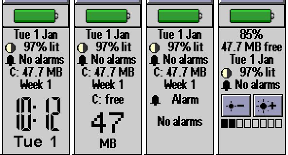
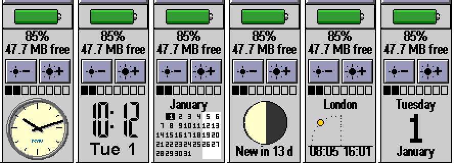
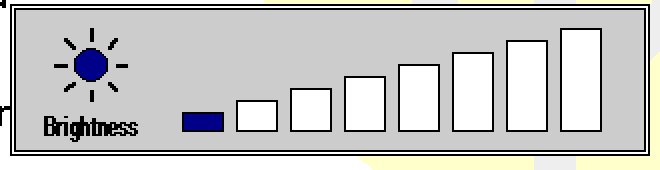

# Toolbar widgets and clock faces

*17 November 2026.*

## The space above the clock

Every program's toolbar has a little space above the clock. Psion left it empty. Coda has used it for a while for the battery's charge, free memory and the brightness control, three fixed lines. On Discord people asked for more: free space on the disks, the next alarm, a world clock, tapping the clock to see something else. So that space is now yours to fill.

## Widgets you choose

Control panel > Toolbar has a Widgets page with six lines, top first. Each one can be the battery's charge or the time it has left, free memory, free space on C: or D:, the date, the week number, the moon, the next alarm, or the brightness or contrast controls. The page checks that what you pick fits, and tells you if it doesn't.

The Taps page says what a tap on each widget does: nothing, its own thing (free memory opens the memory manager, the date opens Agenda, the next alarm opens Time), or any program you pick.

## A clock with six faces

The clock was analogue or digital. Now a tap on it goes to the next face, in the order you set on the Clock page: Psion's analogue and digital clocks, this month's calendar with today boxed, the moon with the days to the next full or new moon, sunrise and sunset for your home city with the sun on its arc, and the date in large figures. Any widget can be a face too, drawn large, so a tap can take you from the time to the free space on your card to your next alarm.

Every program shows the same face, so it doesn't change as you move between them. With only one face, a tap does what you set on the Clock page. With none, the clock goes and the widgets have its room.

## Brightness you can see

Change the brightness or contrast from the keyboard and the level shows large on the screen for a moment, then goes.

It's all tried in the emulator so far, in every theme. The real netBook is next.
