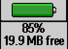
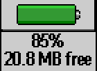

# Down to 9 MB

*18 November 2026.*

This morning the netBook was running out of memory. By the evening the small Coda image was 10 MB. Tonight it is 9 MB, and that's another megabyte to work in.

## Why a megabyte at a time

The netBook has 32 MB of memory and no flash ROM. At every cold start the bootloader copies the whole system off the card into memory and it stays there, so every byte of the system is a byte you can't use. The system sets that memory aside in whole megabytes, rounded up. A 9.1 MB image costs 10 MB; get it under 9 MB and a whole megabyte comes back.

The 10 MB image had 75 KB to spare. So about 950 KB had to go.

## What moved to the card

The same idea as before: things you don't use all the time live on the card as ordinary files, and the system finds them there when it needs them. On the card they take no memory until they're opened.

| Moved to the card | Size |
|---|---|
| The spelling dictionary | 286 KB |
| The thesaurus | 184 KB |
| Sketch's clip art | 74 KB |
| The alarm sounds Fanfare, Soft bells and Church bell | 37 KB |
| Credits | 36 KB |
| Word's templates Memo, Phone log and Meeting minutes | 21 KB |

OPL's demo programs and the headers its translator reads went to the card too.

Each is found where it always was, just on the card. Word's spell check and thesaurus read their dictionaries from it, Sketch's Insert clipart reads its pictures from it, and the alarm sounds are in the list with Rings and Chimes, which are built in. Blank document stays in the system, so Word's new file is always there.

## The wallpaper, 6 KB

The Coda wallpaper was a 248 KB picture. It's flat shapes in a few colours, so it is now stored the way the Shell's own pictures are, a run of each colour at a time: 6 KB, still in the system, so it shows with or without the card. Each theme paints it in its own colours.

## GSM phone support out

The netBook could dial out through a GSM mobile phone over infrared. That needs a 143 KB driver nothing else uses, and no one is dialling a 1999 phone over infrared now. It's gone from the small image. Dialling out through a modem, which PsiMail, PsiWeb and PsiTerm use, has its own driver and is as it was.

## The numbers

| System image | Free at the System screen |
|---|---|
| 14 MB (last night's) | 15.6 MB |
| 10 MB (this evening's) | 18.6 MB |
| 9 MB (tonight's), card in | 19.9 MB |
| 9 MB, no card | 20.8 MB |

 

The 9 MB image still has 137 KB to spare inside its 9 MB.

That's 4.3 MB more than last night.

## Coda full

The full image is the same as before: 13 MB, with everything in the system, for using the netBook without its card. PsiBoot's File > Switch image moves between the two Coda images and Psion's own.
