# Memory back, and an alarm of its own

*18 November 2026.*

This morning's entry was about the netBook running out of memory. This is what changed during the day: more memory free from the start, a toolbar that tells you when it's getting low, programs that hold less, and a few other things along the way.

## Two Coda images on the card

The netBook copies its whole system image into memory at every cold start, so a smaller image is more memory to work in. There are now two Coda images on the card, next to Psion's own:

- **Coda**, the small one, 10 MB. The things you don't use all the time stay on the card as ordinary files, and Coda finds them there.
- **Coda full**, with everything inside it, for using the netBook without its card.

With the small image and the card in, the System screen shows about 18.6 MB free. With last night's 14 MB image it was 15.6 MB.

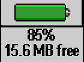 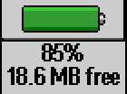

PsiBoot chooses between them. File > Switch image... lists the card's other images by what they are: "Coda, most free memory", "Coda full, no card needed" and "Psion's own", with "Back up C: first" under them.

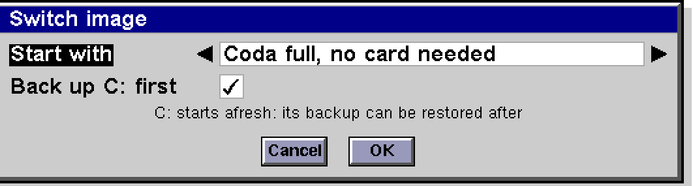

## On the card until you need it

A program in the system image takes memory all the time, whether it's open or not. On the card it takes none until you open it, and gives it all back when you close it. In the small image these live on the card:

- Calc, Sketch and Record, both Coda's and Psion's own. Psion's three only ever existed inside the image, so I rebuilt each one as a file, and each is checked to go back into the image byte for byte;
- PsiAmp, PsiHub, Clips and Timer;
- Smooth text's styles (the one in use stays in the system), the extra typefaces and the font choices;
- the Office file converters;
- Psion's Help;
- the example files.

Nothing about using them changes. The Calc icon opens Calc, Word's Insert Sketch opens Sketch, Set font lists Inter, and Control panel > Programs still swaps Psion's programs and Coda's.

## The free memory line

The free memory line on every toolbar now changes colour as memory runs down: as it was above 3 MB, amber under 3 MB, and white on red under 1.5 MB.

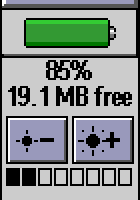 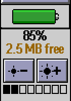 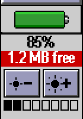

A tap on it opens the Free memory dialog, at any level. "Counting memory..." shows at once, and the dialog follows. It lists what you can do, biggest first: close a program (it saves first), put a program to sleep, or move the biggest files in Documents to the card. Tick what you want and press Free, and it says how much came back. Under 750 KB the dialog comes up by itself, once, and "Tell me when memory is low" turns that off.

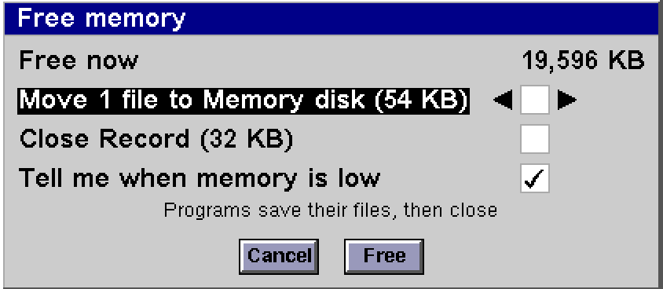

## Programs that hold less

Some of Coda's programs set aside big buffers when they started and kept them all day. Now they take them when they need them and give them back after:

- **PsiMail** holds 212 KB less while no mailbox is open.
- **Sync** holds about 650 KB less between syncs.
- **PsiPDF** keeps its fonts in a file and reads each one only when a page needs it, about 370 KB less with a file open. Behind another program it can be put to sleep from the Free memory dialog.
- **PsiWeb** gives memory back after each page. Behind another program it tidies up after 30 seconds, and after 10 minutes its engine goes to sleep when nothing would be lost. Come back to it and it opens on the same page, with its Back and Forward lists and cookies.

## PsiLinux goes to sleep

Linux on the netBook now gives its memory back too. When it's idle it hands back its caches and whatever its programs have finished with.

And when PsiLinux is behind another program with just a shell at its prompt, it goes to sleep: Linux's memory is written to the card and given back to the Psion. Switch back and Linux carries on where it was, in a moment. A shell at its prompt held about 4.7 MB awake and 2 MB asleep. Only what changed since the last sleep is written again, to spare the card. Preferences > General > In the background sets when it sleeps: after 1 minute (the standard), 5 or 15 minutes, or never. An editor, a running program or an open connection keeps it awake.

## Help, diagnostics and files

- **Help.** Type "help" in PsiHub, or "guide" or "manual", for "Help - the netBook's guide". It opens Psion's Help in Data.

  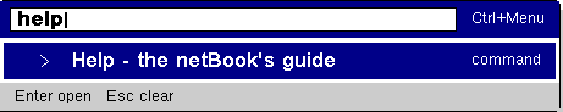

- **Diagnostics.** With the debug mode on in Control panel > Diagnostics, every program's own log is kept on the card as it changes, next to the system log. Send sends them all: it shows "Connecting..." until the connection is up, then "Sending log...".
- **Example files** are on the card, in Documents > Example files, with two PDFs for the PDF viewer. A new C: disk no longer gets a copy. Tools > Re-install sample files has gone from the System screen's menu, with its Shift+Ctrl+S, as there is nothing in the system to re-install.
- **PsiFiles** shows hidden files and folders, always.
- **The name tap.** A tap on the program's name at the top of the toolbar opens PsiMemMan's task list.

## Sketch: Redo, Clipart and Fill

Coda's Sketch has a Redo button beside Undo, and Clipart and Fill each have a button of their own, side by side. A tap outside Insert clipart closes it, as Esc does.

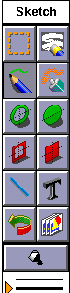 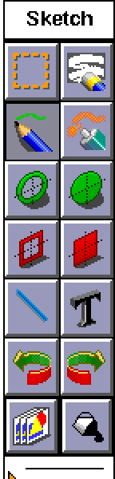

## An alarm screen of its own

An alarm showed the start-up banner across the top, the "netBook" wordmark, so it looked like an About box. It has its own picture now: a bell and "Alarm" in navy and orange, with the rule, the four squares and the coda sign.

Under it, Psion's photo-style clock with its chrome bezel sat on a grey square, beside the date and time on dark grey. The alarm has a clock in Coda's colours now: a white face with a slim navy ring, navy hands, an orange second hand and centre dot, and the date and time on navy. Time, the System screen and the toolbar keep their own clocks.

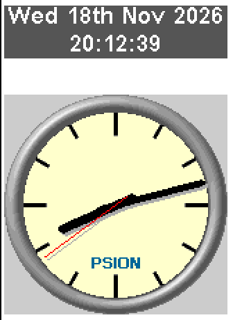 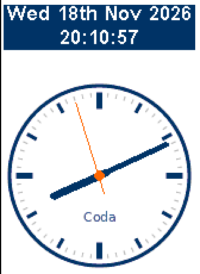
