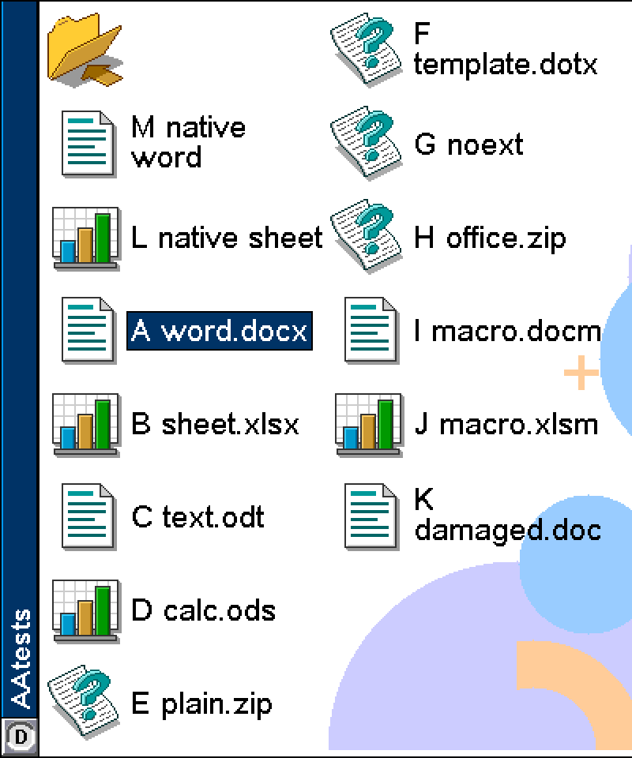
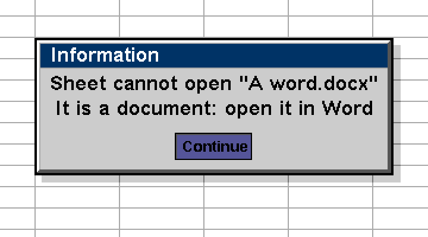
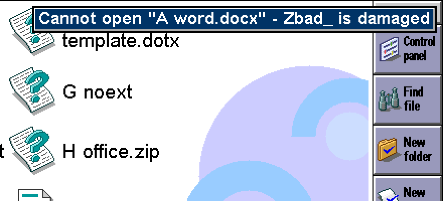
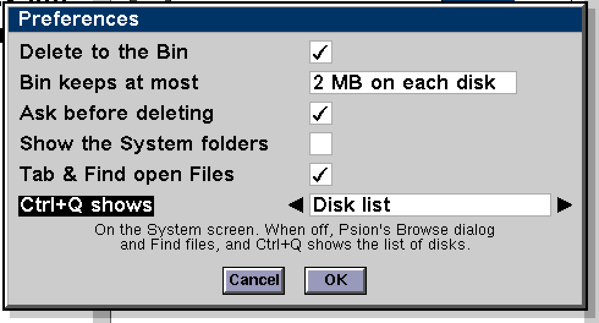
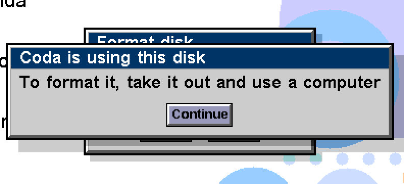
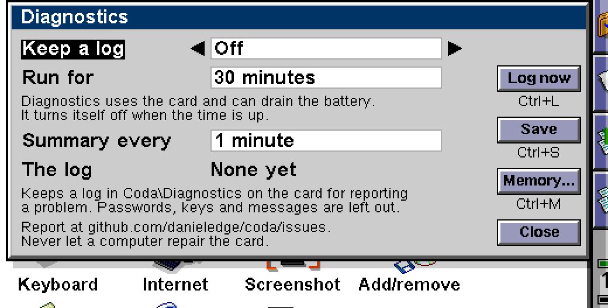

# Coda Beta 1.07: minor bug fixes

*25 November 2026.*

Beta 1 went out two days ago and people have been trying it. Thank you for the reports on GitHub. Coda Beta 1.07 fixes what they found. I've tested these in the emulator. I haven't tried them on a netBook yet.

## Word and Excel files stay with Word and Sheet

A zip program could take .docx and .xlsx files for itself, because inside they are zip files. Now they stay with Word and Sheet. I tested this with a stand-in for such a program.

## A clear message for the wrong program

Opening a file in the wrong program with Open with could make an empty new file, or just say "Corrupt". Word and Sheet now say they can't open it, and what it is. Open with also names a program that is damaged.

## Ctrl+Q has its own setting

You can have the list of disks on Ctrl+Q while Tab still opens Files.

## Formatting a Coda card

The netBook can't format a card with Coda on it while it is in the machine. It used to say only "In use". Now it says why: take the card out and format it on a computer.

## Old backups and the buttons

Restoring an older backup could leave the silkscreen buttons opening the wrong programs, or nothing. A restore now leaves the System screen's own settings file out, and Coda puts a wrong list of buttons right when it starts. So after a restore, set your wallpaper, the System screen's preferences and your own button choices again.

## The battery

One netBook was found flat in the morning. The netBook restarts its automatic switch-off timer every time the card is used, and two things in Coda used it often enough to keep it on: Diagnostics writing its log, and a background network check while the System screen showed a folder on the card. Both are fixed. Closing the lid should switch it off anyway, and I can't explain that part yet.

Diagnostics now runs for 10 minutes, 30 minutes or an hour and then turns itself off, unless you choose to keep it on. It says that it uses the battery.

## Updating

Starting a new Coda empties the Internal disk, so back it up first. The [update steps](https://danieledge.github.io/coda/install.html#update) show how to keep your files. The [release notes](https://github.com/danieledge/coda/releases/tag/beta-1.07) list what's changed.
